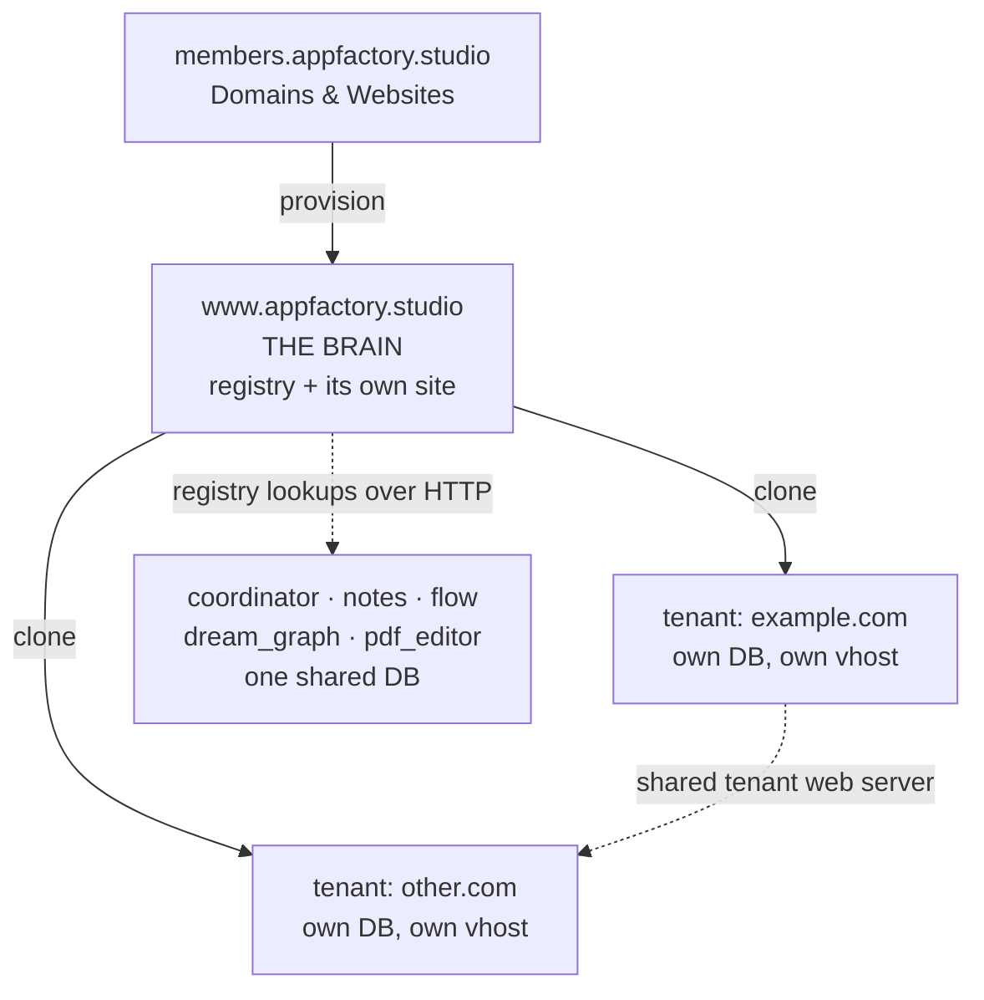

# AFS Ecosystem — Architecture and Design

How the Appfactory Studio applications are **intended** to fit together: who owns which
data, which database each app talks to, how identity is established, how money reaches
what a member is allowed to do, and what afs-connect is for.

> **This document describes intent.** For what is actually built and where it diverges,
> see each plan's `complete/` folder — in particular
> [afs-connect/complete/](afs-connect/complete/README.md) and
> [afs-connect-www/complete/](afs-connect-www/complete/README.md).

---

## 1. The applications

| App | Role |
|-----|------|
| **auth** (Checkpoint) | Identity provider for the whole ecosystem. Issues per-user, per-app bearer tokens; owns feature flags and allocation/quota |
| **www** — *the Brain* | `www.appfactory.studio`. A real Laravel website **and** the control plane: **where members sign up**, it holds the registry of every member website, and it is the template every member site is cloned from |
| **members** | `members.appfactory.studio`. Member dashboard — billing, settings, and the **Domains & Websites** section that provisions new sites. Members arrive here *after* signing up on the Brain |
| **coordinator** | `coordinator.appfactory.studio`. Project management, and the **aggregation hub** for afs-connect |
| **notes / flow / dream_graph / pdf_editor** | The four creative apps |
| **market** | Freelance and asset marketplace |
| **wwwafsportal_v1** | The **tenant** codebase — the duplicate of Brain that gets deployed as a member's website |
| **afsdesktop5** | Appfactory Studio desktop (Electron) — offline-first ports of coordinator, flow, dream_graph, notes, pdf |
| **JoystickEngine** | Game engine; an afs-connect source via the engine auth surface |

---

## 2. Databases — three separate groups

This is the single most important thing to understand, and the easiest to get wrong.

| Group | Database | Contains |
|-------|----------|----------|
| **Brain + members** | `…_appfactorystudio` | Brain's `brain_*` control-plane tables, the website registry, member records — **and Brain's own website content** (its own forms, payments, etc.) |
| **The five apps** | `…_afs_apps_db` | coordinator, notes, flow, dream_graph, pdf_editor — all share one database, using `{app}_` table prefixes. afs-connect's `afsconnect_*` tables live here |
| **Each tenant site** | its own database | That member website's own content |

Consequences worth stating plainly:

- **members and Brain share a database.** members can read the website registry directly.
- **The five apps share a database** but it is *not* Brain's. They reach Brain over HTTP.
- **Every tenant is isolated at the database level.** No app can read a tenant's database
  directly, and no tenant can read another tenant's database — but tenants are **not** one
  VM/server per site. A tenant web server hosts many tenants at once (isolated by database
  and by web-server vhost); provisioning a new tenant means a new database and a new vhost
  on an existing server, not a new server. This was always the intent — it was never meant
  to be one server per tenant.
- **Brain has its own content that child sites cannot see.** Brain is not just a registry —
  it is a live website with its own forms and modules.

---

## 3. Brain and tenants

A member creates a website in **members → Domains & Websites**. Brain provisions it by
deploying a **duplicate of itself** (`wwwafsportal_v1`) onto a tenant web server, with its
own database. Tenant web servers are multi-tenant by design — a single server hosts many
member sites, each with its own database and its own web-server vhost. Provisioning a new
tenant is "add a database and a vhost to an existing tenant server," not "stand up a new
server" — that was always the intended model.

Because the tenant is a clone, it carries the same schema — including the `brain_*`
tables, which sit **empty** on a tenant. Only Brain populates those. The tenant runs its
own forms, email, appointments, payments and so on, entirely independently.



Brain is the reference point for identity and website ownership: every other app asks
Brain "which member is this, and what websites do they own?"

---

## 4. Identity — Checkpoint

**auth** is the identity provider. A user signs in once and receives a bearer token scoped
to a specific application (`COORDINATOR`, `FLOW_EDITOR`, `NOTES_EDITOR`, `GRAPH_EDITOR`,
`PDF_EDITOR`, `MEMBERS`, `GAME_EDITOR`, `APPFACTORY_STUDIO`).

Each app validates the bearer against Checkpoint and derives the caller's
`member_reference_num` **server-side**. Apps must never trust a client-supplied user id.

Members may have **secondary users** (team members). Secondary accounts are supported on
the web apps that have a real team model, and are barred from the desktop and mobile
clients by those clients' own login flows.

---

## 5. afs-connect — the point of the whole thing

**Coordinator is the hub; every other app is a source.** afs-connect gives a member one
place — coordinator — to see, search, and link activity from across everything they own,
for **project-planning purposes**.

The motivating example: a member's tenant website publishes a form. Activity on that form
should show up in coordinator, so the member can review it and attach it to project work.

### How data reaches the hub

Two paths, by design:

1. **Push (webhooks)** — a source app signs and POSTs to coordinator's internal ingest
   endpoint when something is created, updated, or deleted. This is the fast path.
2. **Pull (reconcile)** — coordinator runs a scheduled job that asks each enabled source
   for everything changed since a cursor. This is the safety net and the backfill path.

For the four creative apps, coordinator talks to each app directly. For **websites**,
coordinator talks only to **Brain**, which acts as a *meta-provider*: one signed call
returns data for all of that member's sites, so coordinator never needs tenant URLs or
tenant database credentials.

```
tenant site ──webhook──┐
notes/flow/dg/pdf ─────┼──▶ coordinator ──▶ afsconnect_index ──▶ PM dashboard,
Brain (websites) ──────┘         ▲                                search, task links
                                 └── scheduled reconcile pulls the same data
```

### What is stored

The index is **metadata only** — titles, counts, timestamps, deep links. Not form
submission bodies, not subscriber emails, not booking details. Coordinator stores enough
to *find* something and link it to a task, then links out to the owning app for detail.

---

## 6. The four ways into coordinator's afs-connect

| Surface | Path | Auth | Used by |
|---------|------|------|---------|
| PM (browser) | `/api/afs-connect/*` | Checkpoint bearer | Coordinator's own web UI |
| Internal ingest | `/api/internal/afs-connect/v1/*` | HMAC service key | Brain, members, source apps |
| Engine | `/api/engine/v1/connect/*` | Checkpoint bearer (`GAME_EDITOR`) | Joystick |
| External SDK | `/api/external/afs-connect/v1/*` | Member-issued API token | Unity, CLI, third-party code |

---

## 7. Money — three flows that must not be confused

Money moves in three directions in this ecosystem, and only one of them changes what a
member is allowed to do.

| # | Flow | Who pays whom | Lives in |
|---|------|---------------|----------|
| 1 | **Subscription** | member → Appfactory Studio | Brain (`brain_memberships`), `billing/` |
| 2 | **Direct Payments** | a member's own customers → that member | Brain + tenant sites, `billing/` |
| 3 | **Marketplace** | buyer → seller, platform takes a fee | market, via Stripe Connect, `market/` |

**Only flow 1 touches entitlement.** A member pays for a plan; that resolves to a single
integer, `brain_memberships.membership` (0–4). When payment fails, a Brain-only scheduled
task walks a dunning ladder and finally writes that column **down**. Nothing else needs to
be told: the allocation registry, cloud-storage's quota and retention, and afs-connect's
tier layer all already read it. Making that one integer correct *is* the integration.

**Flow 2 is a product, not a bill.** Direct Payments is machinery Appfactory gives members
so their own sites can charge their own customers through Stripe, Square or PayPal. It
never affects the member's tier — how much a member collects has nothing to do with what
they bought. Its subscriptions, notification schedules and refunds are the member's
business; the platform only operates the mechanism.

**Flow 3 is separate books.** Marketplace sales settle through Stripe Connect: the buyer
pays, the seller is credited less the platform fee, and an append-only seller ledger is the
record. Corrections are new entries, never updates — an updatable financial ledger cannot
be audited.

```
member ──subscription──▶ Brain ──▶ brain_memberships.membership (0-4)
                                          │
                                          └──▶ tier layer of §8, allocation, storage quota

site visitor ──Direct Payment──▶ member's own processor account   (no tier effect)

buyer ──market──▶ Stripe Connect ──▶ seller ledger, platform fee  (separate books)
```

The rule that keeps the three apart: **the tier is the only thing money is allowed to say
to the rest of the ecosystem.** Anything that reads money to decide access should be
reading the tier instead.

## 8. Entitlement — five layers, all fail-closed

Access is denied unless every layer passes. Any unknown state denies.

| # | Layer | Question |
|---|-------|----------|
| 1 | **Global** | Is afs-connect on for the platform? (Checkpoint feature flag) |
| 2 | **Tier** | Does the member's plan include it? (allocation registry) |
| 3 | **Member** | Has the member enabled it? |
| 4 | **Allowed** | Does their tier include *this source*? — packaging |
| 5 | **Enabled** | Has the member enabled *this source*? — privacy |

Layers 4 and 5 are deliberately separate: one is what they bought, the other is what they
choose to share. Sources are declared once in a **source registry**, so adding a source is
a registry entry rather than edits in a dozen places.

---

## 9. The plan folders

| Folder | Covers |
|--------|--------|
| [afs-connect/](afs-connect/README.md) | The core hub: index, APIs, entitlement, billing, source registry |
| [afs-connect-www/](afs-connect-www/README.md) | The website extension — Brain meta-provider, eight site modules |
| [afs-connect-external/](afs-connect-external/README.md) | Member-issued API tokens for external code |
| [afs-connect-desktop/](afs-connect-desktop/) | Appfactory Studio desktop ports + account/cloud sync |
| [billing/](billing/README.md) | Flows 1 and 2 (§7) — subscription lifecycle, dunning, the downgrade write, Direct Payments |
| [market/](market/00_README.md) | Flow 3 (§7) — marketplace, Stripe Connect, fees, seller ledger, payouts |
| [cloud-storage/](cloud-storage/README.md) | Member file storage, quota and retention — a tier consumer |
| [membership_change/](membership_change/README.md) | What happens to resources a member already holds when their tier changes |
| [checkpoint-server-auth/](checkpoint-server-auth/README.md) | Platform-wide auth hardening |
| [_env/](_env/) | Per-app `.env` references |

---

## 10. Design rules that hold across all of it

- **Identity is derived server-side, never accepted from the client.**
- **Coordinator aggregates; it does not own source data.** The owning app remains the
  source of truth; the index is a searchable projection.
- **Tenant databases are reached only by their own deployment.** No cross-tenant reads.
- **Metadata only** — the index never becomes a copy of the content.
- **Everything is toggleable** at four independent levels without a deploy.
- **Fail closed** — an unresolvable member, an unreachable dependency, or a missing
  settings row denies access rather than granting it.
