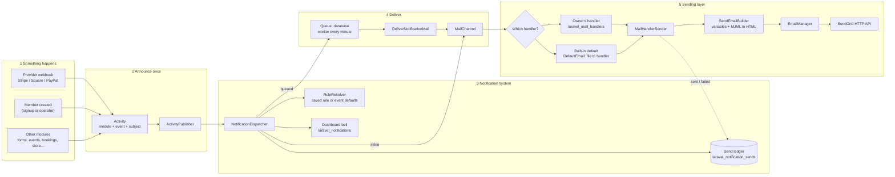
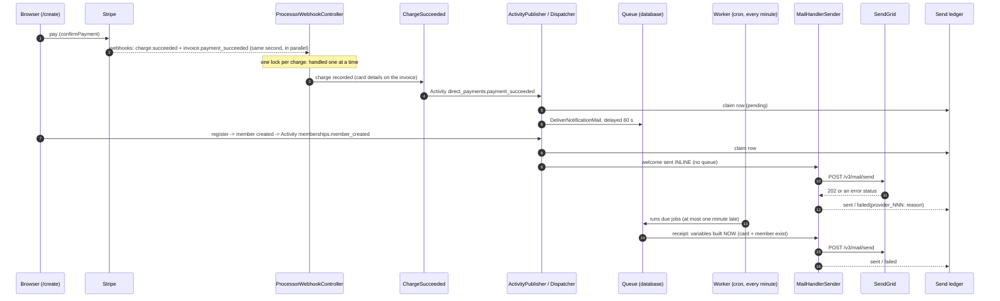
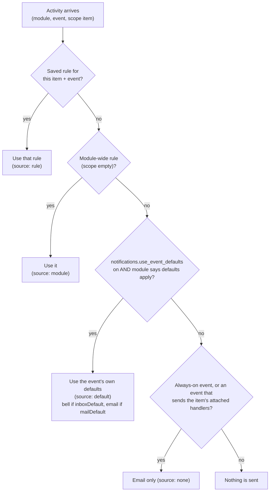

# How email works in the Appfactory Studio platform (as built, 2026-10-22)

**Scope:** the Brain / website application `w/www` (Laravel, PHP) and the admin dashboard in `w/www/resources/js` (TypeScript). The Checkpoint identity server (`w/auth`) has its own, separate mail code, described in section 9.
**Basis:** a read-through audit of the code, plus what was observed on the dev server (`root@45.79.42.137`, `/home/appfactorystudio/websites/dev/www`, database `testdb_appfactorystudio`) while fixing the welcome and receipt emails today.
**Status:** every statement below was read from code or observed on the dev server. Where something was **not** verified it says so. Nothing in this report is a plan; section 10 lists what was changed today and section 11 lists open findings.

**How to read this:** people can read top to bottom (sections 1-3 give the whole picture). Agents can jump: section 12 is a file map, section 13 is a "something did not arrive" checklist, and every section names full file paths. `WWW` below means `C:\projects\vagrant\afs-eco\w\www`; the full path is always written out in the file tables.

---

## Contents

1. [The picture in one page](#1-the-picture-in-one-page)
2. [The two layers and where the code lives](#2-the-two-layers-and-where-the-code-lives)
3. [Life of an email: from an event to the inbox](#3-life-of-an-email-from-an-event-to-the-inbox)
4. [Rules, defaults, queueing and the send ledger](#4-rules-defaults-queueing-and-the-send-ledger)
5. [Variables: how `${...}` gets its values](#5-variables-how--gets-its-values)
6. [Default (built-in) emails: how they are managed in code](#6-default-built-in-emails-how-they-are-managed-in-code)
7. [Default emails and handlers in the admin dashboard](#7-default-emails-and-handlers-in-the-admin-dashboard)
8. [Configuration and infrastructure](#8-configuration-and-infrastructure)
9. [Every other way the system sends email](#9-every-other-way-the-system-sends-email)
10. [What was changed today](#10-what-was-changed-today)
11. [Audit findings and open items](#11-audit-findings-and-open-items)
12. [File map](#12-file-map)
13. [Checklist: an email did not arrive](#13-checklist-an-email-did-not-arrive)
14. [Appendix: one real signup, minute by minute](#14-appendix-one-real-signup-minute-by-minute)

---

## 1. The picture in one page

Plain language first:

1. **Something happens** in a module: a card is charged, a member is created, a form is submitted.
2. The module **announces it once** as an *Activity* ("module `memberships`, event `member_created`, about this member").
3. The **notification system** looks up what the site owner wants for that event (a saved *rule*, or else the event's own *defaults*): a bell in the dashboard, an email, or both. It writes one row per recipient in a **send ledger** so the same email is never sent twice.
4. The email is either **sent right away** (inline) or **queued** and sent a little later by a worker.
5. To send, the system builds a **handler**: the same JSON shape a real handler row in the database has. A handler is "the email": subject, HTML (MJML) body, sender name, and the variables to fill in. It is either a **handler the owner designed** in the Response Builder, or a **built-in default** read from a file and shaped into a handler in memory.
6. The one sending class, `MailHandlerSender`, fills in the **variables**, turns the MJML into HTML, and posts it to **SendGrid's HTTP API**. Laravel's own mailer is **not** used.
7. The answer from SendGrid is written back to the ledger as `sent` or `failed`.



**Three facts to remember**

- **Laravel's mail configuration plays no part.** `config('mail.*')` is not read anywhere in the sending path (it used to be, in one place; fixed today, finding F2). The `mail.default` on the dev server is `log`.
- **The sender address is `<name>@<managed domain>`.** A handler stores only the *name* (`no-reply`); the sender appends `@appfactory.studio` itself.
- **A ledger row of `sent` now means SendGrid answered 2xx.** Before today it only meant "our code did not crash" (finding F1).

---

## 2. The two layers and where the code lives

### 2.1 Notification layer ("who gets what, when")

Shared code, carried by every tenant website. Nothing in it names a particular module.

| Piece | Full path | Job |
|---|---|---|
| Activity | `C:\projects\vagrant\afs-eco\w\www\app\Externals\Activity\Activity.php` | The announcement: module, event, subject, data (facts only), dedupe key |
| Catalogue | `C:\projects\vagrant\afs-eco\w\www\app\Externals\Activity\ActivityCatalog.php` | All registered modules and their events |
| Event definition | `C:\projects\vagrant\afs-eco\w\www\app\Externals\Activity\EventDefinition.php` | One event: defaults, template, variables, delay, inline, always-on (table 4.2) |
| Module contracts | `C:\projects\vagrant\afs-eco\w\www\app\Externals\Activity\Contracts\*.php` | `ActivityModule`, `VariableBuilder`, `RecipientResolver`, `AppliesDefaults`, `AttachedHandlerKey`, `InboxMetadata`, `ScheduledSource` |
| Publisher | `C:\projects\vagrant\afs-eco\w\www\app\Externals\Activity\ActivityPublisher.php` | Hands an Activity to the notification system, then to analytics. Never throws. |
| Module registration | `C:\projects\vagrant\afs-eco\w\www\app\Providers\ActivityServiceProvider.php` | `modules()` lists the ten modules; `memberships` only when `config('brain.is_brain')` |
| Dispatcher | `C:\projects\vagrant\afs-eco\w\www\app\Externals\Notifications\NotificationDispatcher.php` | Resolves the rule, claims ledger rows, delivers bell + email |
| Rule resolver | `C:\projects\vagrant\afs-eco\w\www\app\Externals\Notifications\RuleResolver.php` | Saved rule, else module-wide rule, else event defaults |
| Rules service (admin API logic) | `C:\projects\vagrant\afs-eco\w\www\app\Externals\Notifications\NotificationRulesService.php` | Catalogue, rules, validated save, ledger list, resend |
| Mail channel | `C:\projects\vagrant\afs-eco\w\www\app\Externals\Notifications\Channels\MailChannel.php` | "Chosen handler, else built-in default", one recipient per send |
| Inbox channel | `C:\projects\vagrant\afs-eco\w\www\app\Externals\Notifications\Channels\InboxChannel.php` | The dashboard bell |
| Queued job | `C:\projects\vagrant\afs-eco\w\www\app\Externals\Notifications\Jobs\DeliverNotificationMail.php` | Sends one email later; builds the variables when it runs |
| Default emails | `C:\projects\vagrant\afs-eco\w\www\app\Externals\Notifications\DefaultEmail.php` | Reads a built-in template file and shapes it into a handler (section 6) |
| Mail seam | `C:\projects\vagrant\afs-eco\w\www\app\Externals\DirectPayments\Mail\GeneralMailTransport.php` (bound in `C:\projects\vagrant\afs-eco\w\www\app\Providers\DirectPaymentsServiceProvider.php`) | The one hop to the sending layer; replaced by a recording stand-in in tests |
| Rule / ledger / bell models | `C:\projects\vagrant\afs-eco\w\www\app\Models\Externals\Notifications\{NotificationRule,NotificationSend,Notification}.php` | Tables `laravel_notification_rules`, `laravel_notification_sends`, `laravel_notifications` |
| Defaults switch | `C:\projects\vagrant\afs-eco\w\www\config\notifications.php` | `use_event_defaults` (on; env `NOTIFICATIONS_USE_EVENT_DEFAULTS`) |

The ten modules (each has a `...ActivityModule.php` in its own `Notifications` folder): `analytics`, `appointments`, `direct_payments`, `ecommerce`, `events`, `forms`, `memberships` (Brain only), `site_users`, `sponsorships`, `subscribers`.

### 2.2 Sending layer ("fill in the template and hand it to SendGrid")

Older code, shared by everything that sends.

| Piece | Full path | Job |
|---|---|---|
| Sender (the one entry point) | `C:\projects\vagrant\afs-eco\w\www\app\Services\Portal\MailHandler\MailHandlerSender.php` | `send(MailHandlerSenderOptions)`: finds the provider key, takes a handler (by reference or in-place JSON), builds per-recipient variables, calls the builder, reports `SendResult` |
| Sender options | `C:\projects\vagrant\afs-eco\w\www\app\Services\Portal\MailHandler\MailHandlerSenderOptions.php` | Handler reference or in-place JSON, recipients, client variables, override flag |
| Result | `C:\projects\vagrant\afs-eco\w\www\app\Services\Portal\MailHandler\SendResult.php` | `sent`, `failed(reason)`, `skipped(reason)` |
| Builder | `C:\projects\vagrant\afs-eco\w\www\app\Http\Controllers\Portal\FunctionsController.php`: `SendEmailBuildIntegration()` → `SendEmailBuilder()` | Per recipient: MJML to HTML, substitute variables, compose `from@domain`, call the provider |
| System variables | same file: `SetupEmailSystemVariables()` | Flattens the site's settings into variables (section 5.3) |
| Provider call | `C:\projects\vagrant\afs-eco\w\www\app\Services\Portal\MailHandler\EmailManager.php` | `POST https://api.sendgrid.com/v3/mail/send`; records the HTTP status |
| Handler / provider models | `C:\projects\vagrant\afs-eco\w\www\app\Models\Portal\MailHandler\{MailHandlerModel,MailProviderModel}.php` | Tables `laravel_mail_handlers`, `laravel_mail_providers` |
| Provider key | table `brain_config`, JSON `controller.email_providers[0].token`, read by `FunctionsController::getBrainConfig()` | The SendGrid API key. The active `laravel_mail_providers` row (`status = 1`, name `appfactory_studio`) only says "use SendGrid". |
| Variable name catalogue | `C:\projects\vagrant\afs-eco\w\www\app\Mail\variables.json` | The list of names the Response Builder offers (finding F6) |

---

## 3. Life of an email: from an event to the inbox

### 3.1 The sequence (a paid signup, the most complex case)



Why the receipt waits: the card details arrive with a second Stripe event, and the member row is created a moment after the payment. The receipt's variables are built **when the job runs**, so a 60-second delay lets both exist.

### 3.2 What `MailHandlerSender::send()` does, step by step

File: `C:\projects\vagrant\afs-eco\w\www\app\Services\Portal\MailHandler\MailHandlerSender.php`

1. (Tests only) a fake can replace the whole function.
2. Loads the site's configuration and managed domain (`FunctionsController::__get_main_configurations()`).
3. Finds the active provider row, and replaces its key with the Brain's SendGrid token. No row, or no token: returns `failed('no_provider_token')`.
4. Gets the handler JSON: either the in-place JSON it was given (built-in defaults) or the row `laravel_mail_handlers.reference_num`. Not found: `failed('mail_handler_not_found')`.
5. If `override_emails` is true, the handler's own recipients are replaced by the ones given.
6. Turns the flat variables (`name => value`) into the shape the builder reads (one list per recipient).
7. Calls `SendEmailBuildIntegration()`, which for each handler entry and each recipient: converts MJML to HTML (a shell command), substitutes variables, builds `from@domain`, and calls `EmailManager`.
8. Reads the answer: an internal `error` key (including "No receipents" = `skipped`), or, since today, the **provider's HTTP status**: 2xx = `sent`, anything else (or "never reached SendGrid") = `failed` with the provider's message, for example `provider_401: Maximum credits exceeded`.

---

## 4. Rules, defaults, queueing and the send ledger

### 4.1 What decides whether an email is sent

`RuleResolver` (`C:\projects\vagrant\afs-eco\w\www\app\Externals\Notifications\RuleResolver.php`) answers "what applies to this Activity", first match wins:



- A rule can only **switch things off** or **choose wording and handler**. An **always-on** event ignores "email off".
- "Attached handlers" (compatibility): an event such as `direct_payments.payment_succeeded` with no rule sends every handler the owner has **attached to the item** (`laravel_mail_handlers.item_reference_num`). Each such handler gets its own ledger identity `attached:<handler reference>`. With none attached, and defaults on, the **built-in default email** is sent instead.
- On the dev server `use_event_defaults` is **true** and there are **no saved rules** for `memberships`, so the welcome and the bell come from the event defaults.

### 4.2 The settings of one event (`EventDefinition`)

File: `C:\projects\vagrant\afs-eco\w\www\app\Externals\Activity\EventDefinition.php`

| Setting | Meaning |
|---|---|
| `key`, `label` | Machine name and the label the admin sees |
| `inboxDefault`, `mailDefault` | Bell / email on by default |
| `alwaysOn` | The email cannot be switched off |
| `defaultTemplate` | `<folder>/<event>` of the built-in email, or null (only chosen handlers) |
| `variables` | The names a template may use (and what the variable builder returns) |
| `mailDelaySeconds` | The email is queued with this delay. Direct Payments reads `direct_payments.mail_delay_seconds` (**60**, `C:\projects\vagrant\afs-eco\w\www\config\direct_payments.php`) |
| `mailInline` | `true` = send in the request that announced the event, not queued (the welcome email since today) |
| `attachedHandlers` | Send the handlers attached to the item when there is no rule |
| `recipientMode` | `customer` (the module's resolver) or `handler` (the handler's own list); a rule may also say `custom` |
| `mailUnavailable` | A reason the event cannot send email yet; the editor shows it disabled |
| `recordAnalytics`, `analyticsKeys`, `appliesTo`, `scheduled`, `inboxTitle/Body/Link`, `severity`, `inboxCategory` | Analytics, scheduling, bell wording |

### 4.3 Queued or inline

`NotificationDispatcher::dispatch()` passes `queue = !event.mailInline`:

| Mode | Behaviour | Used by |
|---|---|---|
| **Queued** (default) | The ledger row is `pending`; a job `DeliverNotificationMail` is dispatched with `delay(mailDelaySeconds)`. The worker is `php artisan queue:work --stop-when-empty --max-time=55`, started **every minute** by cron (`C:\projects\vagrant\afs-eco\w\www\routes\console.php`, line 19). So a queued email arrives **between its delay and its delay + about one minute**. `tries = 1`: a failed send is never retried automatically. | the payment receipt; most events |
| **Inline** | Sent during the request; the variables are built immediately. A failure is recorded and never fails the request. The send adds the MJML shell step and a one-second `sleep(1)` in the builder (finding F4). | `memberships.member_created` (the welcome), since today |
| **Scheduled** ("N days before") | `evaluateScheduled()` runs from a command (`direct_payments:subscription-notify`, every 15 minutes) and sends inline | upcoming-charge reminders and similar |

### 4.4 The send ledger (`laravel_notification_sends`)

One row per (rule, event, subject, recipient, channel). It is both the **record** and the **lock against duplicates**.

| Status | Meaning |
|---|---|
| `pending` | claimed, waiting for the queued job |
| `sent` | the provider accepted it (2xx) |
| `failed` | refused or crashed; the `error` column says why (for example `provider_400: Invalid from email address`). A failed row **holds its key**: the same send is not tried again until an admin "resends" (which clears the row) |
| `skipped` | no recipient resolvable (`no_recipient`) or the handler had no addresses |

Publishing the same Activity twice is one email and one bell, because the second claim hits the unique key.

---

## 5. Variables: how `${...}` gets its values

### 5.1 The model

A template is MJML (HTML for email) containing placeholders written `${name}`. At send time every placeholder is replaced by text. There are three sources, applied **in this order** by `FunctionsController::SendEmailBuilder()` (`C:\projects\vagrant\afs-eco\w\www\app\Http\Controllers\Portal\FunctionsController.php`, around lines 1713-1910):

```mermaid
flowchart TD
    T["Template: MJML body + subject<br/>contains $&#123;name&#125; placeholders"] --> S1
    S1["1  SCHEMA variables<br/>stored in the handler JSON (variables.schema).<br/>Their VALUES may contain other placeholders,<br/>so they run first."] --> S2
    S2["2  CLIENT variables<br/>supplied by the module that sent the email<br/>(variables.client, one list per recipient)"] --> S3
    S3["3  SYSTEM variables<br/>the site's own settings, rebuilt at send time<br/>(name, logo1, primaryColor1, address, phone, social links ...)"] --> OUT
    OUT["Subject and HTML after replacement.<br/>A placeholder nobody supplied stays as literal text."]
```



- A placeholder that no source supplies is **left as literal text** (`${full_name}` appeared in an email for exactly this reason).
- In the **subject**, values pass through `strip_tags`. In the body they are inserted as given.
- Built-in default emails clean every client value first (`DefaultEmail::variables()`: tags removed, `${` broken to `$ {`) so a customer cannot type a placeholder into their own name.

### 5.2 Client variables: who supplies them

Each module registers a **VariableBuilder** (`C:\projects\vagrant\afs-eco\w\www\app\Externals\Activity\Contracts\VariableBuilder.php`) that returns a list of `{name, value}`. By convention names carry the module prefix.

| Module | Builder (full path) | Names it supplies |
|---|---|---|
| Memberships (welcome) | `C:\projects\vagrant\afs-eco\w\www\app\Services\Brain\Memberships\Notifications\MembershipsVariableBuilder.php` | `memberships_full_name` (falls back to the username), `memberships_username`, `memberships_plan`, `memberships_login_url`, `memberships_free_period`, `site_name`, `site_url` |
| Direct Payments (payment email) | `C:\projects\vagrant\afs-eco\w\www\app\Externals\DirectPayments\Notifications\DirectPaymentsVariableBuilder.php` + `...\DirectPaymentsInvoiceVariables.php` + the invoice's `clientVariables()` in `C:\projects\vagrant\afs-eco\w\www\app\Models\Externals\DirectPayments\DirectPaymentInvoice.php` | `direct_payments_amount`, `_amount_cents`, `_currency`, `_card_brand`, `_card_last4`, `_payment_method`, `_customer_name`, `_receipt_url`, `_invoice_number`, `_charged_at`, `email`, `site_name`, `site_url` |
| Direct Payments (subscription events) | same builder | `firstname`, `lastname`, `email`, `amount`, `currency`, `plan_name`, `direct_payment_name`, `next_charge_date`, `days_until_charge`, `subscription_status`, `manage_subscription_url`, `access_ends_at`, `site_name`, `site_url` |
| Other modules | each module's `...\Notifications\*VariableBuilder.php` or `*Mailer.php` | their own names (see `C:\projects\vagrant\afs-eco\w\www\app\Mail\variables.json` for the commerce, forms, events and booking names) |

### 5.3 System variables (the site's brand)

`SetupEmailSystemVariables()` reads the first row of `C:\projects\vagrant\afs-eco\w\www\app\Models\Portal\LaravelSetting.php` (the site's settings JSON) and **flattens every group** into variables. The names seen on the dev server: `dashboardDisplayName, icon, name, address, phone, copyrightShort, copyrightLong, primaryColor1, primaryColor2, accentColor1, accentColor2, logo1, logo2, logo3, favicon, facebook, instagram, twitter, linkedin, youtube, pinterest, snapchat, discord, twitch, threads`. They are rebuilt on every send, so changing a setting changes the next email.

For built-in defaults there is one extra step (`DefaultEmail::applyBrand()`): an **unset** colour, name or footer would arrive as the text `- NOT SET -`, so it is replaced by a fallback (colour `#1f2937`, name = the site's domain, footer "© year name"), and the logo block is swapped for the plain brand-name block when there is no logo.

### 5.4 Extending a module's variables without touching the module

Direct Payments emails can be enriched by **providers** listed in `C:\projects\vagrant\afs-eco\w\www\config\mail_variables.php` (module key `direct_payments`). A provider implements `C:\projects\vagrant\afs-eco\w\www\app\Services\Portal\MailHandler\ClientVariables\ClientVariableProvider.php`, is handed the invoice, and returns more `name => value` pairs. The registry is `C:\projects\vagrant\afs-eco\w\www\app\Services\Portal\MailHandler\ClientVariables\ClientVariables.php`: it never throws (a bad provider is logged and skipped), names must match `^[a-z][a-z0-9_]*$`, standard names are locked, later providers win.

Registered today: `C:\projects\vagrant\afs-eco\w\www\app\Services\Brain\Memberships\Mail\AddMemberVariables.php`. Given the invoice it finds the **member** (by the member reference on the invoice, then by email, then by payer) and adds:

| Name | Value |
|---|---|
| `memberships_full_name`, `memberships_username`, `memberships_plan` | the same names the welcome email uses |
| `full_name`, `username`, `membership_title` | the names the **old** welcome handlers were written with, so those keep working |

With no member found, `full_name` falls back to the name on the card; the rest are empty. It does nothing on a tenant (no `brain_memberships` table).

### 5.5 Which name for which email (cheat sheet)

| You are writing... | Use |
|---|---|
| The member **welcome** (event `memberships.member_created`) | `${memberships_full_name}` `${memberships_username}` `${memberships_plan}` `${memberships_login_url}` `${memberships_free_period}` |
| A **payment receipt** (event `direct_payments.payment_succeeded`) | `${direct_payments_customer_name}` `${direct_payments_amount}` `${direct_payments_card_brand}` `${direct_payments_card_last4}` `${direct_payments_payment_method}` `${direct_payments_receipt_url}`, and (via the provider) `${username}` `${membership_title}` `${full_name}` |
| The site's name, colour, logo | `${name}` `${primaryColor1}` `${logo1}` `${copyrightShort}` |
| The site's address and name | `${site_url}` and `${site_name}` (from the managed domain), supplied to Direct Payments emails and, since the F5 fix, to the memberships welcome |

---

## 6. Default (built-in) emails: how they are managed in code

### 6.1 Where they live

Folder: `C:\projects\vagrant\afs-eco\w\www\resources\js\portal\admin\afsemail\mjml-templates\mjml\defaults\<folder>\`

| Folder | Contents |
|---|---|
| `dp` (Direct Payments) | `defaults.json` + 15 `.mjml` files: `payment_succeeded`, `payment_receipt`, `payment_failed`, `payment_details_required`, `payment_details_updated`, `payment_method_changed`, `subscription_canceled`, `subscription_cancel_scheduled`, `subscription_access_ended`, `subscription_paused`, `subscription_provider_changed`, `subscription_updated`, `subscription_ending_payment_details_required`, `trial_ending`, `upcoming_charge` |
| `memberships` | `defaults.json` + `member_created.mjml` (the welcome) |
| `sponsorships` | `defaults.json` + `application_denied.mjml` |

Each `defaults.json` is the **manifest**: per event a `label`, a `subject` (placeholders allowed, for example `Welcome to ${name}`), a `preview`, `always_on`, and the list of `variables` the template may use. The `.mjml` files are plain MJML with `${...}` placeholders and two marker blocks, `<!--dp:logo-->...<!--/dp:logo-->` and `<!--dp:nologo-->...<!--/dp:nologo-->`; the server keeps one of them.

Only events with a `defaultTemplate` have a built-in email: the Direct Payments events, `memberships.member_created`, `sponsorships.application_denied`. Other modules send only handlers the owner designed (or their own mailers, section 9).

### 6.2 How a default becomes an email

`DefaultEmail::json('<folder>/<event>')` (`C:\projects\vagrant\afs-eco\w\www\app\Externals\Notifications\DefaultEmail.php`) reads the `.mjml` and the manifest **at send time** (`resource_path()`, so the files must exist on the server) and returns an **in-place handler with the same structure as a real handler row**:

```
{ "handlers": { "<event>": {
    "active": true, "integration": [], "alert": false, "emails": [],
    "from": "no-reply",                         <- the NAME only; the sender appends @<managed domain>
    "title": "<manifest label>", "subject": "<manifest subject>",
    "body_mjml_html": "<the template, brand blocks resolved>", "body_mjml_projectData": null,
    "variables": { "schema": [ <brand fallbacks> ], "client": [], "system": [] }
} } }
```

`MailChannel` hands this to `MailHandlerSender` exactly like a database handler: **a default never bypasses the sender.** The template name must match `^[a-z_]+/[a-z_]+$`.

### 6.3 Adding or changing a built-in email

1. Put `<event>.mjml` in `...\mjml\defaults\<folder>\` and add the event to that folder's `defaults.json` (label, subject, preview, `always_on`, `variables`).
2. In the module's `...ActivityModule.php`, give the `EventDefinition` `defaultTemplate: '<folder>/<event>'`, `mailDefault: true`, the same `variables` list, and a delay or `mailInline`.
3. In the module's `VariableBuilder`, **return every name in that list**. A name that is in the template but not returned will appear as literal text.
4. In the module's `RecipientResolver`, return the address (`customerEmail()`).
5. Check against the test pattern in `C:\projects\vagrant\afs-eco\w\www\tests\Feature\DirectPayments\DefaultEmailsTest.php` (every placeholder is provided; `from` is `no-reply` with no `@`).
6. Deploy the `.mjml` and `defaults.json` to the server. The send reads them from disk, so **no front-end build is needed to send**; a build is only needed for the starter gallery in the admin (section 7.3).

---

## 7. Default emails and handlers in the admin dashboard

The admin dashboard is TypeScript under `C:\projects\vagrant\afs-eco\w\www\resources\js\portal\admin\`. There are **three** places.

### 7.1 The Notifications card and page (what is sent, to whom, with which email)

| Piece | Full path |
|---|---|
| Per-item page ("Notifications" with a Response Builder button) | `C:\projects\vagrant\afs-eco\w\www\resources\js\portal\admin\components\notifications\notificationsPage.ts` |
| Shared card used on module screens (`appendNotificationsCard`, used by the Memberships, Site Users and Subscribers screens) | `C:\projects\vagrant\afs-eco\w\www\resources\js\external\ui\notifications\card.ts` |
| The rule editor itself | `C:\projects\vagrant\afs-eco\w\www\resources\js\external\ui\notifications\RulesEditor.ts` (+ `rulesModel.ts`, `model.ts`) |
| Dashboard inbox / bell | `C:\projects\vagrant\afs-eco\w\www\resources\js\external\ui\notifications\inbox.ts`; the dashboard's notifications screen `C:\projects\vagrant\afs-eco\w\www\resources\js\portal\admin\controllers\settings\notifications.ts` (lists the bell messages and polls for new ones every 15 seconds) |

What an owner sees: for each event of the item, an **Email** switch, a **Dashboard** switch, which **email** to send (the **built-in default** or one of their handlers), who gets it (customer, the handler's own list, or custom addresses), wording for the bell, and for scheduled events "N days before". The card draws itself from the **server's catalogue**, so a module's new event appears with no front-end change.

Server endpoints (file `C:\projects\vagrant\afs-eco\w\www\routes\externals.php`, controller `C:\projects\vagrant\afs-eco\w\www\app\Http\Controllers\Externals\Notifications\NotificationRulesApiController.php`, prefix `/portal/api/externals/v1`, all behind `externals.dashboard`):

| Method and path | Does |
|---|---|
| `GET /notification-catalog` | modules and their events (the vocabulary) |
| `GET /notification-rules?module=&scope_ref=` | the rules of one item, each event with its **effective** state (`rule`, `module`, `default` or `none`) |
| `PUT /notification-rules` | validated save: a rule present is upserted (its reference kept so the ledger stays attached); a rule omitted has both switches turned off, never deleted; an always-on event keeps its email |
| `GET /notification-rules/sends` | the send ledger (50 a page; filter by event and status) |
| `POST /notification-rules/sends/{id}/resend` | clears one `failed` or `skipped` row so the same send is allowed again; **it does not send by itself** |

### 7.2 The Response Builder (designing a handler)

`C:\projects\vagrant\afs-eco\w\www\resources\js\portal\admin\afsemail\afsemail.ts` (about 1,850 lines) is the email builder: **GrapesJS + MJML** for layout, **TinyMCE** for the text. The text a person writes is stored as the **value of a named variable**; the layout refers to it as `${variable}`. It produces the handler object described in its header comment (`handlers[<ref>]` with `active, emails, from, subject, body_mjml_html, body_mjml_projectData, variables {schema, client, system}`) and saves it with `dataStore.saveEmailHandlers(...)` into `laravel_mail_handlers`, keyed by the **item** it belongs to (`item_reference_num`). Handlers attached to an item this way are what an "attached handlers" event sends (section 4.1).

- The **From** dropdown stores the bare name (the server appends `@domain`).
- The variable picker is fed by `C:\projects\vagrant\afs-eco\w\www\app\Mail\variables.json`.
- System variables are rebuilt on each render, not saved on the handler.

### 7.3 The starter gallery (default templates as a starting point)

`afsemail.ts` also builds a **gallery** from the `.mjml` files under `...\afsemail\mjml-templates\mjml\` (the older starters such as `welcome.mjml`, `reset.mjml`, `ticket.mjml`) **and** the built-in defaults, shown as for example "Payment Receipt (dp)". Choosing one loads its MJML into the builder; the owner can then edit and save it as **their own handler**, which then overrides the built-in for that item. The gallery is bundled by Vite, so a new default appears there **after a front-end build**, but it sends without one.

### 7.4 Providers and domain authentication

Mail providers: table `laravel_mail_providers` (model above). The SendGrid key itself is in the Brain settings. Domain authentication for sending is handled by `C:\projects\vagrant\afs-eco\w\www\app\Http\Controllers\Portal\Admin\SendgridDomainAuthController.php`.

---

## 8. Configuration and infrastructure

| Setting | Where | Value on dev | Effect |
|---|---|---|---|
| SendGrid key | table `brain_config`, `controller.email_providers[0].token` | set (69 characters) | the one key all sending uses (MUA, notifications, billing) |
| Active provider | table `laravel_mail_providers`, `status = 1` | `Appfactory Studio` / `appfactory_studio` | tells the sender to use SendGrid; no row = `no_provider_token` |
| Managed domain | `FunctionsController::GetManagedDomain()` | `appfactory.studio` | the part after `@` in the sender address |
| Sender name | `DefaultEmail::FROM` in `C:\projects\vagrant\afs-eco\w\www\app\Externals\Notifications\DefaultEmail.php` | `no-reply` | built-in emails come from `no-reply@appfactory.studio` |
| Event defaults on | `NOTIFICATIONS_USE_EVENT_DEFAULTS` -> `config/notifications.php` | on | events send their defaults when no rule exists |
| Receipt delay | `config/direct_payments.php` `mail_delay_seconds` | 60 | seconds before a payment email is sent |
| Sign-in link in the welcome | `MEMBERSHIPS_LOGIN_URL` -> `C:\projects\vagrant\afs-eco\w\www\config\memberships.php` (`login_url`, the only place it is read) | `https://auth15.appfactory.studio/login` (prod profile: `https://auth.appfactory.studio/login`) | the Sign in button; unset falls back to the app URL and logs a warning |
| Brain-only module | `config('brain.is_brain')` (`C:\projects\vagrant\afs-eco\w\www\config\brain.php`) | true on dev | registers the memberships module |
| Queue | `QUEUE_CONNECTION=database`; worker via `routes/console.php` line 19 | every minute | latency of queued mail |
| Cache (for the webhook locks) | `database` | | supports locks |
| Laravel mailer | `config('mail.default')` | `log` | **not used** for any of this |

---

## 9. Every other way the system sends email

| Path | Files | Uses the notification system? | Notes |
|---|---|---|---|
| Notification emails (receipts, welcome, reminders, owner alerts) | sections 2-6 | yes | the main path |
| Mail handler API ("send this handler now") | `C:\projects\vagrant\afs-eco\w\www\app\Http\Controllers\Portal\MailHandler\MailHandlerApiController.php`, `...\MailHandlerController.php` | no | calls `FunctionsController::SendEmailHandler()` |
| Site Users (verify, reset, change) | `C:\projects\vagrant\afs-eco\w\www\app\Externals\SiteUsers\Mail\SiteUsersMailer.php` | partly | calls `MailHandlerSender::send` |
| Events, Appointments, Ecommerce receipts | `...\Externals\Events\Mail\EventCommunicationService.php`, `...\Appointments\Mail\AppointmentCommunicationService.php`, `...\Ecommerce\Mail\EcommerceReceiptService.php` | partly | call `MailHandlerSender::send` |
| Forms | `C:\projects\vagrant\afs-eco\w\www\app\Externals\Forms\Mail\FormsMailer.php` | partly | renders the submission's answers into the template |
| Billing / dunning (Brain) | `C:\projects\vagrant\afs-eco\w\www\app\Services\Brain\Memberships\Mail\BillingMailer.php` | no (own path) | `SendEmailBuildIntegration`; now reads the provider status too |
| Brain app mails | `C:\projects\vagrant\afs-eco\w\www\app\Services\Brain\Apps\AppMailService.php` | no | builds a handler with `from = config('brain.mail.from', 'no-reply')` (the model the default emails now follow) |
| **MUA** (the mail client: web and phone) | `C:\projects\vagrant\afs-eco\w\www\app\Http\Controllers\Portal\Mail\MailMuaController.php` (`POST /portal/mail/api/send-email`) | no | sends **one** message through `FunctionsController::sendEmailWithIntegration()` to SendGrid, then files a copy in Sent over IMAP. Any provider failure becomes HTTP 500 "Failed to send email"; the reason is only in `laravel.log` as `[MailMua] send failed` (finding F10) |
| Domain-auth test mail | `...\Portal\Admin\SendgridDomainAuthController.php` | no | `sendEmailWithIntegration` |
| **Checkpoint** (login system: verify, password reset, password setup, email change) | `C:\projects\vagrant\afs-eco\w\auth\app\Services\Checkpoint\EmailService.php` | **no, a different application** | sends through the SendGrid library with **its own** config (`sendgrid.api_key`, `from_email` default `no-reply@appfactory.studio`); skipped with a log line when no key is set |

Related report on the receiving end (mailboxes, IMAP, Yahoo throttling): `C:\projects\vagrant\afs-eco\packages\afsserver\plans\_docs\reports\2026-10-22-afs-mail-email-delivery-investigation.md`.

---

## 10. What was changed today

All in `C:\projects\vagrant\afs-eco\w\www` (git repository `www`, branch `main`, **not pushed**), uploaded to the dev server with `C:\projects\vagrant\afs-eco\packages\afsserver\bin\upload-changed.sh`.

| Commit | What | Why |
|---|---|---|
| `41be0e21f` | Welcome template: subject `Welcome to ${name}`, no empty paragraph, a Sign in button, greeting falls back to the username | polish; blank lines and "Hello ," |
| `f2ad17a2d` | `MailHandlerSender.php` and `BillingMailer.php` report a SendGrid refusal as `failed` with the provider's message | a refusal used to be recorded as `sent` (F1) |
| `f16d8fb3c` | `AddMemberVariables.php` + `config/mail_variables.php`; receipt delay 30 -> 60 s | the old handler's `${username}`, `${membership_title}`, `${full_name}`; wait for the member to exist |
| `361de5c06` | `DefaultEmail.php`: `from` is `no-reply`, not Laravel's address | the real cause of **no built-in email ever being delivered** (F2) |
| `9ea0144aa` | Webhook locks per payment (Stripe, Square, PayPal) in `ProcessorWebhookController.php`; welcome sent inline (`MembershipsActivityModule.php`) | lost card details on the receipt (F3); "no delay for the welcome" |
| `49c53e4a8` | `MEMBERSHIPS_LOGIN_URL` added to eight `.env` profiles under `w\www` | the welcome's sign-in link |
| `f5f3917c4` | `PayerService::updateEmail()` tolerates an address another payer holds | an error logged on every repeat signup |
| (earlier, signup) `c91a7bf0f`, `1cd7b7790`, `5115502dc` | payer token on `/create`, finish-a-paid-signup, discount code | not email, but they produced the signups that exposed the email problems |

**Data and server changes (not in git):**

- The owner's handler **"Welcome, Member"** (`laravel_mail_handlers.reference_num = v1073-9983-5893-1098`, dev database): `${full_name}`, `${last4}`, `${brand}`, `${amount}` renamed to `${direct_payments_customer_name}`, `${direct_payments_card_last4}`, `${direct_payments_card_brand}`, `${direct_payments_amount}`. Backup on the server: `www/storage/logs/mail_handler_v1073-9983-5893-1098_before_rename_20261022_134735.json`. `${username}` and `${membership_title}` were left (now supplied by `AddMemberVariables`).
- Dev server `.env` got `MEMBERSHIPS_LOGIN_URL` (backup `.env.bak-membershipsloginurl-20261022145130`).
- Invoice `inv_tBA5iFE9D8Vq`: the lost card details were written back from the stored Stripe event (backup in `www/storage/logs/invoice_inv_tBA5iFE9D8Vq_metadata_before_repair_20261022_145420.json`). No email was sent by the repair.

**Not run:** the PHPUnit tests added or changed today (`MembershipsAdoptionTest`, `DefaultEmailsTest`, `PayerServiceUpdateEmailTest`, `CanonicalDiscountTest`) have **not** been run. Only `php -l` and, for the front end, an `esbuild` syntax check were done.

---

## 11. Audit findings and open items

Severity: **High** = emails lost or wrong in normal use; **Medium** = wrong in some cases or costly to maintain; **Low** = untidy.

| # | Finding | Severity | State |
|---|---|---|---|
| **F1** | `MailHandlerSender::send()` ignored the provider's HTTP status, so a SendGrid refusal was recorded as `sent` | High | **Fixed** (`f2ad17a2d`). The ledger now shows `failed: provider_401: Maximum credits exceeded` and similar |
| **F2** | Built-in emails used `config('mail.from.address')` = `hello@example.com` as the handler's `from`; the sender appended `@appfactory.studio`, giving an invalid address, refused by SendGrid (`400 Invalid from email address`). **No built-in email was ever delivered**, and F1 hid it | High | **Fixed** (`361de5c06`). Confirmed on dev: the welcome was `sent` at 14:28:10 afterwards |
| **F3** | One payment is announced by several webhook events handled in parallel; each rewrote the invoice's whole `metadata` column from its own copy, so the later save erased the earlier one's card details and the receipt went out blank. Same pattern exists in Square and PayPal | High | **Fixed** by a lock per payment (`9ea0144aa`). Not tested live. The browser-side calls (PayPal capture, create-payment) are separate writers and are **not** locked |
| **F4** | `SendEmailBuilder` converts MJML with a **shell command** and `sleep(1)` **per recipient**, writes debug JSON files (`hello*.json`, including the integration record) to hard-coded `/home/appfactorystudio/websites/...` paths, and its error branch names `www15`. The inline welcome now carries this cost inside the signup request | Medium | Open. Worth replacing the shell step with an in-process MJML render and removing the debug writes |
| **F5** | The memberships welcome template ends with `${site_url}` and its manifest lists `site_name` and `site_url`, but `MembershipsVariableBuilder` returned only its five `memberships_*` names, so the footer link showed literal `${site_url}`. (The Direct Payments builder supplies both.) | Medium | **Fixed** after this report was first written: `MembershipsVariableBuilder.php` now supplies `site_name` and `site_url` from the managed domain (and the event declares them in `MembershipsActivityModule.php`). A test checks that every placeholder in the welcome template is supplied. Not committed or uploaded yet when this line was written |
| **F6** | `C:\projects\vagrant\afs-eco\w\www\app\Mail\variables.json` (the builder's variable picker) has 36 names and none of `memberships_*`, `username`, `membership_title` or `full_name`, so an owner cannot discover them in the Response Builder | Medium | Open |
| **F7** | A queued email is late by up to a minute beyond its delay (cron every minute), and `tries = 1`: a transient SendGrid error is never retried; only an admin "resend" re-opens a failed row | Medium | Open. Consider a short retry for 5xx / timeout |
| **F8** | The receipt's member details exist only if the account was made within the delay (60 s). A paid signup finished later (the "finish creating account" retry) would show empty `${username}` | Low | Open, by design |
| **F9** | `__get_main_configurations()` still queries a legacy `configurations` table that the dev database does not have; it logs `Legacy DB query failed` on every send. Harmless for the email (system variables come from `LaravelSetting`) | Low | Open |
| **F10** | MUA returns a generic "Failed to send email" (HTTP 500) for any provider failure | Low | Open (offered, not done) |
| **F11** | Checkpoint's emails use a **separate** SendGrid configuration and `from_email`; a key change in the Brain does not change them | Low | Open; document when changing keys |
| **F12** | Deliverability is outside the code: SendGrid credit limits (`Maximum credits exceeded` seen at 02:42 UTC) and Yahoo deferring SendGrid's IPs (see the investigation report) look like "email not arriving" but are not bugs | Info | Operational |
| **F13** | The four tests changed today are unrun | Info | Open |

---

## 12. File map

**Notification layer (PHP)**
`C:\projects\vagrant\afs-eco\w\www\app\Externals\Activity\` `Activity.php`, `ActivityCatalog.php`, `ActivityPublisher.php`, `EventDefinition.php`, `Contracts\`
`C:\projects\vagrant\afs-eco\w\www\app\Externals\Notifications\` `NotificationDispatcher.php`, `RuleResolver.php`, `NotificationRulesService.php`, `DefaultEmail.php`, `EffectiveRule.php`, `Channels\MailChannel.php`, `Channels\InboxChannel.php`, `Jobs\DeliverNotificationMail.php`, `Contracts\MailTransport.php`
`C:\projects\vagrant\afs-eco\w\www\app\Http\Controllers\Externals\Notifications\NotificationRulesApiController.php`
`C:\projects\vagrant\afs-eco\w\www\app\Providers\ActivityServiceProvider.php`, `DirectPaymentsServiceProvider.php`
`C:\projects\vagrant\afs-eco\w\www\config\notifications.php`, `activity.php`, `direct_payments.php`, `memberships.php`, `mail_variables.php`

**Modules that announce events**
`...\app\Externals\DirectPayments\Notifications\` (module, activities, variable builders, recipient resolver), `...\app\Externals\DirectPayments\ChargeSucceeded.php`, `...\app\Http\Controllers\Externals\Processor\ProcessorWebhookController.php`
`...\app\Services\Brain\Memberships\Notifications\` (`MembershipsActivityModule.php`, `MembershipsActivities.php`, `MembershipsRecipientResolver.php`, `MembershipsVariableBuilder.php`), `...\app\Services\Brain\Memberships\MemberProvisioning.php`, `...\app\Http\Controllers\Brain\Memberships\MembershipController.php`
`...\app\Externals\{Forms,Sponsorships,Ecommerce,Events,Appointments,SiteUsers,Subscribers,Analytics}\Notifications\`

**Sending layer (PHP)**
`...\app\Services\Portal\MailHandler\` `MailHandlerSender.php`, `MailHandlerSenderOptions.php`, `SendResult.php`, `EmailManager.php`, `ClientVariables\`
`...\app\Http\Controllers\Portal\FunctionsController.php` (`SendEmailBuildIntegration`, `SendEmailBuilder`, `SetupEmailSystemVariables`, `sendEmailWithIntegration`, `getBrainConfig`)
`...\app\Models\Portal\MailHandler\`, `...\app\Models\Portal\LaravelSetting.php`, `...\app\Mail\variables.json`

**Built-in email templates**
`...\resources\js\portal\admin\afsemail\mjml-templates\mjml\defaults\{dp,memberships,sponsorships}\`

**Admin dashboard (TypeScript)**
`...\resources\js\portal\admin\afsemail\afsemail.ts` (Response Builder and gallery), `...\resources\js\portal\admin\components\notifications\notificationsPage.ts`, `...\resources\js\external\ui\notifications\` (`card.ts`, `RulesEditor.ts`, `rulesModel.ts`, `model.ts`, `inbox.ts`)

**Plans and earlier documents**
`C:\projects\vagrant\afs-eco\packages\afsserver\plans\www\notifications_and_analytics\` (README and steps 00-11: the design of the notification system)
`C:\projects\vagrant\afs-eco\packages\afsserver\plans\create_member_redo\07-direct-payment-email.md` (the receipt and client variables), `...\04-charge-succeeded-hook.md`, `...\08-queue-worker.md`
`C:\projects\vagrant\afs-eco\packages\afsserver\plans\membership_change\11-new-member-welcome-and-alerts.md` (the welcome and the Memberships module)

**Tables:** `laravel_notification_rules`, `laravel_notification_sends`, `laravel_notifications`, `laravel_mail_handlers`, `laravel_mail_providers`, `brain_config`, `laravel_direct_payment_invoices`, `laravel_processor_webhooks`, `jobs`, `failed_jobs`.

---

## 13. Checklist: an email did not arrive

Work down the list; each step says what it proves. Run server commands with `C:\projects\vagrant\afs-eco\packages\afsserver\bin\remote-run.sh -p www '<command>'` (it starts in `/home/appfactorystudio/websites/dev/www`).

1. **Was it supposed to be sent?** Is there a ledger row? `laravel_notification_sends` (newest first) shows module, event, channel, recipient, status, error, `sent_at`.
   - No row: no rule/defaults applied, `notifications.use_event_defaults` is off, the event is not announced, or the address could not be resolved (`skipped / no_recipient` rows do exist).
   - `pending`: the queue has not run it yet. Look at the `jobs` table and `crontab` / `php artisan schedule:list` (worker every minute) and the delay.
   - `failed`: read `error`. `provider_401` = key or credits. `provider_400: Invalid from email address` = sender address. `provider_unreachable` = the call to SendGrid did not get an answer. `no_provider_token` = no active provider row or no key. `unknown_event` = the module was not registered (Brain-only module on a tenant).
   - `sent`: SendGrid accepted it (2xx). Go to step 3.
2. **The log.** `storage/logs/laravel.log`: `[Notifications][Mail] Sent|Failed` (one line per send), `[MailMua] send failed` (MUA), `[ClientVariables] ...skipped` (a variable provider problem), `[Webhook][Stripe] charge lock not obtained in time` (the webhook lock).
3. **Did it leave SendGrid and arrive?** SendGrid's Email Activity shows `processed`, `deferred` (with the receiving server's reason, for example Yahoo `421 4.7.0 [TSS04]`), `delivered`, or `bounce`. On the mail server (`/var/log/maillog`) mail from SendGrid appears with a `bounces+...@em510.appfactory.studio` envelope sender. Nothing there and `sent` in the ledger means SendGrid has it but has not delivered yet.
4. **Text wrong (a literal `${...}`)?** The name is not supplied for that event: compare the template's placeholders with section 5.5 and with the module's `VariableBuilder`. A card or member detail blank on a receipt: the data was not there when the job ran (section 3.1).
5. **Wrong sender?** `DefaultEmail::FROM` for built-in emails, the handler's `From` for owner handlers; the domain is the managed domain.

---

## 14. Appendix: one real signup, minute by minute

A paid signup on the dev server, 2026-10-22 (UTC), from the database and logs, **after** the sender fix and before the "inline welcome" change:

| Time | What happened | Evidence |
|---|---|---|
| 14:27:12 | invoice `inv_JjapObpuO3R2` created on `/create` | `laravel_direct_payment_invoices.created_at` |
| 14:27:17 | Stripe `customer.subscription.created` | `laravel_processor_webhooks` id 16 |
| 14:27:42 | Stripe `charge.succeeded`, `customer.subscription.updated`, `payment_intent.succeeded`, `invoice.payment_succeeded` (ids 17-20) in one second | webhook table; the invoice then has `last4 4242`, `payment_method card`, `mail_queued_at 14:27:42` |
| about 14:27:45 | member created and announced; the dashboard bell row is written | ledger id 17 (`inbox`, `sent_at` 14:27:45) |
| 14:28:10 | welcome email `sent` (it was still queued then: about 25 s after creation) | ledger id 16 (`mail`, `member_created`) |
| 14:29:09 | receipt `sent` (webhook 14:27:42 + 60 s delay + worker tick) | ledger id 15 (`direct_payments.payment_succeeded`, rule `attached:v1073-9983-5893-1098`) |

With the inline welcome (`9ea0144aa`, uploaded after this signup) the welcome is sent in the signup request itself, a second or two after the member row is created.

For comparison, the earlier 14:11 signup is the one that lost its card details to the race (F3) and whose welcome failed with `provider_400: Invalid from email address` (F2).

*End of report.*
