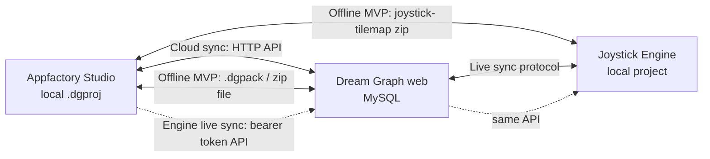

# 01 — Dream Graph Cloud Sync (draft)

> **Progressive plan — draft only.** Full implementation waits until:
> 1. Dream Graph desktop **offline MVP** (Phases 0–6) is complete.
> 2. **Studio authentication** — [06-studio-authentication.md](06-studio-authentication.md).

Planned **after** offline MVP. Design hooks are in
[../dream-graph/03-data-model-and-files.md](../dream-graph/03-data-model-and-files.md) so offline work does not require a rewrite.

> **Authentication is out of scope for this document until studio auth is defined.**
> Cloud sync assumes a future plan exposes a **`RemoteStorageAdapter`** interface —
> no sign-in UI or token handling in the Dream Graph port itself.
>
> **Server-side update:** Dream Graph web's own API previously had **no
> authentication at all** — not even the client-supplied-header pattern other
> apps had; most controllers explicitly checked nothing ("Authorization
> disabled for development"). That's fixed independently of this doc's
> desktop-sync plan — see [07 § Phase S0.5g](07-unified-sync-orchestration.md).
> Relevant for whoever implements the `RemoteStorageAdapter` this doc assumes:
> the API now requires `Authorization: Bearer` with Checkpoint app name
> `GRAPH_EDITOR`, and every project-scoped route verifies the caller's
> `member_reference_num` against the resource's owner via
> `Concerns\AuthorizesProjectOwnership`.

## Three sync surfaces

| Surface | Offline MVP | This plan |
|---------|-------------|-----------|
| Desktop ↔ files | ✅ Primary | Still supported |
| Desktop ↔ cloud | ❌ | Cloud sync (after studio auth) |
| Desktop ↔ engine | Manual zip | See [02-engine-live-sync.md](02-engine-live-sync.md) |
| Cloud ↔ engine | ✅ API exists | Unchanged |

---

## Cloud sync strategy

**Prerequisite:** Studio authentication plan delivers a session the Dream Graph adapter can read (bearer token or equivalent).

### Modes (user-selectable per linked project)

| Mode | Behavior |
|------|----------|
| **Local only** | Default offline v1 |
| **Link only** | UUID mapping; manual Push/Pull buttons |
| **Auto sync** | Debounced push after local save; poll pull every N seconds |

### Push (local → cloud)

For each dirty entity since last sync:

| Entity | Web endpoint | Strategy |
|--------|--------------|----------|
| Graph content | `PUT /api/graphs/{graph}/content` | Full-state (same as web autosave) |
| Tilemap chunks | `PUT /api/projects/{project}/tilemaps/{tilemap}/chunks` | Dirty chunks + `base_version` |
| New assets | `POST /api/projects/{project}/assets` | Multipart upload |
| Catalog rows | Individual CRUD endpoints | Batch on push |

Verified against `apps/dream_graph/routes/api.php` (lines 51, 65, 138).

> **Two distinct tilemap surfaces — do not conflate them.**
>
> | Surface | Route | Auth | Used by |
> |---------|-------|------|---------|
> | **Project-nested CRUD** | `GET`/`PUT /api/projects/{project}/tilemaps/{tilemap}/chunks` | Studio user session | **This doc** — cloud sync push/pull |
> | **Engine live-sync bridge** | `GET /api/tilemaps/{tilemapId}/export`, `POST /api/tilemaps/{tilemapId}/import` | `tilemap.sync:read` / `:write` machine tokens | [02-engine-live-sync.md](02-engine-live-sync.md) |
>
> The bridge routes are deliberately un-nested and use **no model binding** —
> controllers resolve by id *or* uuid. They are not a substitute for the nested
> CRUD routes and carry a different credential.

Track `lastSyncedAt` and per-entity versions in `sync.json`.

### Pull (cloud → local)

1. Fetch project manifest from `GET /api/projects/{project}`
2. For each graph: `GET /api/graphs/{graph}` — compare `updated_at`
3. For tilemaps: load document + chunks if remote version > local
4. Merge policy: prompt if both sides changed since last sync

### Conflict handling

| Conflict | Resolution |
|----------|------------|
| Tilemap 409 | Dialog — take remote / keep local / duplicate map |
| Graph simultaneous edit | Prompt with diff summary; avoid silent last-write-wins |
| Asset missing locally | Download from `/api/assets/{uuid}` on pull |
| Deleted remotely | Tombstone in sync manifest; ask to delete local copy |

### Offline queue

When authenticated but network down:

- Queue operations in `.dgproj/sync-queue.jsonl`
- Drain on reconnect; cap size with UI warning if overflow

---

## afs-connect integration (optional, later)

Web Dream Graph exposes `/internal/afs-connect/v1/*` for coordinator indexing.

Desktop participation requires: authenticated user (studio auth plan), project linked to cloud UUID, optional "Share with coordinator" toggle. Defer until cloud sync is stable. Metadata only — not full narrative text.

---

## Security checklist

- [ ] Credentials outside exported bundles; restrictive file permissions
- [ ] TLS verification always on
- [ ] No service keys in renderer
- [ ] Revoked token → 401 → clear local credential
- [ ] Sync token scoped to one project

---

## Environment URLs

| Environment | Dream Graph base URL |
|-------------|---------------------|
| Dev | `https://graph.dev.appfactory.studio` |
| Prod | `https://graph.appfactory.studio` |

Non-secret base URL in bundled config (similar to Joystick `DreamGraphSync.json`).

---

## Open decisions (resolve before implementation)

1. **Merge tool** for graph conflicts — build or always prompt fork?
2. **Auto-sync default** — opt-in vs opt-out?
3. **Tilemap sync token UI** — desktop project settings vs web-only mint?
4. **Shared Node export library** between Laravel and Electron main process?

Authentication decisions belong in the **studio auth** doc (to be added), not here.
