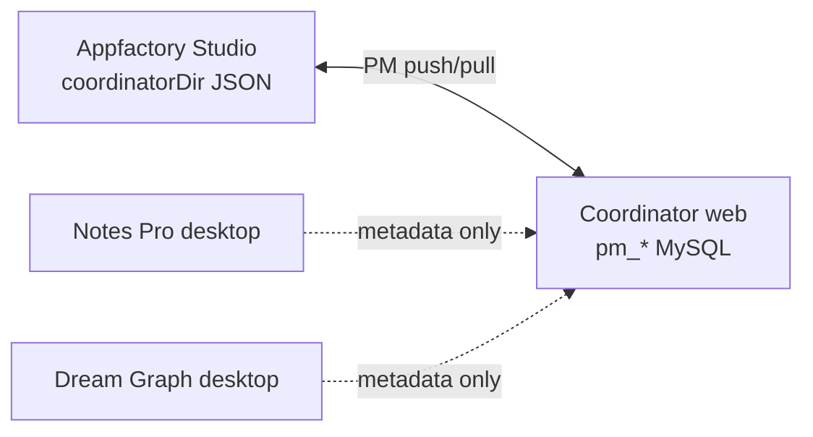

# 03 — Coordinator PM Cloud Sync (draft)

> **Progressive plan — draft only.** Full implementation waits until:
> 1. Coordinator desktop **offline MVP** (Phases 0–11) is complete.
> 2. **Studio authentication** is defined in this folder.
> 3. Dream Graph and other app cloud sync adapters exist or are in progress.

Syncs the **PM workspace** between Appfactory Studio (local JSON) and the web
Coordinator Laravel API (`/api/pm/*`).

AFS Connect hub sync (cross-app metadata) is a **separate concern**:
[04-desktop-apps-report-to-coordinator.md](04-desktop-apps-report-to-coordinator.md)

---

## Sync surfaces



| Surface | This doc | Other doc |
|---------|----------|-----------|
| Coordinator PM workspace | ✅ Here | |
| Notes/DG/PDF → hub index | | [04-desktop-apps-report-to-coordinator.md](04-desktop-apps-report-to-coordinator.md) |
| Dream Graph project sync | | [01-cloud-sync.md](01-cloud-sync.md) |
| Engine tilemap live sync | | [02-engine-live-sync.md](02-engine-live-sync.md) |

---

## Prerequisites

1. **Studio authentication** — Checkpoint session in afsdesktop5 (`renderer/checkpoint/`
   already exists; needs coordinator-specific token forwarding).
2. **Offline MVP complete** — local `.coordproj` + `workspace.json` stable.
3. **Member resolution** — map Checkpoint user → `member_reference_num` via Brain API
   (same as web `PmMemberController`).

---

## Auth headers — ✅ bearer-only, as of [07 § Phase S0.5](07-unified-sync-orchestration.md#phase-s05--server-side-bearer-enforcement-blocks-all-sync)

Web `pm-api.ts` (`coordinator/resources/js/src/pm-api.ts`, via the shared
`checkpointAuthHeaders()` helper in `checkpoint-auth-headers.ts`) sends a
single header:

```
Authorization: Bearer {checkpoint access token}
```

No `X-User-Id`, `X-Checkpoint-User-Id`, or `X-Coordinator-Role` — the `pm`
route group is now guarded by `MemberCheckpointAuthMiddleware`
(alias `checkpoint.member`, `coordinator/routes/api.php`), which validates
the bearer via `CheckpointTokenValidator` (required app `COORDINATOR`) and
sets `checkpoint_member_reference_num` / `checkpoint_user_id` /
`checkpoint_user_type` / `checkpoint_app_role` as request attributes.
`Concerns\ResolvesMember` and `Concerns\ResolvesCoordinatorAuth` read those
attributes exclusively — never a header — so a forged `X-User-Id` (or any
other header) no longer does anything.

`checkpoint_app_role` is `'admin'` for primary users (matches
`resources/js/src/authz.ts`'s `isCoordinatorAdmin()`) or the secondary
user's Checkpoint-assigned `COORDINATOR`-scoped role — **secondary users are
still valid callers here**, since Coordinator PM already has a team/role
model for them; see [06](06-studio-authentication.md)'s note on why a
blanket secondary rejection at this layer would have been wrong.

> **Also fixed in the same pass:** `GET /api/afs-connect/*` used the identical
> vulnerable `ResolvesMember` pattern and is now gated by the same
> middleware, **except** `GET /api/afs-connect/sources` (a static,
> member-agnostic catalog consumed unauthenticated by `apps/members` — gating
> it would have broken that cross-app integration for no security benefit).
> `apps/members` also called coordinator's now-gated
> `GET /api/afs-connect/status` unauthenticated, server-to-server, to merge
> entitlement state into its own settings page; that now goes through a new
> signed `GET /internal/afs-connect/v1/status` (existing `afs_connect.service`
> HMAC channel) instead.
>
> **`PmMemberController::show()`** (`GET /api/pm/member`) had its own,
> separate hole: it took an arbitrary `?user_id=` query param with **zero**
> auth check and returned that member's full Brain record — an unauthenticated
> IDOR, not just an unauthenticated identity spoof. It now resolves the
> caller's own record from the validated bearer.

Implement in `coordinator/api-remote.ts` — swaps in for `pm-api-desktop.ts` when
signed in.

---

## Sync modes (user-selectable)

| Mode | Behavior |
|------|----------|
| **Local only** | Default offline v1 — no remote calls |
| **Link only** | UUID/id mapping; manual Push/Pull buttons |
| **Auto sync** | Debounced push after local save; poll pull every N seconds |

Store mode in `~/Documents/afsfiles/coordinator/sync.json`:

```json
{
  "mode": "local-only",
  "linkedMemberRef": null,
  "lastPullAt": null,
  "lastPushAt": null,
  "conflictPolicy": "ask"
}
```

---

## Push strategy

1. User edits → local debounced save (unchanged offline path).
2. If mode ≠ `local-only`: queue push of changed `.coordproj` payloads.
3. `PUT /api/pm/projects/{id}` with `projectDataToPersistPayload()` body.
4. Workspace metadata changes → `PUT /api/pm/workspace` — **read-modify-write only**;
   see the full-array warning under [Linking local ↔ remote project](#linking-local--remote-project).

**Granularity:** Per-project push (not whole workspace every keystroke).

---

## Pull strategy

1. Poll `GET /api/pm/workspace` on interval (auto mode) or manual Pull button.
2. Compare `updatedAt` / version per project.
3. On conflict: show merge UI (task-level or project-level — TBD).

---

## Conflict handling (draft)

| Policy | Behavior |
|--------|----------|
| **Ask** | Dialog: Keep local / Keep remote / Merge |
| **Local wins** | Overwrite remote on push |
| **Remote wins** | Overwrite local on pull |

Task-level merge may use `source[].id` matching (same id scheme online/offline
after link). Unmatched ids: treat as new tasks.

---

## Linking local ↔ remote project

> **Constraint — the PM API has no project-create endpoint.**
> `apps/coordinator/routes/api.php` exposes only:
>
> ```
> GET  /api/pm/member
> GET  /api/pm/workspace
> PUT  /api/pm/workspace
> GET  /api/pm/projects/{projectId}
> PUT  /api/pm/projects/{projectId}
> ```
>
> There is **no `POST /api/pm/projects`** and no `GET /api/pm/projects` index.
> Project creation and enumeration both go through the **workspace** endpoint.

### How creation actually works

`PmPersistenceService::persistProjects()` (called from `PUT /api/pm/workspace`)
upserts with `PmProject::withTrashed()->updateOrCreate()` keyed on
**`(member_reference_num, client_id)`**, where `client_id` is a
**client-supplied integer**. So desktop *can* create a remote project — by
including it in the `projects` array of a workspace PUT. No new endpoint needed.

This also means local and remote share **one id space** (`client_id`), which is
what makes the task-level `source[].id` merge above work after link.

> ### ⚠️ Workspace PUT is destructive — full-array semantics
>
> `persistProjects()` soft-deletes every project **not** present in the incoming
> array:
>
> ```php
> PmProject::forMember($memberReferenceNum)
>     ->whereNotIn('client_id', $incomingIds)
>     ->whereNull('deleted_at')
>     ->update(['deleted_at' => now()]);
> ```
>
> A desktop client that PUTs a **partial** workspace silently soft-deletes every
> project it did not know about — including projects created on web or on another
> device since the last pull. `persistTeams()` should be assumed to behave the
> same way.
>
> **Rules for the desktop adapter:**
>
> 1. **Never** PUT `workspace.projects` without a preceding successful
>    `GET /api/pm/workspace` in the same sync cycle.
> 2. Merge local additions into the **full** remote project list, then PUT.
> 3. If the pull leg fails, abort the push leg — do not fall back to
>    local-only state.
> 4. Prefer `PUT /api/pm/projects/{projectId}` for per-project content; reserve
>    workspace PUT for create/rename/reorder/delete of the project list itself.
> 5. Treat project deletion as an explicit user action, never as a side effect of
>    a narrower payload.

### Link flow (v1)

| Step | Action |
|------|--------|
| 1 | `GET /api/pm/workspace` — fetch full remote project list |
| 2 | User picks an existing remote project, **or** chooses "create remote" |
| 3 | Create: assign a `client_id` not colliding with the remote list, merge into the full array, `PUT /api/pm/workspace` |
| 4 | Store the mapping in `.coordproj`; push content via `PUT /api/pm/projects/{projectId}` |

Adding a dedicated `POST /api/pm/projects` remains a reasonable server-side
cleanup — it would remove the read-modify-write hazard entirely — but it is
**not** a prerequisite for C2.

On link, store in `.coordproj`:

```json
{
  "cloud": {
    "remoteProjectId": 42,
    "linkedAt": "2026-08-01T12:00:00.000Z"
  }
}
```

---

## Payload parity

Desktop `.coordproj` must match web API payload from `projectDataToPersistPayload()`.
Reference: `apps/coordinator/resources/js/src/project-persist.ts` and
`PmPersistenceService.php`.

Derived views are **never** pushed — server rebuilds from `source[]` same as desktop.

---

## Implementation phases (cloud — after offline MVP)

> **Phase-letter collision:** the `C*` identifiers below are **this document's**,
> and do not correspond to the `C1a`–`C3` desktop-auth phases in
> [06-studio-authentication.md](06-studio-authentication.md) (where `C2` means 2FA).
> The cross-document spine is the `S*` series in
> [07-unified-sync-orchestration.md](07-unified-sync-orchestration.md).

| Phase | Deliverable |
|-------|-------------|
| C1 | Studio auth doc + sign-in UI gates cloud features — not started |
| **C1.5** | Server-side bearer enforcement on `/api/pm/*` + `pmHeaders()` sends the token (= [07](07-unified-sync-orchestration.md) phase S0.5) — ✅ **Shipped**, ahead of C1 |
| C2 | Remote PM adapter (`pm-api-remote.ts`) + link project flow — not started; still blocked on C1 (desktop `StudioAuthService`), independent of C1.5 |
| C3 | Manual push/pull + conflict dialog |
| C4 | Auto sync + background poll |
| C5 | Multi-device conflict merge refinement |

Completion notes: `account-and-cloud-sync/complete/` (create when C1 starts).

---

## Non-goals (this doc)

- AFS Connect index ingest (see doc 04)
- Replacing web Laravel with desktop-only sync
- Real-time WebSocket sync (REST poll only in v1)

---

## Related references

| Document | Relevance |
|----------|-----------|
| [../coordinator/03-data-model-and-files.md](../coordinator/03-data-model-and-files.md) | Local file layout + `cloud` hooks |
| `apps/coordinator/routes/api.php` | PM route contract |
| `apps/coordinator/app/Services/Pm/PmPersistenceService.php` | Server persistence |
| [01-cloud-sync.md](01-cloud-sync.md) | Dream Graph cloud sync (parallel track) |
