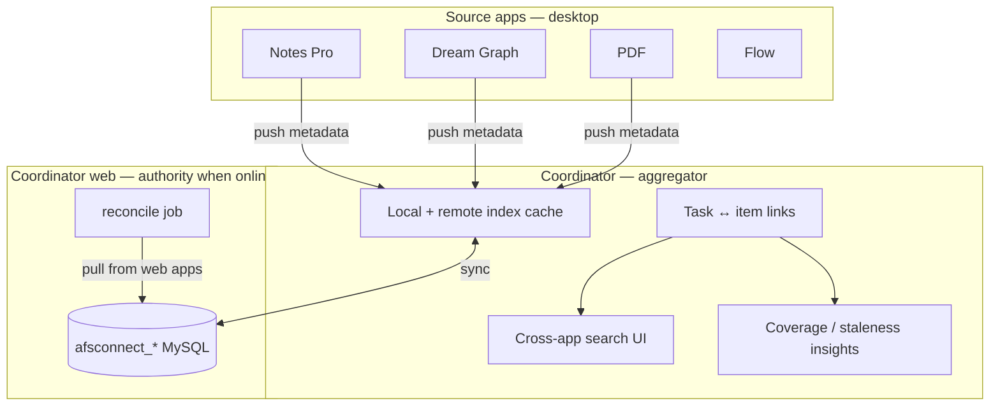

# 04 — Desktop Apps Report to Coordinator (draft)

> **Progressive plan — draft only.** Implements the **AFS Connect hub** inside
> Appfactory Studio — the reason Coordinator is the most comprehensive app.

When online, every other desktop app **reports metadata** to Coordinator. Coordinator
aggregates, searches, and links cross-app items. PM task ↔ note/graph/PDF links
surface in both directions.

PM workspace sync (tasks, kanban, budget) is separate:
[03-coordinator-pm-sync.md](03-coordinator-pm-sync.md)

Web reference: `apps/afsserver/plans/afs-connect/`

---

## Hub vs source roles



| Role | Apps |
|------|------|
| **Hub** | Coordinator (desktop + web) |
| **Sources** | Notes Pro, Dream Graph, PDF, Flow |

---

## What "report" means

Source apps do **not** copy full documents into Coordinator. They push **metadata**
matching the web afs-connect ingest contract.

### Wire format — event envelope, not a flat item

`AfsConnectIngestController::store()` validates an **envelope** wrapping a batch
of items. Reporters must send this shape, not a bare item:

```json
{
  "event_id": "dsk_flow_9f2c1a8e-...",
  "source_app": "flow",
  "member_reference_num": "MR-12345",
  "occurred_at": "2026-08-01T12:00:00Z",
  "items": [
    {
      "source_id": "proj_abc123",
      "title": "Onboarding flow",
      "snippet": "ref_9f2c1a8e",
      "updated_at": "2026-08-01T11:59:58Z",
      "project_hint": 42
    }
  ]
}
```

| Envelope field | Required | Constraint | Purpose |
|----------------|----------|------------|---------|
| `event_id` | ✅ | `string`, max 191 | **Idempotency key** — see below |
| `source_app` | ✅ | `string`, max 32 | `notes`, `dream_graph`, `pdf_editor`, `flow` |
| `member_reference_num` | ✅ | `string`, max 64 | Owner scope; entitlement is checked against it |
| `occurred_at` | ✅ | `date` | When the local event happened, **not** when it was sent |
| `items` | ✅ | `array` | Batch of metadata rows (below) |

| Item field | Example |
|------------|---------|
| `source_id` | App-native uuid or id |
| `title` | Display name |
| `snippet` | Short preview text |
| `updated_at` | ISO timestamp |
| `project_hint` | Optional coordinator project id link |

Source: `apps/coordinator/app/Http/Controllers/Api/Internal/AfsConnectIngestController.php:33`.

### `event_id` and the offline queue — required, not optional

Ingest is **idempotent by `event_id`** and returns **`409 Already processed`** when
one repeats. Because desktop reporters queue to disk and replay on reconnect
(below), this is a correctness requirement, not a nicety:

1. **Generate `event_id` when the event is enqueued**, never at send time — a
   retry must reuse the same id or the server cannot dedupe it.
2. **Persist `event_id` in the queue record** (see the shared queue schema in
   [07-unified-sync-orchestration.md](07-unified-sync-orchestration.md) § Offline mutation queue).
3. **Treat `409` as success** — it means a prior attempt landed. Drop the queue
   entry; do **not** count it against `retry_count` or surface an error.
4. Set `occurred_at` from the **local save time**, so a queue drained hours later
   still orders correctly against web-origin changes.

Response is `202 Accepted` on success — ingest is queued server-side into
`afsconnect_*` for async processing, so a `202` means *accepted*, not *indexed*.
Do not block UI on it.

> **Auth note:** this endpoint sits behind `afs_connect.service`, which is **HMAC
> service-to-service** auth (`AfsConnectServiceAuthMiddleware`, signed over app +
> timestamp + body — no bearer at all). A distributable desktop binary cannot hold
> that shared secret, so reporters **must not post here directly**. See
> § Reporter transport below for the surface they use instead — the envelope
> contract above remains the payload of record either way.

---

## Reporter transport — use the engine surface, not the internal ingest

Coordinator has **three** distinct auth modes, and picking the wrong one is the
main design risk in this document:

| Route group | Middleware | Credential | Right for desktop? |
|-------------|------------|------------|--------------------|
| `/api/afs-connect/*` | none | member web session | ❌ Same-origin only |
| `/api/internal/afs-connect/v1/*` | `afs_connect.service` | HMAC shared secret over app+timestamp+body | ❌ **Cannot ship a secret in a desktop binary** |
| `/api/external/afs-connect/v1/*` | `afs_connect.external_token` | long-lived issued token | ⚠️ Per-install provisioning burden |
| `/api/engine/v1/*` | `afs_connect.engine` | **per-user Checkpoint bearer** | ✅ **Yes** |

The engine surface exists because the Joystick Engine hit this exact wall: a
native, distributable client that needs to report into Coordinator, holds no
service secret, and must not be trusted to declare its own member scope.
[`EngineCheckpointAuthMiddleware`](../../../../../apps/coordinator/app/Http/Middleware/EngineCheckpointAuthMiddleware.php)
resolves `engine_member_reference_num` / `engine_checkpoint_user_id` /
`engine_user_type` from the validated token, and its own docblock states the
point: *member scope comes from the validated token, never from a client-supplied
field.*

Appfactory Studio desktop has the identical shape. It should use the identical
pattern.

### Available today on that surface

```
GET  /api/engine/v1/connect/entitlement
POST /api/engine/v1/connect/snapshot
POST /api/engine/v1/connect/activity
POST /api/engine/v1/connect/commits
GET  /api/engine/v1/connect/tasks
POST /api/engine/v1/connect/tasks/{taskId}
```

`connect/entitlement` also replaces the ad-hoc entitlement plumbing sketched under
§ Entitlement gating — the server already answers "is this member entitled?" for a
bearer-authenticated native client.

### What D1 must decide

The middleware pins `REQUIRED_APP_NAME = 'GAME_EDITOR'`. Desktop needs its own
app name (see [06 § Checkpoint app registration](06-studio-authentication.md#checkpoint-app-registration-c1a-prerequisite)),
so one of:

| Option | Change | Notes |
|--------|--------|-------|
| **A — Accept a set of app names** (recommended) | `REQUIRED_APP_NAME` → allow-list containing `GAME_EDITOR` + `APPFACTORY_STUDIO` | Smallest diff; one surface, two native clients |
| **B — Parallel `studio/v1` group** | New middleware pinned to the studio app name, same controllers | Cleaner separation, more surface to maintain |

Either way the reporter payload is the ingest envelope documented above, and
`snapshot` is the natural fit for batched metadata reporting.

**Do not** resolve this by embedding a service secret in the desktop app, and do
not resolve it by having desktop write to Coordinator's local index and relying on
PM sync to carry metadata upstream — that couples reporter delivery to an
unrelated sync mode and silently drops metadata for members who never link a PM
workspace.

Full content fetched **on demand** from source app via existing app APIs (defense
in depth — same as web).

Reference: `apps/afsserver/plans/afs-connect/04-api-contracts.md`

---

## Desktop reporting architecture

Each source app adds a thin **metadata reporter** module:

```
src/renderer/components/{app}/afsConnectReporter.ts
```

| App | Reporter triggers |
|-----|-------------------|
| Notes Pro | On note save/delete |
| Dream Graph | On project save, graph rename, tilemap save |
| PDF | On document save/metadata change |
| Flow | On project create/save/rename/delete |

Reporter calls (when entitled + signed in):

1. **Local cache** — write to coordinator's local index file (offline queue)
2. **Remote ingest** — `POST` to coordinator internal API or direct index update

### Offline queue

When network unavailable, queue events in:

```
~/Documents/afsfiles/coordinator/afs-connect-queue.jsonl
```

Flush on reconnect + entitlement check.

---

## Coordinator desktop hub UI

Add `#/afs-connect` route **only when cloud sync Phase D is active**:

| Panel | Purpose |
|-------|---------|
| Source status | Per-app toggle + last sync time |
| Cross-app search | Query local index + remote index |
| Item drawer | Metadata + "Open in app" button |
| Task links | Link PM task ↔ external item |
| Insights | Staleness, coverage, overdue-without-links |
| Activity timeline | Aggregated events |

Copy from web: `afsConnect.ts`, `afsConnectItemDrawer.ts`, `afsConnectTaskLinks.ts`

Kanban cross-app badges (`afsConnectKanbanBadges.ts`) attach in Phase D3.

---

## Entitlement gating

Match web afs-connect entitlement stack:

1. Global kill switch (ops)
2. Plan entitlement (Parse/alloc)
3. Member toggle (Members dashboard → coordinator settings API)
4. Per-source-app toggle

Desktop: hide `#/afs-connect` nav and reporter calls until all four pass.
Reuse `renderer/checkpoint/` feature flags when studio auth lands.

Reference: `apps/afsserver/plans/afs-connect/05-feature-toggle-and-billing.md`

---

## Sync with web coordinator authority

When online, **web coordinator DB is authoritative** for the cross-app index.
Desktop maintains a **cache** for offline search (stale OK with timestamp).

| Operation | Online | Offline |
|-----------|--------|---------|
| Search | Query remote index; merge local queue | Query local cache only |
| Link task ↔ item | POST `/api/afs-connect/links` | Queue; flush on reconnect |
| Pull fresh index | GET `/api/afs-connect/summary` | Show last-synced badge |
| Reconcile | Server job pulls from web apps | N/A |

Scheduled reconcile (`afs-connect:reconcile` every 15 min) runs on **server only**.
Desktop apps push on save; server reconcile catches web-origin changes.

---

## Per-source app integration checklist

### Notes Pro

| Item | Detail |
|------|--------|
| Source key | `notes` |
| Metadata | note title, folder path, updated_at, uuid |
| Open in app | Navigate afsdesktop5 → Notes Pro → open note |
| Cloud sync prerequisite | Notes Pro cloud adapter (future doc) |

### Dream Graph

| Item | Detail |
|------|--------|
| Source key | `dream_graph` |
| Metadata | project name, graph node count, tilemap count, updated_at |
| Open in app | Navigate → Dream Graph → open project |
| Cloud sync prerequisite | [01-cloud-sync.md](01-cloud-sync.md) |

### PDF

| Item | Detail |
|------|--------|
| Source key | `pdf_editor` |
| Metadata | document name, page count, updated_at |
| Open in app | Navigate → PDF → open document |

### Flow

| Item | Detail |
|------|--------|
| Source key | `flow` |
| Metadata | project name, reference_id, revision, updated_at |
| Open in app | Navigate → Flow → open project (draw view) |
| Cloud sync prerequisite | [05-flow-cloud-sync.md](05-flow-cloud-sync.md) |
| Offline MVP | ✅ Phases 0–4 in `afsdesktop5` |

---

## Implementation phases (hub — after offline MVP + auth)

| Phase | Deliverable |
|-------|-------------|
| D0 | **Decide reporter transport** (§ Reporter transport) + register the desktop Checkpoint app name — blocks everything below |
| D1 | Studio auth + entitlement helper via `GET /api/engine/v1/connect/entitlement` |
| D2 | Local index cache + offline queue in coordinator main store |
| D3 | `#/afs-connect` UI (read-only search + open in app) |
| D4 | Task ↔ item links + kanban badges |
| D5 | Notes Pro reporter |
| D6 | Dream Graph reporter |
| D7 | PDF reporter |
| D8 | Insights + activity timeline |
| D9 | Engine surface hooks (optional — game editor context) |
| D10 | Flow reporter |

**Dependency order:** D0 → D1 → D2 → D3 before any source reporter (D5–D7 can parallelize).

---

## IPC additions (hub phases)

Extend `coordinator:*` handlers:

| Handler | Purpose |
|---------|---------|
| `coordinator:afs-index-search` | Query local cache |
| `coordinator:afs-index-ingest` | Upsert metadata row (from reporters) |
| `coordinator:afs-link-create` | Task ↔ item link |
| `coordinator:afs-link-delete` | Remove link |
| `coordinator:afs-queue-flush` | Push queued events to remote |

---

## Non-goals (v1 hub)

- Editing a note/graph/PDF **from inside** Coordinator (read + link + open only)
- Real-time push from server to desktop (poll-based)
- Replacing web reconcile job with desktop-only peer sync

---

## Related references

| Document | Relevance |
|----------|-----------|
| `apps/afsserver/plans/afs-connect/00-overview.md` | Hub problem statement |
| `apps/afsserver/plans/afs-connect/07-sync-and-indexing-strategy.md` | Index + reconcile |
| [03-coordinator-pm-sync.md](03-coordinator-pm-sync.md) | PM workspace sync |
| [../coordinator/04-pm-views-and-modules.md](../coordinator/04-pm-views-and-modules.md) | Excluded afs-connect modules in offline phases |
