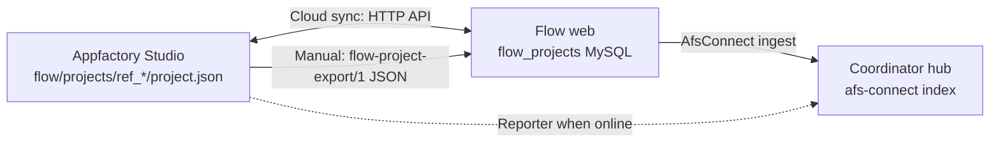

# 05 — Flow Cloud Sync (draft)

> **Progressive plan — draft only.** Full implementation waits until:
> 1. Flow desktop **offline MVP** (Phases 0–4) is complete ✅
> 2. **Studio authentication** — [06-studio-authentication.md](06-studio-authentication.md).
> 3. Optional: Phase 5 import/export for manual web handoff ✅ (desktop)

Planned **after** offline MVP. On-disk hooks are in
[../flow/03-data-model-and-files.md](../flow/03-data-model-and-files.md) (`revision`, optional `cloud` block).

> **Authentication is out of scope for this document until studio auth is defined.**
> Cloud sync assumes a future **`RemoteStorageAdapter`** the Flow renderer can call —
> no Checkpoint UI in the Flow port itself.

---

## Three sync surfaces



| Surface | Offline MVP | This plan |
|---------|-------------|-----------|
| Desktop ↔ files | ✅ Primary | Still supported |
| Desktop ↔ cloud | ❌ | Cloud sync (after studio auth) |
| Desktop ↔ web handoff | ✅ JSON export/import | Still supported |
| Flow → Coordinator metadata | ❌ | [04-desktop-apps-report-to-coordinator.md](04-desktop-apps-report-to-coordinator.md) D10 |

---

## Web API reference (authority when online)

Base path: `/api/flow`.

> ### ✅ The Flow API now authenticates — [07 § Phase S0.5](07-unified-sync-orchestration.md#phase-s05--server-side-bearer-enforcement-blocks-all-sync) shipped
>
> This section originally documented a real gap: `/api/flow` claimed to be
> "Checkpoint JWT + `X-User-Id` header" but validated nothing —
> `flow/routes/api.php` applied no middleware to the flow group, and identity
> came entirely from a client-supplied `X-User-Id` header via `ResolvesMember`.
> Any caller setting `X-User-Id: <n>` read and wrote that member's Flow
> projects, with no token check, no signature, no session.
>
> That's fixed. `flow/routes/api.php` now applies `checkpoint.member`
> (`FlowCheckpointAuthMiddleware`) to both the `flow` group **and** Flow's own
> `pm` group (team settings — same header-trust bug, `X-App-Role` this time,
> fixed in the same pass). The middleware validates
> `Authorization: Bearer <token>` via a Flow-local `CheckpointTokenValidator`
> (ported into `flow/app/Services/Checkpoint/` — Flow is a separate Laravel
> app/deploy from coordinator, so there's no shared PHP package to import
> instead), required app `FLOW_EDITOR`, and sets
> `checkpoint_member_reference_num` / `checkpoint_user_id` /
> `checkpoint_user_type` / `checkpoint_app_role` as request attributes.
> `Concerns\ResolvesMember` / `Concerns\ResolvesAppAuth` read those exclusively
> now — the `?user_id` query fallback is gone entirely, and `X-User-Id` /
> `X-Checkpoint-User-Id` / `X-App-Role` do nothing.
>
> `projectStore.ts`'s bearer is unconditional now (was `if (token)` —
> silently falling back to header-only identity when absent); it throws
> client-side instead. Same fix applied to `settings/pm-api.ts`.
>
> Both primary and secondary Checkpoint users remain valid callers — Flow's
> settings group has its own team/role model (`isSettingsAdmin()`) secondary
> users participate in; see [06](06-studio-authentication.md)'s note on why a
> blanket secondary rejection at this layer would have broken that.

| Method | Path | Body | Response |
|--------|------|------|----------|
| GET | `/projects` | — | `{ projects: FlowProjectRecord[] }` |
| POST | `/projects` | `{ name }` | `{ project }` (201) |
| GET | `/projects/{referenceId}` | — | `{ project }` |
| PUT | `/projects/{referenceId}` | `{ name?, scene? }` | `{ project }` |
| DELETE | `/projects/{referenceId}` | — | 204 |

Web source: `apps/flow/app/Http/Controllers/Api/ProjectController.php`

Client record shape matches desktop `project.json` (minus `member_reference_num` on desktop).

---

## Cloud sync strategy

**Prerequisite:** Studio authentication plan delivers a session the Flow adapter can read.

### Modes (user-selectable per linked project)

| Mode | Behavior |
|------|----------|
| **Local only** | Default offline v1 |
| **Link only** | Map local `reference_id` ↔ remote `reference_id`; manual Push/Pull |
| **Auto sync** | Debounced push after draw save; poll pull every N seconds |

### Push (local → cloud)

On save (or manual Push):

1. `PUT /api/flow/projects/{referenceId}` with `{ name, scene }`
2. Bump local `revision`; store `cloud.lastSyncedRevision` in optional sidecar `sync.json`:

```
~/Documents/afsfiles/flow/projects/{reference_id}/sync.json
```

```json
{
  "remoteReferenceId": "ref_abc123",
  "lastSyncedRevision": 5,
  "lastSyncedAt": "2026-08-01T12:00:00.000Z",
  "mode": "auto"
}
```

Keep `project.json` free of cloud fields for clean export (export strips `sync.json`).

### Pull (cloud → local)

1. `GET /api/flow/projects/{referenceId}`
2. If remote `revision` > local `revision` since last sync → merge or prompt
3. Write scene via atomic `project.json` update

### Conflict handling

| Conflict | Resolution |
|----------|------------|
| Both sides edited since last sync | Dialog — take remote / keep local / duplicate project |
| Remote deleted | Prompt to delete local or unlink |
| Large `files` blob mismatch | Prefer full scene replace; warn on size |

Use `revision` integer (already on both sides) for conflict detection — no optimistic locking on desktop v1.

### Offline queue

When authenticated but network down:

```
~/Documents/afsfiles/flow/sync-queue.jsonl
```

One line per queued PUT/DELETE; drain on reconnect.

---

## Linking local ↔ remote projects

First cloud link options:

| Option | When |
|--------|------|
| **Create remote** | POST new project; store mapping in `sync.json` |
| **Link existing** | User picks remote project from list; map IDs |
| **Import then link** | Import `flow-project-export/1` on web, then link desktop copy |

Desktop **never** overwrites remote `reference_id` on link — mapping lives in `sync.json` only.

---

## AFS Connect reporter (Coordinator hub)

Web Flow already dispatches ingest on create/update/delete:
`apps/flow/app/Services/AfsConnect/AfsConnectIngestDispatcher.php` (`source_app: flow`).

Desktop reporter (Phase D10 in doc 04):

| Trigger | Metadata |
|---------|----------|
| Project create/save/rename | `source_app: flow`, `source_id: proj_*`, `title`, `snippet: reference_id` |
| Project delete | `op: delete` |

Full hub design: [04-desktop-apps-report-to-coordinator.md](04-desktop-apps-report-to-coordinator.md).

---

## Storage adapter interface (renderer)

Same swap pattern as offline `projectStore.ts`:

```typescript
interface FlowRemoteAdapter {
  listProjects(): Promise<FlowProjectRecord[]>;
  getProject(referenceId: string): Promise<FlowProjectRecord | null>;
  createProject(name: string): Promise<FlowProjectRecord>;
  saveProject(referenceId: string, payload: { name?: string; scene?: ProjectScene }): Promise<FlowProjectRecord>;
  deleteProject(referenceId: string): Promise<void>;
}
```

Offline: IPC → main store.  
Online: HTTP → `/api/flow/*` via main-process fetch (keep tokens out of renderer).

---

## Environment URLs

| Environment | Flow base URL |
|-------------|---------------|
| Dev | TBD (same host as Checkpoint dev) |
| Prod | TBD (Flow Laravel app URL) |

Non-secret base URL in bundled config when studio auth lands.

---

## Security checklist

- [x] **Server validates the bearer on `/api/flow/*`** (and Flow's own `/api/pm/*`) — ✅ shipped, see § above
- [x] **`member_reference_num` derived from the token, never from `X-User-Id`**
- [x] `?user_id` query-param fallback removed from `ResolvesMember`
- [ ] Credentials in main process / safeStorage only
- [ ] TLS verification always on
- [ ] No service keys in renderer
- [ ] Revoked token → 401 → clear session
- [ ] Scene `files` may contain embedded images — size limits documented

---

## Implementation phases (cloud — after studio auth)

| Phase | Deliverable |
|-------|-------------|
| **F0** | Server-side bearer enforcement on `/api/flow/*` (= [07](07-unified-sync-orchestration.md) phase S0.5) — ✅ **Shipped**, ahead of F1 |
| F1 | `sync.json` schema + link UI stub in Flow settings (future) — not started |
| F2 | `RemoteStorageAdapter` HTTP implementation in main process — not started |
| F3 | Push/Pull buttons on dashboard; conflict dialog — not started |
| F4 | Auto-sync mode + offline queue — not started |
| F5 | AFS Connect reporter (coordinate with hub D10) — not started |

**Dependency order:** Studio auth doc (desktop `StudioAuthService`, still not
started) → F2 → F3 before F4/F5. F0 is independent and already done.

---

## Open decisions

1. **Auto-sync default** — opt-in vs opt-out?
2. **Conflict UI** — modal in Flow vs Coordinator-style toast?
3. **Member scope** — resolve `member_reference_num` at link time only?
4. **Web import endpoint** — dedicated POST or reuse export file upload?

Authentication decisions belong in the **studio auth** doc (to be added), not here.

---

## Related references

| Document | Relevance |
|----------|-----------|
| [../flow/03-data-model-and-files.md](../flow/03-data-model-and-files.md) | Local `project.json` + export format |
| [../flow/complete/03-data-model-and-files.complete.md](../flow/complete/03-data-model-and-files.complete.md) | Manual JSON handoff |
| [04-desktop-apps-report-to-coordinator.md](04-desktop-apps-report-to-coordinator.md) | Hub + Flow reporter |
| `apps/flow/routes/api.php` | Web REST routes |
| `apps/afsserver/plans/afs-connect/` | Web hub design |
