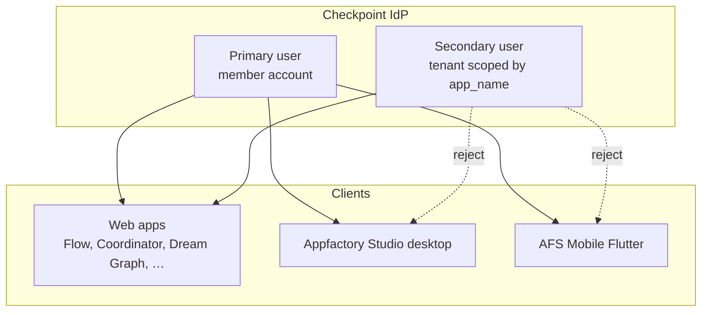
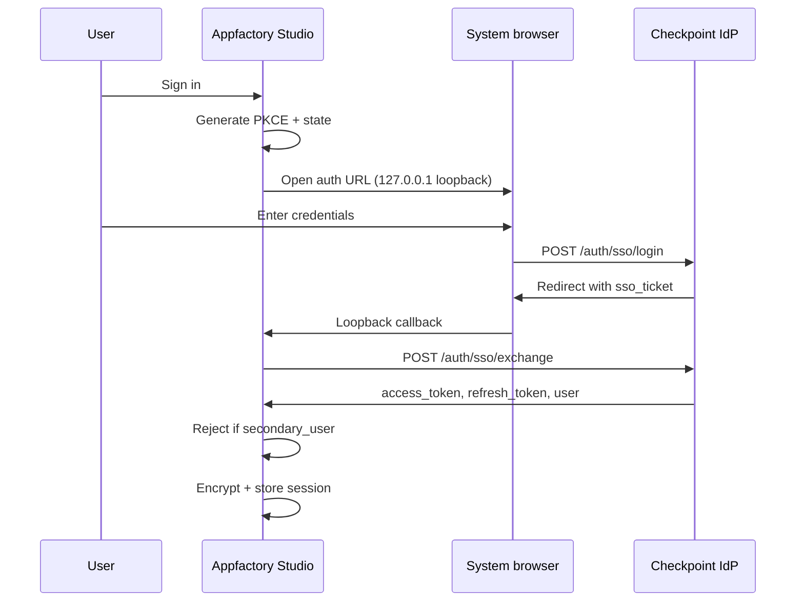

# 06 — Studio Authentication (Checkpoint IdP)

> **Master plan** for Appfactory Studio sign-in across **desktop** (`afsdesktop5`),
> **mobile** (`afsmobile_flutter`), and alignment with **web** apps that already use
> Checkpoint SSO. Cloud sync docs [01](01-cloud-sync.md)–[05](05-flow-cloud-sync.md)
> and [07-unified-sync-orchestration.md](07-unified-sync-orchestration.md) **depend on
> this document** for bearer tokens and session lifecycle.

---

## Goals

1. **Single IdP** — All studio clients authenticate against Checkpoint (`apps/auth`).
2. **Environment parity** — Dev uses `https://auth15.appfactory.studio`; production uses `https://auth.appfactory.studio`.
3. **Primary users only on native** — Desktop and mobile accept **primary** Checkpoint accounts only. **Secondary (tenant) users may sign in on web apps only.**
4. **Shared session contract** — One session model that sync adapters and Coordinator can read without per-app reimplementation.
5. **Progressive rollout** — Replace ad-hoc Settings modal login with a studio-wide auth service; wire SSO where appropriate.

---

## Checkpoint IdP reference

| Item | Location |
|------|----------|
| Laravel service | `apps/auth` |
| API prefix | `{authHost}/checkpoint` |
| Dev host | `https://auth15.appfactory.studio` |
| Prod host | `https://auth.appfactory.studio` |
| Documentation | `apps/auth/CHECKPOINT_DOCUMENTATION.md` |
| TypeScript client (canonical) | `apps/auth/public/checkpoint/client/typescript/src/` |
| Desktop vendored SDK | `afsdesktop5/src/renderer/checkpoint/` |
| Flutter client package | `checkpoint_client` (used by `afsmobile_flutter`) |
| Routes | `apps/auth/routes/checkpoint.php` |
| Config | `apps/auth/config/checkpoint.php` |

### API surface (primary users)

| Operation | Endpoint | Used by |
|-----------|----------|---------|
| Email login | `POST /checkpoint/auth/login` | Desktop Settings modal, mobile |
| Username login | `POST /checkpoint/auth/login/username` | Desktop Settings modal, mobile |
| Logout | `POST /checkpoint/auth/logout` | All |
| Refresh | `POST /checkpoint/auth/refresh` | SDK auto-refresh |
| SSO ticket exchange | `POST /checkpoint/auth/sso/exchange` | Web apps, desktop browser SSO |
| Token validate | `POST /checkpoint/auth/token/validate` | Optional gate on app start |

### API surface (secondary users — **web only**)

| Operation | Endpoint | Native clients |
|-----------|----------|----------------|
| Secondary login | `POST /checkpoint/secondary/login` | **Blocked** |
| Account selection | `POST /checkpoint/secondary/select-account` | **Blocked** |
| Secondary register | `POST /checkpoint/secondary/register` | **Blocked** |
| List / CRUD | `/checkpoint/secondary/*` | **Blocked** |

Secondary flow is documented in `CHECKPOINT_DOCUMENTATION.md` § Secondary Users. Web apps pass `user_type=secondary`, `app_name`, and `super_user_id` on the login redirect; callback returns `user_type=secondary` and a JWT whose payload includes `user.type === 'secondary_user'`.

---

## User types and platform matrix



| Platform | Primary login | Secondary login | SSO browser flow | 2FA |
|----------|---------------|-----------------|------------------|-----|
| **Web** | ✅ SSO-first (`ClientHandler.handlePageLoad`) | ✅ Full flow + account picker | ✅ Default | ✅ Web UI |
| **Desktop** | ✅ Target: SSO + fallback password | ❌ **Explicitly rejected** | ✅ Target (PKCE + loopback) | ⚠️ Phase 2 |
| **Mobile** | ✅ Password via `loginNormal` | ❌ **Explicitly rejected** | 🔜 Optional deep link later | ⚠️ Phase 2 |

### Secondary user rejection policy (native)

Native clients **must not** implement secondary login UI, account selection, or SSO callbacks with `user_type=secondary`.

**Enforcement points** (all required):

1. **Pre-login** — Do not expose secondary-specific entry points (no tenant URL params, no “sign in as guest/team member” flows).
2. **Post-login JWT inspection** — After any successful auth response, decode access token (or read `user.type` from response body) and reject if:
   - `user.type === 'secondary_user'`, or
   - JWT claim `user_type === 'secondary'`, or
   - Presence of `super_user_id` + `app_name` scope without primary member id.
3. **On session restore** — Same check when rehydrating tokens from disk; clear session and show “This account type is not supported on desktop/mobile. Please use the web app.”
4. **SSO callback** — If browser SSO returns secondary params, abort before token exchange and show the same message.

**Rationale:** Secondary users are tenant-scoped sub-accounts for SaaS web products. Desktop and mobile are **owner-primary** surfaces for full studio file access; tenant users should use the web app their organization linked.

### What "server-side" turned out to mean (corrected during [07](07-unified-sync-orchestration.md) Phase S0.5)

An earlier draft of this section added a 5th enforcement point — "server-side
rejection of `user_type === 'secondary'`, required, not optional" — reasoning
that points 1–4 are all client-side and therefore bypassable. That's true, but
the fix it prescribed was wrong. Implementing Phase S0.5 surfaced why:

1. **The real gap wasn't "the server doesn't reject secondary users."** It was
   "the server doesn't check the bearer at all" — `/api/pm/*` and `/api/flow/*`
   derived identity from a client-supplied `X-User-Id` header, full stop. A
   forged header worked regardless of whether the underlying account was
   primary or secondary. **That's what needed fixing, and it's now fixed** —
   see [07 § Phase S0.5](07-unified-sync-orchestration.md#phase-s05--server-side-bearer-enforcement-blocks-all-sync).
2. **Once the bearer is actually validated, rejecting secondary tokens at
   `/api/pm/*` would have broken a real, legitimate feature.** Coordinator's PM
   workspace already supports secondary (tenant/team-member) users via web —
   `isCoordinatorAdmin()`, team roles, the works. Flow's own settings group has
   the same model (`isSettingsAdmin()`). A blanket secondary-token rejection at
   those two middlewares is not "closing a gap," it's turning off a feature
   those apps ship today.
3. **The server has no reliable signal that a request came from the desktop
   app** specifically, as opposed to the web SPA — both present the same
   bearer shape over the same HTTP endpoint. "Desktop never logs in as
   secondary" is therefore inherently a **client-side** property: it holds
   because the desktop app's own login flow (points 1–4 above) never completes
   a secondary session, not because some server check would catch it if it
   did. The `client_platform`-hint IdP enhancement mentioned below is the only
   way to make that distinguishable server-side, and it remains optional,
   future work — not a blocker.

**What actually shipped:** every request behind `checkpoint.member`
(coordinator's `MemberCheckpointAuthMiddleware`, Flow's
`FlowCheckpointAuthMiddleware`) carries a server-validated
`userType: 'normal' | 'secondary'` and resolved `appRole` as request
attributes — derived from Checkpoint itself, never from a client header. Nothing
currently uses that to reject secondary callers, because nothing should:
enforcement of "desktop is primary-only" stays where it always made sense,
in desktop's own login flow.

| Layer | Enforces | Status |
|-------|----------|--------|
| Renderer/UI checks (points 1–4) | UX — clear message, no dead ends; the *actual* enforcement point for "desktop is primary-only" | Required |
| Server-side bearer validation ([07 § S0.5](07-unified-sync-orchestration.md#phase-s05--server-side-bearer-enforcement-blocks-all-sync)) | Real access control — a forged identity header no longer works, for primary or secondary | ✅ Shipped |
| Checkpoint `client_platform` grant refusal | Defence in depth at the IdP — the only way to make "this bearer came from desktop" distinguishable server-side | Optional follow-up |

---

## Environment configuration

### The single switch: `IS_PRODUCTION`

Environment selection is **one boolean, set in `.env`**, which drives the existing
`isProduction` export. There is no environment *name* string — no
`development`/`production`/`staging` vocabulary to keep in sync across clients.
Everything else (auth host, Checkpoint API base, SSO domain, and later the app API
hosts) is derived from that one boolean.

| `IS_PRODUCTION` | `isProduction` | Auth base URL | Checkpoint API base |
|-----------------|----------------|---------------|---------------------|
| `false` (default) | `false` | `https://auth15.appfactory.studio` | `https://auth15.appfactory.studio/checkpoint` |
| `true` | `true` | `https://auth.appfactory.studio` | `https://auth.appfactory.studio/checkpoint` |

Web apps use Vite env vars (`VITE_CHECKPOINT_*`). Desktop and mobile use their own flags (below).

### Desktop — `afsdesktop5/.env`

Project root (gitignored; commit `.env.example` as the template):

```env
# Production toggle. false → auth15 (dev), true → auth (prod).
# Anything other than exactly "true" is treated as false.
IS_PRODUCTION=false
```

**Wiring plan (C1a) — ✅ shipped:**

1. `dotenv` added as a devDependency (`afsdesktop5/package.json`); `webpack.config.js` calls `require('dotenv').config()` at the top, before building the four bundle configs (main, renderer, transcription worker, sync worker).
2. `webpack.config.js` computes a single `IS_PRODUCTION` string (`'true'` only for the exact literal `'true'`, `'false'` otherwise) and applies one `webpack.DefinePlugin({ 'process.env.IS_PRODUCTION': JSON.stringify(IS_PRODUCTION) })` to `commonConfig.plugins`, inherited by all four bundles — including main, since `src/main/index.ts` already imports `isProduction` straight from `../renderer/config` (pre-existing cross-boundary import; no separate `src/main/config.ts` was needed).
3. `src/renderer/config.ts` rewritten, same export names and shape as before so no call site changed:

```typescript
export const isProduction = process.env.IS_PRODUCTION === 'true';

export const API_URLS = {
    production: 'https://auth.appfactory.studio',
    development: 'https://auth15.appfactory.studio'
};

export const CHECKPOINT_SSO_DOMAIN = isProduction
  ? API_URLS.production
  : API_URLS.development;
export const CHECKPOINT_BASE_URL = `${CHECKPOINT_SSO_DOMAIN}/checkpoint`;
```

4. `.env.example` added, documenting the flag and the "copy to `.env`" step.

Verified end to end: unset/`.env`-default → `"false"`; `IS_PRODUCTION=true` env
override → `"true"`; typo'd `IS_PRODUCTION=True` → falls back to `"false"`
(fail-safe, not fail-open).

`CHECKPOINT_BASE_URL` / `CHECKPOINT_SSO_DOMAIN` are new exports, not yet
consumed anywhere — `settings.ts` still derives its own URL by stripping
`/login` off `API_URLS` (see "Current state" below). Wiring `settings.ts` to
use these directly is **C1e**, not C1a.

> **Compare against the string `'true'` explicitly.** Env vars are always strings,
> so `process.env.IS_PRODUCTION` is `"false"` — which is **truthy**. A bare
> `Boolean(process.env.IS_PRODUCTION)` or `!!process.env.IS_PRODUCTION` ships every
> dev build against the production IdP. Default to dev on anything unrecognised,
> so a typo fails safe.

3. Expose the same value to the **main process** via `webpack.DefinePlugin` or a small `src/main/config.ts`, so sync HTTP issued from main hits the same hosts as renderer auth. A split here means tokens minted against one environment get sent to the other.
4. Document in README: copy `.env.example` → `.env` for local dev; CI production builds set `IS_PRODUCTION=true`.

**Current state (post-C1a):** `src/renderer/config.ts` reads `isProduction` from `IS_PRODUCTION` in `.env` via webpack `DefinePlugin`, as above. `settings.ts:40` still derives the Checkpoint base itself by taking `isProduction ? API_URLS.production : API_URLS.development` and stripping a trailing `/login`, rather than using the new `CHECKPOINT_BASE_URL` export — that consolidation is **C1e** (unified login), not part of C1a's scope.

### Mobile — `afsmobile_flutter/lib/config.dart`

Mirror desktop semantics — same boolean, same name, same fail-safe default:

```dart
const bool isProduction = bool.fromEnvironment('IS_PRODUCTION', defaultValue: false);

String get checkpointBaseUrl => isProduction
    ? 'https://auth.appfactory.studio'
    : 'https://auth15.appfactory.studio';
```

Built with `--dart-define=IS_PRODUCTION=true` for release. `bool.fromEnvironment`
parses only the literal `true`/`false`, so the string-truthiness trap that applies
to Node does not apply here.

**Gap:** `apiBaseUrl` currently points at `members15` for both modes — unrelated to Checkpoint; leave as-is until members API consolidation is scoped.

---

## Checkpoint app registration (C1a prerequisite)

Checkpoint scopes authorization, entitlement, and secondary-user tenancy by
**`app_name`**. There is currently **no identifier for the desktop client.**
[`CheckpointAppName`](../../../../../auth/app/Services/Checkpoint/CheckpointAppName.php)
registers:

```
MEMBERS  COORDINATOR  NOTES_EDITOR  PDF_EDITOR
FLOW_EDITOR  GRAPH_EDITOR  GAME_EDITOR
```

`GAME_EDITOR` is the precedent worth studying: it was added for the Joystick
Engine, *"the standalone desktop C++ Checkpoint client"* — the same category of
client as `afsdesktop5`. Appfactory Studio needs its own, proposed
**`APPFACTORY_STUDIO`**.

> This is not cosmetic. `EngineCheckpointAuthMiddleware` rejects any token not
> authorized for its required app name, so **every server-side enforcement path
> in [07 § Phase S0.5](07-unified-sync-orchestration.md#phase-s05--server-side-bearer-enforcement-blocks-all-sync)
> and [04 § Reporter transport](04-desktop-apps-report-to-coordinator.md#reporter-transport--use-the-engine-surface-not-the-internal-ingest)
> depends on this constant existing first.**

### Registration is a multi-repo change

`CheckpointAppName`'s own docblock requires the PHP enum, every app's
`app-names.ts`, and each native client's copy to agree. Adding one name means
touching all of them:

| # | Location | Change |
|---|----------|--------|
| 1 | `apps/auth/app/Services/Checkpoint/CheckpointAppName.php` | `const APPFACTORY_STUDIO = 'APPFACTORY_STUDIO';` + add to `all()` |
| 2 | `apps/auth/resources/js/checkpoint/app-names.ts` | Mirror the constant |
| 3 | Each consuming app's `resources/js/checkpoint/app-names.ts` | Mirror (coordinator, flow, members, … — they are per-app copies, not a shared package) |
| 4 | `afsdesktop5/src/renderer/checkpoint/` | Add an `app-names.ts` — the vendored SDK threads `app_name` through login/SSO but ships no constant |
| 5 | Checkpoint app config / allowed redirect domains | Register the entry, incl. the `127.0.0.1` loopback for Flow A below |

`JoystickEngine_v2/libs/checkpoint_cpp/include/Checkpoint/AppNames.h` is the C++
mirror — unchanged by this, but it is the reason the sync requirement exists.

**Mobile:** `afsmobile_flutter` needs the same treatment if mobile sync is ever
scoped. Out of scope while mobile is auth-only.

---

## Session model (target contract)

All studio clients should converge on this shape so sync adapters share one interface.

### AuthResponse (from Checkpoint SDK)

Stored fields (minimum):

| Field | Purpose |
|-------|---------|
| `access_token` | Bearer for REST sync |
| `refresh_token` | Silent refresh |
| `expires_in` / expiry | Proactive refresh |
| `user.id` | `X-User-Id` header on web APIs |
| `user.email`, `user.username` | UI |
| `user.type` | Must be absent or `member` — reject `secondary_user` |

### Desktop storage (current → target)

| Concern | Current | Target |
|---------|---------|--------|
| Persistence | Encrypted `localStorage['user_session']` via `safe-storage-encrypt` IPC | Keep; add main-process mirror for sync |
| Login UI | Settings → Account tab modal (`settings.ts`) | Studio auth service + optional SSO button |
| SDK usage | Raw `CheckpointClient.auth.login*` | `ClientHandler` wrapper (matches web/testing) |
| Token refresh | Partial via SDK | Central `AuthService` on interval + before sync |
| Logout | Settings sign-out | Global; invalidate sync queues |

### Mobile storage (current)

| Concern | Implementation |
|---------|----------------|
| Tokens | `checkpoint_client` → `flutter_secure_storage` |
| Metadata | SharedPreferences via handler |
| Restore | `ClientHandler.loadExistingAuth()` on `AppStarted` |

### Proposed shared interface (desktop renderer + main)

```typescript
interface StudioAuthSession {
  accessToken: string;
  refreshToken: string;
  expiresAt: number; // unix ms
  userId: number;
  userType: 'primary'; // narrowed — secondary never stored
  email: string;
  username: string;
}

interface StudioAuthService {
  getSession(): Promise<StudioAuthSession | null>;
  loginWithPassword(identifier: string, password: string): Promise<StudioAuthSession>;
  loginWithBrowser(): Promise<StudioAuthSession>; // desktop SSO
  logout(): Promise<void>;
  refreshIfNeeded(): Promise<StudioAuthSession | null>;
  onSessionChanged(cb: (session: StudioAuthSession | null) => void): () => void;
}
```

Main process subscribes via IPC (`auth:get-session`, `auth:session-changed`) so `RemoteStorageAdapter` implementations never touch renderer `localStorage`.

---

## Desktop (`afsdesktop5`) — current state and migration

### What exists today

| Component | Path | Notes |
|-----------|------|-------|
| Config | `src/renderer/config.ts` | Hardcoded dev URLs |
| Settings login | `src/renderer/components/settings.ts` | Email/username + password modal |
| Session restore | `settings.ts` → `restoreSessionIfPresent` | Decrypts `user_session` |
| Renderer auth UI | `src/renderer/renderer.ts` | `updateAuthUI`, member area link |
| Vendored SDK | `src/renderer/checkpoint/` | Full client including `browser-auth.ts`, `secondary-users.ts`, `ClientHandler` |
| SSO / PKCE | `checkpoint/browser-auth.ts` | Used in `_testing/` only, not production shell |
| Secondary API | `checkpoint/secondary-users.ts` | Present in SDK — **must not be wired in UI** |

### Target auth flows

#### Flow A — Browser SSO (recommended primary UX)

Matches web apps and `_testing` harness:



Implementation notes from `browser-auth.ts`:

- Register `127.0.0.1` (or configurable port) in Checkpoint allowed redirect domains for the desktop app entry.
- Use `ClientHandler` or `BrowserAuthHandler` from vendored SDK.
- Show “Opening browser…” modal; handle timeout and user cancel.

#### Flow B — In-app password (fallback)

Keep Settings modal but route through `ClientHandler.loginNormal()` instead of raw `CheckpointClient.auth.login*`:

1. Call login.
2. If `requires_2fa` → show “Use web sign-in or disable 2FA” (Phase 1); OTP screen in Phase 2.
3. If success → **inspect `user.type`** → reject secondary.
4. Persist via `StudioAuthService`.

### Desktop implementation phases

| Phase | Scope | Deliverable |
|-------|-------|-------------|
| **C1a** | Env flag | ✅ **Shipped** — `.env` + `dotenv` + webpack DefinePlugin; `config.ts` sets `isProduction` from `IS_PRODUCTION === 'true'` |
| **C1a′** | App name | ✅ **Shipped** — `APPFACTORY_STUDIO` registered across all locations in § Checkpoint app registration |
| **C1b** | Auth service | `src/renderer/services/studio-auth.ts` + IPC to main — not started |
| **C1c** | Secondary guard | `assertPrimaryUser(user)` on login + restore — desktop's own enforcement point (see § "What server-side turned out to mean" above); not started. Server-side bearer validation ([07 § S0.5](07-unified-sync-orchestration.md#phase-s05--server-side-bearer-enforcement-blocks-all-sync)) already shipped ahead of C1c, independently — it authenticates secondary tokens rather than rejecting them, which is the correct behavior per that section |
| **C1d** | SSO wiring | Settings “Sign in with browser” using `browser-auth.ts` — not started |
| **C1e** | Unify login | Migrate `settings.ts` to `StudioAuthService`; wire `CHECKPOINT_BASE_URL`/`CHECKPOINT_SSO_DOMAIN` from C1a — not started |
| **C2** | 2FA | OTP step or force SSO for 2FA accounts — not started |
| **C3** | Global gate | Optional: require auth before cloud sync toggles (offline still works unsigned) — not started |

---

## Mobile (`afsmobile_flutter`) — analysis and alignment

### Architecture

```
lib/
├── config.dart              # isProduction → checkpointBaseUrl
├── repositories/
│   └── auth_repository.dart # CheckpointClient + ClientHandler
├── bloc/auth/
│   ├── auth_bloc.dart       # AppStarted, LoginRequested, LogoutRequested
│   ├── auth_event.dart
│   └── auth_state.dart
├── pages/
│   ├── login_page.dart      # Form → AuthBloc
│   └── home_page.dart       # Optional login; not gated
└── app.dart                 # AuthBloc at root, home = HomePage
```

### Login flow (today)

1. `AppStarted` → `AuthRepository.getCurrentUser()` → `ClientHandler.loadExistingAuth()`.
2. User opens Login from Home → `LoginRequested` → `ClientHandler.loginNormal(identifier, password)`.
3. On success → `Authenticated` → fetch API data + notifications → pop login route.
4. On failure → `AuthFailure` with `lastError` (includes 2FA message).

### Deliberate choices (correct for this plan)

| Behavior | Status | Notes |
|----------|--------|-------|
| Primary login only | ✅ | Uses `loginNormal`, not `loginSecondary` |
| No secondary UI | ✅ | Package supports secondary; app ignores it |
| Checkpoint direct | ✅ | Not legacy `/api/login` |
| Secure token storage | ✅ | Via `checkpoint_client` |

### Gaps to close (mobile phases)

| Gap | Risk | Phase |
|-----|------|-------|
| **No secondary JWT guard** | Secondary user could login if Checkpoint ever issued token via misconfiguration | **M1** — add `assertPrimaryUser` after login + restore |
| **No auth gate** | App usable without login; cloud features would fail silently | **M2** — gate sync/cloud screens only (not calculator/notes offline) |
| **2FA unsupported** | Accounts with 2FA cannot login | **M3** — OTP UI or deep-link SSO |
| **`isProduction` manual** | Same as desktop pre-C1a | **M1** — `bool.fromEnvironment('IS_PRODUCTION')` + `--dart-define=IS_PRODUCTION=true` |
| **No token refresh hook for sync** | Future sync needs bearer injection | **M2** — expose `AuthRepository.getAccessToken()` for API client |

### Mobile rejection UX (copy)

> This account type is not supported in the mobile app. Please sign in at the web app for your organization.

Show on secondary detection; call `logout()` to clear any partial tokens.

---

## Web apps (reference — no desktop work)

Web Flow, Coordinator, Dream Graph already use:

- `VITE_CHECKPOINT_BASE_URL`
- `ClientHandler.handlePageLoad()` for SSO ticket in URL
- Secondary flows where product requires multi-tenant access

Desktop/mobile plans **do not** change web behavior. Server APIs continue to accept Checkpoint JWT from any client; authorization is unchanged.

---

## Security considerations

1. **Token storage** — Desktop: OS `safeStorage` encryption (existing IPC). Mobile: `flutter_secure_storage`. Never log tokens.
2. **PKCE** — Required for desktop browser SSO.
3. **Loopback redirect** — Bind localhost listener only for auth callback; close immediately after receipt.
4. **Refresh rotation** — Use SDK refresh; on 401 from sync, attempt one refresh then sign out.
5. **Secondary block** — Desktop's own login flow (enforcement points 1–4 above) never completes a secondary session; that client-side check is the actual enforcement point, not a stopgap. See § What "server-side" turned out to mean.
6. **Session invalidation** — Logout clears local + POST `/auth/logout`; main process clears in-memory bearer cache.
7. **Server validates the bearer** — ✅ Shipped for `/api/pm/*`, `/api/afs-connect/*`, `/api/flow/*` ([07 § Phase S0.5](07-unified-sync-orchestration.md#phase-s05--server-side-bearer-enforcement-blocks-all-sync)). Desktop sending a token is not the same as the server requiring one — it now requires one.
8. **Member scope from the token** — Never from `X-User-Id` or any other client-supplied field. Enforced server-side as of S0.5.

---

## Testing checklist

| Case | Desktop | Mobile |
|------|---------|--------|
| Primary email login | ✅ | ✅ |
| Primary username login | ✅ | ✅ |
| Wrong password | Error message | AuthFailure |
| Secondary login attempt (desktop UI) | Rejected + message | Rejected + message |
| Secondary bearer sent **directly** to `/api/pm/*` or `/api/flow/*`, bypassing the desktop UI | Server **accepts** it, scoped to that secondary user's own member/role — desktop never presenting one is what actually blocks this case, not a server-side reject | N/A |
| Forged `X-User-Id`, no bearer, direct to sync API | Server returns 401 — bearer required, headers ignored | Server returns 401 |
| Restored session primary | Works | Works |
| Restored session secondary (simulated JWT) | Cleared + message | Cleared + message |
| Logout | Clears UI + storage | Unauthenticated |
| Dev vs prod URL | `IS_PRODUCTION` unset/`false`/`true` → correct host | `--dart-define=IS_PRODUCTION` |
| `IS_PRODUCTION` typo (e.g. `True`, `1`, empty) | Falls back to **dev**, never prod | Same |
| 2FA account | Clear error / SSO | Clear error |
| SSO browser flow | Opens browser, returns token | N/A until deep link |

---

## Related documents

| Doc | Relationship |
|-----|--------------|
| [07-unified-sync-orchestration.md](07-unified-sync-orchestration.md) | Consumes session contract from this doc |
| [01-cloud-sync.md](01-cloud-sync.md) | Dream Graph bearer usage |
| [03-coordinator-pm-sync.md](03-coordinator-pm-sync.md) | Coordinator PM API auth |
| [04-desktop-apps-report-to-coordinator.md](04-desktop-apps-report-to-coordinator.md) | Reporter auth |
| [05-flow-cloud-sync.md](05-flow-cloud-sync.md) | Flow API auth headers |

Completion notes: create `account-and-cloud-sync/complete/C1-*.md` as phases land.
