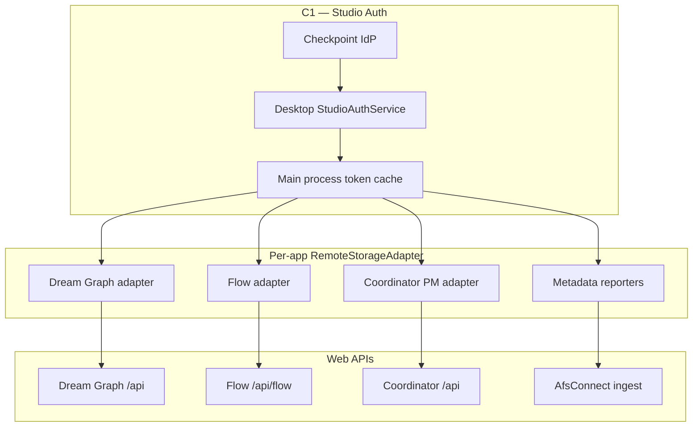
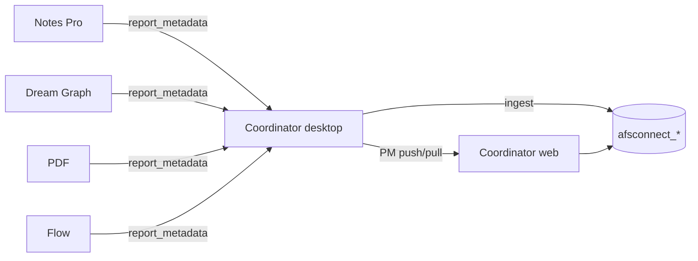

# 07 — Unified Sync Orchestration

> **Master plan** tying together per-app cloud sync documents, Coordinator as the
> aggregation hub, and the shared infrastructure that [06-studio-authentication.md](06-studio-authentication.md)
> enables. Read this after studio auth scope is understood; implement **auth first (C1)**,
> then sync in the order below.

---

## Overview

Appfactory Studio offline ports (Dream Graph, Coordinator, Flow, Notes Pro, PDF) are **complete locally**. Cloud sync adds:

1. **Authenticated HTTP** — Checkpoint bearer on every remote call.
2. **Per-app adapters** — Push/pull entity data to each web app's API.
3. **Coordinator hub** — Cross-app metadata index + PM workspace sync.
4. **Offline queues** — Mutations while disconnected replay when online.



---

## Prerequisite chain (authoritative order)

| Step | Item | Doc | Status |
|------|------|-----|--------|
| 0 | Dream Graph offline MVP | [dream-graph/complete](../dream-graph/complete/) | ✅ |
| 1 | Flow offline MVP | [flow/complete](../flow/complete/) | ✅ |
| 2 | Coordinator offline MVP | [coordinator/complete](../coordinator/complete/) | ✅ |
| 3 | **Studio authentication** | [06-studio-authentication.md](06-studio-authentication.md) | 📋 Plan — desktop client (C1a–e) still pending; server side (below) shipped ahead of it |
| 3.5 | **Server-side bearer enforcement** | This doc § Phase S0.5 | ✅ **Shipped** — `/api/pm/*`, `/api/afs-connect/*` (coordinator), `/api/flow/*` (flow) now validate a Checkpoint bearer |
| 4 | Shared sync infrastructure | This doc § Infrastructure | 📋 Plan |
| 5 | Coordinator PM sync | [03-coordinator-pm-sync.md](03-coordinator-pm-sync.md) | Draft |
| 6 | Dream Graph cloud sync | [01-cloud-sync.md](01-cloud-sync.md) | Draft |
| 7 | Flow cloud sync | [05-flow-cloud-sync.md](05-flow-cloud-sync.md) | Draft |
| 8 | Hub + reporters | [04-desktop-apps-report-to-coordinator.md](04-desktop-apps-report-to-coordinator.md) | Draft |
| 9 | Engine live sync | [02-engine-live-sync.md](02-engine-live-sync.md) | Draft |

**Rule 1:** No sync UI or network calls until **C1** delivers `StudioAuthService.getSession()` in desktop (and mobile equivalent when mobile sync is scoped).

**Rule 2:** No sync ships to users until **S0.5** makes the server validate that
session. Rule 1 without Rule 2 is a client politely presenting credentials nobody
checks. **S0.5 itself has now shipped** (server-side; see § Phase S0.5) — S0
(the desktop `StudioAuthService`) has not, so no sync UI can ship yet regardless.

---

## Per-app sync map

| App | Local root | Remote authority | Sync doc | Reporter |
|-----|------------|------------------|----------|----------|
| Dream Graph | `~/Documents/afsfiles/dream_graph/` | Dream Graph web MySQL | [01](01-cloud-sync.md) | [04](04-desktop-apps-report-to-coordinator.md) |
| Flow | `~/Documents/afsfiles/flow/projects/` | Flow web `flow_projects` | [05](05-flow-cloud-sync.md) | [04](04-desktop-apps-report-to-coordinator.md) |
| Coordinator | `~/Documents/afsfiles/coordinator/` | Coordinator web PM | [03](03-coordinator-pm-sync.md) | Hub (self) |
| Notes Pro | notes data dir | — (metadata only initially) | TBD | [04](04-desktop-apps-report-to-coordinator.md) |
| PDF | pdf data dir | — (metadata only initially) | TBD | [04](04-desktop-apps-report-to-coordinator.md) |
| Engine tilemap | `.dgproj` / engine zip | Cloud tilemap API | [02](02-engine-live-sync.md) | Via Dream Graph |

Each offline port already leaves **hooks** (`cloud: null`, optional `sync.json` sidecars). Sync attaches without schema rewrites.

---

## Shared infrastructure

### 1. RemoteStorageAdapter (interface)

Defined once in desktop main process; renderer calls via IPC.

```typescript
interface SyncMode {
  type: 'local_only' | 'link_only' | 'auto';
  pollIntervalMs?: number; // auto mode
}

interface RemoteStorageAdapter {
  /** Human-readable link status for settings UI */
  getLinkStatus(projectId: string): Promise<LinkStatus>;

  /** Map local id ↔ remote id */
  linkProject(localId: string, remoteId: string): Promise<void>;

  /** Push local changes since last sync */
  push(projectId: string): Promise<PushResult>;

  /** Pull remote changes */
  pull(projectId: string): Promise<PullResult>;

  /** Last error / conflict for UI */
  getLastSyncError(projectId: string): Promise<string | null>;
}
```

Per-app modules implement this interface:

- `src/main/sync/dream-graph-adapter.ts`
- `src/main/sync/flow-adapter.ts`
- `src/main/sync/coordinator-pm-adapter.ts`

### 2. Auth token injection

All HTTP from **main process** (Node `fetch` or `axios`):

```typescript
async function authorizedFetch(url: string, init: RequestInit = {}) {
  const session = await authBridge.getSession(); // IPC from renderer StudioAuthService
  if (!session) throw new SyncError('NOT_AUTHENTICATED');
  return fetch(url, {
    ...init,
    headers: {
      ...init.headers,
      Authorization: `Bearer ${session.accessToken}`,
    },
  });
}
```

No `X-User-Id` (or any other identity header) — the server derives member
scope from the bearer alone. Sending one would be inert at best; it invites a
future regression where some endpoint reads it again.

Refresh: on `401`, call `authBridge.refreshIfNeeded()` once, retry; else surface sign-in prompt.

> ### ✅ Server-side validation now exists — Phase S0.5 shipped
>
> Earlier drafts of this doc flagged that `/api/pm/*` and `/api/flow/*`
> validated nothing — a bearer sent by `authorizedFetch` would have been
> decorative, since both routes derived identity from a client-supplied
> `X-User-Id` header. That gap is closed:
>
> | Target | Route group(s) | Middleware | Identity from |
> |--------|-----------------|------------|---------------|
> | Coordinator PM + hub | `/api/pm/*`, `/api/afs-connect/*` (except `/sources`) | `checkpoint.member` → `MemberCheckpointAuthMiddleware` | validated bearer ✅ |
> | Flow | `/api/flow/*`, `/api/pm/*` (Flow's own) | `checkpoint.member` → `FlowCheckpointAuthMiddleware` | validated bearer ✅ |
> | Coordinator engine surface | `/api/engine/v1/*` | `afs_connect.engine` | validated bearer ✅ |
>
> Full detail, including two things that needed non-obvious fixes along the
> way (a cross-app-unauthenticated `/sources` endpoint, and a `members`↔
> `coordinator` server-to-server status call with no bearer to present): see
> § Phase S0.5 below.

**Secondary users:** blocked at desktop auth (doc 06) so the desktop app never
holds a secondary session to begin with. The server-side middlewares above
authenticate secondary tokens rather than rejecting them outright — see
Phase S0.5's note on why S0.5f was corrected during implementation, and
[06 § Secondary user rejection policy](06-studio-authentication.md#secondary-user-rejection-policy-native)
for the (client-side) enforcement that remains desktop's job.

### 3. Offline mutation queue

Shared queue module per adapter:

```
~/Documents/afsfiles/.sync-queue/{app}/{project_id}.json
```

| Field | Purpose |
|-------|---------|
| `event_id` | **Idempotency key** — generated at enqueue time, never at send time |
| `op` | `push` \| `pull` \| `report_metadata` |
| `payload` | Serialized mutation |
| `created_at` | Ordering **and** the `occurred_at` sent to the server |
| `retry_count` | Backoff |

On reconnect: drain queue FIFO; exponential backoff on 5xx; drop after N failures with user-visible error.

### Idempotency (required for any replayed queue)

A disk-backed queue that survives restarts will re-send operations the server may
have already applied. Every queued op therefore carries an `event_id` assigned
**when the op is enqueued**, so a retry is byte-identical to the original attempt.

| Rule | Detail |
|------|--------|
| Generate at enqueue | Assigning the id at send time defeats server-side dedupe entirely |
| Persist with the record | The id must survive an app restart alongside the payload |
| `409` is success | Coordinator ingest returns `409 Already processed` for a repeated `event_id` — drop the entry, do **not** increment `retry_count` or raise an error |
| `202` ≠ indexed | Ingest is accepted and processed async; never block UI on it |
| `occurred_at` from `created_at` | A queue drained hours later must still order correctly against web-origin changes |

`report_metadata` ops map to the ingest envelope in
[04-desktop-apps-report-to-coordinator.md](04-desktop-apps-report-to-coordinator.md) § Wire format.

For `push` ops against **Coordinator PM**, note the additional read-modify-write
hazard on `PUT /api/pm/workspace` documented in
[03-coordinator-pm-sync.md](03-coordinator-pm-sync.md) — a queued workspace push must
re-pull and re-merge at drain time rather than replaying a stale full array.

### 4. Sync sidecar files

Per-project metadata (already planned in app docs):

```
{project_dir}/sync.json
```

```json
{
  "mode": "auto",
  "remote_id": "uuid-from-web",
  "last_synced_at": "2026-07-31T12:00:00Z",
  "last_synced_revision": 42,
  "last_error": null
}
```

### 5. IPC surface (renderer ↔ main)

| Channel | Direction | Purpose |
|---------|-----------|---------|
| `auth:get-session` | R→M | Bearer for sync |
| `auth:refresh` | R→M | Proactive refresh |
| `sync:get-status` | R→M | Link mode + last error |
| `sync:push` | R→M | Manual / debounced push |
| `sync:pull` | R→M | Manual / poll pull |
| `sync:set-mode` | R→M | local_only / link_only / auto |
| `sync:events` | M→R | Progress, conflict, auth required |

### 6. Settings UI (studio-wide)

Add **Account & Sync** section (extend Settings → Account tab):

- Sign in / Sign out (from doc 06)
- Per-app sync status summary
- Global “Sync now” when online
- Link project wizard (pick remote project or create)

Individual apps expose sync controls in their own settings drawers calling shared IPC.

---

## Sync modes (consistent across apps)

| Mode | Network | Behavior |
|------|---------|----------|
| **Local only** | None | Default; no sync.json required |
| **Link only** | On demand | User maps local ↔ remote; Push/Pull buttons |
| **Auto** | Background | Debounced push after save; periodic pull |

Conflict policy (default **per app doc**): last-write-wins with revision counters unless app specifies merge (e.g. tilemap chunks use `base_version` — see [02-engine-live-sync.md](02-engine-live-sync.md)).

---

## Coordinator hub orchestration

Coordinator is **dual role**:

1. **PM sync client** — Tasks, kanban, budget ↔ web ([03-coordinator-pm-sync.md](03-coordinator-pm-sync.md)).
2. **Metadata hub** — Receives reports from Notes, Dream Graph, PDF, Flow ([04-desktop-apps-report-to-coordinator.md](04-desktop-apps-report-to-coordinator.md)).



**Reporter trigger:** After local save in source app, if authenticated + online, enqueue `report_metadata` with title/snippet/updated_at. Coordinator indexes locally immediately; pushes to web when PM sync runs.

**Ordering:** Implement PM sync (03) before relying on hub for cross-app search; reporters (04) can ship in parallel with Flow/DG sync.

---

## Implementation phases

### Phase S0 — Auth foundation (blocks everything)

From [06-studio-authentication.md](06-studio-authentication.md):

- C1a: `IS_PRODUCTION` boolean in `.env` + webpack
- C1b–C1e: `StudioAuthService`, secondary guard, SSO, unified Settings login
- Main process `authBridge`

**Exit criteria:** Signed-in primary user; bearer available in main; secondary rejected.

### Phase S0.5 — Server-side bearer enforcement (blocks all sync)

> ✅ **Shipped.**

**Server-side work, not desktop.** S0 gives the desktop a token; S0.5 makes the
token *mean something*. Without it S2–S6 would ship an open API (see the red
block under § Auth token injection, now updated to reflect the fix below).

#### The pattern that shipped

Coordinator's [`EngineCheckpointAuthMiddleware`](../../../../../apps/coordinator/app/Http/Middleware/EngineCheckpointAuthMiddleware.php),
originally built for the Joystick Engine (a native, distributable client that
cannot hold a service secret and must not be trusted to assert its own
identity), was generalized into a reusable `CheckpointTokenValidator` +
`CheckpointIdentity` pair (moved from `App\Services\AfsConnect\Engine` to
`App\Services\Checkpoint` in coordinator) and ported into Flow's own
`App\Services\Checkpoint` namespace (separate Laravel app, separate deploy —
no shared PHP package to depend on instead). Each guarding middleware:

- takes `Authorization: Bearer <checkpoint access token>`,
- validates it via `CheckpointTokenValidator` against a **required `app_name`**
  (`COORDINATOR` for coordinator's two groups, `FLOW_EDITOR` for Flow's two),
- rejects with `401` and a `*_AUTH_<REASON>` code on failure, and
- attaches `checkpoint_member_reference_num`, `checkpoint_user_id`,
  `checkpoint_user_type`, and `checkpoint_app_role` to the request — member
  scope comes from the validated token, never from a client-supplied field.

| # | Deliverable | App | Status |
|---|-------------|-----|--------|
| S0.5a | Register `APPFACTORY_STUDIO` app name | `apps/auth` + all 9 `app-names.ts` mirrors + `afsdesktop5` | ✅ Done |
| S0.5b | `MemberCheckpointAuthMiddleware` (alias `checkpoint.member`) on `/api/pm/*` **and** `/api/afs-connect/*`; role derived server-side | `coordinator` | ✅ Done — see note on scope below |
| S0.5c | Web clients (`pm-api.ts`, `afs-connect-api.ts`, `member-context.ts`) send the bearer via shared `checkpoint-auth-headers.ts` | `coordinator` web | ✅ Done, same commit as S0.5b |
| S0.5d | `FlowCheckpointAuthMiddleware` (alias `checkpoint.member`) on `/api/flow/*` **and** `/api/pm/*` (Flow's own team-settings group) | `flow` | ✅ Done |
| S0.5e | `projectStore.ts` and `settings/pm-api.ts` bearer made unconditional; `?user_id` / `X-User-Id` / `X-App-Role` dropped entirely | `flow` web | ✅ Done |
| S0.5f | ~~Reject `user_type === 'secondary'` at the middleware~~ **Corrected during implementation — see below** | both | ✅ Superseded |

**S0.5b/d turned out broader than "the pm/flow groups":** Coordinator's
`/api/afs-connect/*` (`ResolvesMember`-based, same header-trust bug) and
Flow's own `/api/pm/*` (Flow's team/role settings, same pattern again with
`X-App-Role`) used the identical vulnerable trait pattern and were fixed in
the same pass — leaving either ungated while its sibling group was locked
down would have been an inconsistent half-fix.

**S0.5f was wrong as originally written, and not shipped as specified.**
Coordinator's PM workspace already supports secondary (tenant) team members
via web (`isCoordinatorAdmin()`/team roles), and Flow's settings group is the
same pattern (`isSettingsAdmin()`). Blanket-rejecting secondary tokens at
these two middlewares would have broken that existing, legitimate usage — the
"secondary users are web-only" policy in
[06-studio-authentication.md](06-studio-authentication.md) is a **desktop
client** policy (the desktop app never completes a secondary login in the
first place), not a statement that every server API must refuse a secondary
token. The server has no reliable way to tell "this bearer came from the
desktop app" from "this bearer came from the web SPA" — both hit the same
endpoint over HTTP with the same header. What **did** ship: both
`user_type: 'normal' | 'secondary'` and a resolved `appRole` are available on
every request attribute set, so any endpoint that genuinely needs to
distinguish or restrict by user type can — `PmWorkspaceController` already
does, via `isCoordinatorAdmin()`.

**Cross-app regression caught and fixed during implementation:** Coordinator's
`GET /api/afs-connect/sources` is a static, member-agnostic catalog consumed
*unauthenticated, cross-app* by `apps/members`'s own
`AfsConnectSettingsController` proxy — gating it under `checkpoint.member`
would have broken that integration for zero security benefit (the response
carries no member data). It was carved back out into its own ungated route.
Separately, `apps/members` also called coordinator's now-gated
`GET /api/afs-connect/status` **unauthenticated**, server-to-server, to merge
entitlement state into its own settings page — `members` has no per-member
Checkpoint bearer to present for that backend-to-backend hop. Rather than
leave it broken or leave the endpoint open, coordinator gained a signed
equivalent (`GET /internal/afs-connect/v1/status`, behind the existing
`afs_connect.service` HMAC middleware `members` already uses for
settings), and `members`'s `CoordinatorSettingsClient` gained a matching
`fetchStatus()` using the same signing helper as `fetchSettings()`.

**Exit criteria:** `curl -H 'X-User-Id: <someone-else>'` against `/api/pm/*`,
`/api/afs-connect/*` (except `/sources`), and `/api/flow/*` returns `401`, not
data. A valid primary or secondary bearer succeeds, scoped to its own member.
`GET /api/afs-connect/sources` still works unauthenticated (by design). The
`members` ↔ `coordinator` settings/status integration still works, now over
the signed channel instead of the open one.

#### S0.5g — Extended to Dream Graph, Notes Pro, and PDF Editor

A routine "who else calls the endpoint we just gated" check on Coordinator
surfaced the same header-trust bug in three more apps that were never part of
this document's original four (Coordinator, Flow, desktop, auth) - all
discovered and fixed in the same pass, same pattern (`App\Services\Checkpoint\
CheckpointTokenValidator` ported per app, a `checkpoint.member` middleware,
`Concerns\ResolvesMember`/`ResolvesAppAuth` rewritten to read validated
request attributes, matching web client fixes):

| App | Scope | Notably different from Coordinator/Flow |
|-----|-------|------------------------------------------|
| **Notes Pro** | `/api/pm/*` (settings) **and** the entire `/api/notes-pro/*` product API (notes, folders, tags, search, attachments) | Same header-trust pattern, just a much larger route surface |
| **Dream Graph** | `/api/pm/*` **and** essentially the whole app - projects, graphs, nodes, connections, assets, entities, variables, templates, exports, imports, tilesets, tilemaps, tilemap layers, tilemap sync tokens | **Worse than header-trust**: most controllers had literal `// Authorization disabled for development` comments and checked *nothing* - a valid-looking `GraphProjectPolicy` existed but was dead scaffolding from an unrelated, session-based auth model, never actually wired in (deleted; see `ProjectController`'s updated docblock). Fixing this meant a new `Concerns\AuthorizesProjectOwnership` trait with real `member_reference_num` ownership checks (not just "is this bearer valid"), added across ~19 controllers |
| **PDF Editor** | `/api/pm/*` **and** `/api/documents/*` + `/api/documents/{doc}/shares/*` | Document sharing has a **legitimate anonymous path** (public share-link tokens) that a blanket required-bearer gate would have broken - needed a second, *optional*-auth middleware variant (`PdfCheckpointOptionalAuthMiddleware`) alongside the required one, so `DocumentController::resolveAccess()`'s existing owner-or-shared-or-token logic keeps working for both authenticated and anonymous callers |

**Known, deliberate, NOT-fixed gap:** Dream Graph's asset image/texture
serving (`GET /assets/{uuid}` and `/assets/{uuid}/thumbnail`) stays
unauthenticated. At least 8 frontend call sites load these via plain
`` or unauthenticated `fetch()` (image nodes, tilemap panels, asset
picker, presentation mode, tileset loading) - none can attach an
`Authorization` header, so gating these two routes would 403 every image and
texture in the app rather than close a gap. See
`AssetController::thumbnail()`'s docblock. The real fix is signed URLs (the
pattern this app already uses for `exports/{export}/download`) minted
server-side and threaded through all 8 call sites - a frontend-architecture
change, out of scope for this pass.

Also found and fixed along the way, independent of auth: `VariableController::
updateVariable()`/`destroyVariable()`'s routes never had a `{project}` URL
segment, so a `GraphProject $project` parameter could never have bound -
those two endpoints were broken before this pass touched them at all.

### Phase S1 — Infrastructure skeleton

- `RemoteStorageAdapter` types + IPC channels
- `authorizedFetch` + refresh retry
- Empty adapters returning `local_only`
- Global online/offline detector

### Phase S2 — Coordinator PM sync

Follow [03-coordinator-pm-sync.md](03-coordinator-pm-sync.md):

- Link workspace
- Push/pull tasks, kanban columns, budget lines
- `sync.json` in coordinator project dir

**Exit criteria:** Edit task offline → auto push when online.

### Phase S3 — Flow cloud sync

Follow [05-flow-cloud-sync.md](05-flow-cloud-sync.md):

- `PUT /api/flow/projects/{referenceId}`
- Debounced scene push from draw save
- Flow reporter stub → Coordinator

### Phase S4 — Dream Graph cloud sync

Follow [01-cloud-sync.md](01-cloud-sync.md):

- Graph content + catalog CRUD
- Asset upload multipart
- Optional link to engine live sync

### Phase S5 — Hub reporters

Follow [04-desktop-apps-report-to-coordinator.md](04-desktop-apps-report-to-coordinator.md):

- Notes, PDF, DG, Flow metadata reporters
- Coordinator search UI reads local index

### Phase S6 — Engine live sync

Follow [02-engine-live-sync.md](02-engine-live-sync.md):

- Bearer tilemap pull/push
- Depends on DG cloud link + auth

---

## Mobile sync (future scope)

Mobile (`afsmobile_flutter`) is **auth-aligned** in doc 06 but **sync is out of scope** for initial desktop rollout unless explicitly scheduled.

When mobile sync is added:

1. Reuse Checkpoint session from `AuthRepository`.
2. Call same web APIs (members/flow/coordinator) with bearer.
3. Apply same secondary-user block.
4. Prefer read-heavy features first (notifications, profile) before full offline queue parity.

---

## Environment and API bases

Sync adapters need **app API hosts** separate from Checkpoint:

| Service | Dev (typical) | Prod (typical) | Auth |
|---------|---------------|----------------|------|
| Checkpoint | `auth15.appfactory.studio` | `auth.appfactory.studio` | Login |
| Dream Graph web | app-specific Vite host | production host | Bearer |
| Flow web | flow dev host | flow prod | Bearer + `X-User-Id` |
| Coordinator web | coordinator dev host | coordinator prod | Bearer |

Desktop should centralize these in `config.ts` alongside the Checkpoint hosts, driven by the **same single `isProduction` boolean** from `IS_PRODUCTION` in `.env` (see [06-studio-authentication.md](06-studio-authentication.md) § The single switch). Do not introduce a second environment flag for app APIs — one switch, all hosts, so a build cannot end up authenticating against dev while syncing to prod.

---

## Error handling and UX

| Error | User message | Action |
|-------|--------------|--------|
| `NOT_AUTHENTICATED` | Sign in to sync | Open Account settings |
| `SECONDARY_USER` | Use web app for this account | Logout |
| `CONFLICT` | Remote changed; choose Keep local / Keep remote | Per-app resolver |
| `NETWORK` | Offline — changes queued | Badge on sync icon |
| `QUOTA` | Cloud storage limit | Link to web billing |

---

## Testing strategy

1. **Auth integration** — Mock Checkpoint; verify bearer reaches adapter.
2. **Offline queue** — Airplane mode → edit → reconnect → assert remote state.
3. **Conflict** — Two clients edit same entity; verify revision handling.
4. **Hub** — Save in Flow → Coordinator search finds metadata within N seconds.
5. **Secondary block** — Attempt secondary JWT → sync IPC returns `SECONDARY_USER`.

---

## Document index

| # | File | Focus |
|---|------|-------|
| 01 | [01-cloud-sync.md](01-cloud-sync.md) | Dream Graph HTTP sync |
| 02 | [02-engine-live-sync.md](02-engine-live-sync.md) | Tilemap live protocol |
| 03 | [03-coordinator-pm-sync.md](03-coordinator-pm-sync.md) | PM workspace |
| 04 | [04-desktop-apps-report-to-coordinator.md](04-desktop-apps-report-to-coordinator.md) | AFS Connect hub |
| 05 | [05-flow-cloud-sync.md](05-flow-cloud-sync.md) | Flow REST sync |
| 06 | [06-studio-authentication.md](06-studio-authentication.md) | Checkpoint auth |
| 07 | This file | Orchestration |

Completion notes: `account-and-cloud-sync/complete/S0-auth.md`, `S1-infra.md`, … as phases ship.
