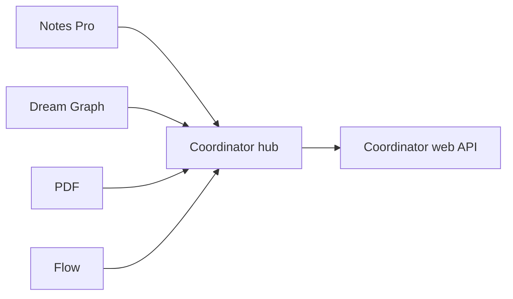

# Account & Cloud Sync — Appfactory Studio (progressive plan)

Cross-cutting plan for **studio authentication**, **per-app cloud sync**, and
**Coordinator as the aggregation hub**. This folder is intentionally **progressive**
— we add documents and phases as prerequisites land, not as one upfront spec.

## Status

| Area | Status |
|------|--------|
| **Server-side API auth** | ✅ **Shipped** — Coordinator, Flow, Dream Graph, Notes Pro, PDF Editor all now validate a Checkpoint bearer instead of trusting client headers; [07 § Phase S0.5 / S0.5g](07-unified-sync-orchestration.md#phase-s05--server-side-bearer-enforcement-blocks-all-sync) |
| Studio sign-in / session | **Planned** — [06-studio-authentication.md](06-studio-authentication.md) |
| Unified sync orchestration | **Planned** — [07-unified-sync-orchestration.md](07-unified-sync-orchestration.md) |
| Dream Graph cloud sync | **Draft** — [01-cloud-sync.md](01-cloud-sync.md) |
| Engine tilemap live sync | **Draft** — [02-engine-live-sync.md](02-engine-live-sync.md) |
| Coordinator PM cloud sync | **Draft** — [03-coordinator-pm-sync.md](03-coordinator-pm-sync.md) |
| Desktop apps → Coordinator hub | **Draft** — [04-desktop-apps-report-to-coordinator.md](04-desktop-apps-report-to-coordinator.md) |
| Flow cloud sync | **Draft** — [05-flow-cloud-sync.md](05-flow-cloud-sync.md) |

## Relationship to desktop app ports

| App | Offline plan | Cloud continues here |
|-----|--------------|----------------------|
| [Dream Graph](../dream-graph/README.md) | Phases 0–6 ✅ complete | [01-cloud-sync.md](01-cloud-sync.md), [02-engine-live-sync.md](02-engine-live-sync.md) |
| [Coordinator](../coordinator/README.md) | Phases 0–11 ✅ complete | [03-coordinator-pm-sync.md](03-coordinator-pm-sync.md), [04-desktop-apps-report-to-coordinator.md](04-desktop-apps-report-to-coordinator.md) |
| [Flow](../flow/README.md) | Phases 0–5 ✅ complete | [05-flow-cloud-sync.md](05-flow-cloud-sync.md), reporter in [04-desktop-apps-report-to-coordinator.md](04-desktop-apps-report-to-coordinator.md) |
| Notes Pro | Port complete (no cloud doc yet) | Reporter in [04-desktop-apps-report-to-coordinator.md](04-desktop-apps-report-to-coordinator.md) |
| PDF | Port complete (no cloud doc yet) | Reporter in doc 04 |

Offline ports leave **schema hooks** (`cloud: null`, optional `sync.json`) so sync
can attach later without rewriting local storage.

## Coordinator as the hub

Every other Appfactory Studio app is a **source**; Coordinator is the **aggregator**:

When sync is enabled, source apps **report metadata** on save; Coordinator PM data
**syncs** to the web workspace. Full design: [04-desktop-apps-report-to-coordinator.md](04-desktop-apps-report-to-coordinator.md).

## Prerequisite chain

1. **Dream Graph offline MVP** — ✅ complete (Phases 0–6)
2. **Flow offline MVP** — ✅ complete (Phases 0–5)
3. **Coordinator offline MVP** — ✅ complete (Phases 0–11)
4. **Studio authentication** — [06-studio-authentication.md](06-studio-authentication.md) (Checkpoint IdP; primary users only on desktop/mobile)
4.5 **Server-side bearer enforcement** — ✅ [07 § Phase S0.5](07-unified-sync-orchestration.md#phase-s05--server-side-bearer-enforcement-blocks-all-sync). Coordinator's `/api/pm/*` + `/api/afs-connect/*` and Flow's `/api/flow/*` + `/api/pm/*` now validate the bearer server-side instead of trusting `X-User-Id`. Step 4 (desktop `StudioAuthService`, the client half of C1) is still not started — sync still cannot ship until it lands.
5. **Shared sync infrastructure** — [07-unified-sync-orchestration.md](07-unified-sync-orchestration.md)
6. **Coordinator PM sync** — [03-coordinator-pm-sync.md](03-coordinator-pm-sync.md)
7. **Per-app cloud sync** — Dream Graph [01-cloud-sync.md](01-cloud-sync.md); Flow [05-flow-cloud-sync.md](05-flow-cloud-sync.md); Notes/PDF TBD
8. **Hub UI + reporters** — [04-desktop-apps-report-to-coordinator.md](04-desktop-apps-report-to-coordinator.md)
9. **Engine live sync** — [02-engine-live-sync.md](02-engine-live-sync.md)

## Documents (current)

| Doc | Purpose |
|-----|---------|
| [01-cloud-sync.md](01-cloud-sync.md) | Desktop ↔ Dream Graph web (HTTP API, sync modes, conflicts) |
| [02-engine-live-sync.md](02-engine-live-sync.md) | Desktop ↔ cloud ↔ Joystick engine (bearer token tilemap protocol) |
| [03-coordinator-pm-sync.md](03-coordinator-pm-sync.md) | Desktop ↔ Coordinator web PM workspace push/pull |
| [04-desktop-apps-report-to-coordinator.md](04-desktop-apps-report-to-coordinator.md) | Source apps report metadata; AFS Connect hub in desktop |
| [05-flow-cloud-sync.md](05-flow-cloud-sync.md) | Desktop ↔ Flow web REST sync + offline queue |
| [06-studio-authentication.md](06-studio-authentication.md) | Checkpoint IdP; desktop/mobile auth; secondary user policy |
| [07-unified-sync-orchestration.md](07-unified-sync-orchestration.md) | Shared adapters, IPC, phase order tying 01–05 together |

## Key auth decisions (summary)

| Decision | Detail |
|----------|--------|
| IdP | Checkpoint (`apps/auth`) — dev `auth15`, prod `auth` |
| Desktop env flag | `IS_PRODUCTION` boolean in `afsdesktop5/.env` → sets `isProduction` (one switch drives every host) |
| Desktop app name | `APPFACTORY_STUDIO` — ✅ registered in `CheckpointAppName` + all `app-names.ts` mirrors + `afsdesktop5`'s own copy; see [06 § Checkpoint app registration](06-studio-authentication.md#checkpoint-app-registration-c1a-prerequisite) |
| Secondary users | **Web only on native** — enforced in desktop's own login flow (it never completes a secondary session); the server-side APIs *authenticate* secondary tokens correctly (Coordinator PM and Flow settings both have real secondary/team-member features) rather than blanket-rejecting them — see [06 § What "server-side" turned out to mean](06-studio-authentication.md) |
| Desktop → Coordinator transport | Engine-surface pattern (`afs_connect.engine`, per-user bearer) — **not** the HMAC internal ingest; see [04 § Reporter transport](04-desktop-apps-report-to-coordinator.md#reporter-transport--use-the-engine-surface-not-the-internal-ingest) |
| Mobile | Primary `loginNormal` only; see Flutter analysis in doc 06 |
| Sync prerequisite | Auth phase **C1** before any `RemoteStorageAdapter` network I/O |

## Related references

| Document | Relevance |
|----------|-----------|
| [../dream-graph/03-data-model-and-files.md](../dream-graph/03-data-model-and-files.md) | Dream Graph on-disk hooks |
| [../coordinator/03-data-model-and-files.md](../coordinator/03-data-model-and-files.md) | Coordinator on-disk hooks |
| `apps/auth/CHECKPOINT_DOCUMENTATION.md` | Checkpoint API reference |
| `apps/afsserver/plans/afs-connect/` | Web AFS Connect hub design |
| `apps/coordinator/` | Coordinator web app (PM + hub) |
| `apps/www/_docs/tilemap/08-live-sync-protocol.md` | Canonical tilemap pull/push wire protocol |

## How to extend this plan

Add new numbered docs only when a topic is ready to implement. Auth (06) and
orchestration (07) are the current master plans; per-app sync docs stay focused on
entity endpoints and conflict rules.

Completion notes for cloud phases: create `account-and-cloud-sync/complete/` when
C1 (studio auth) implementation begins.
