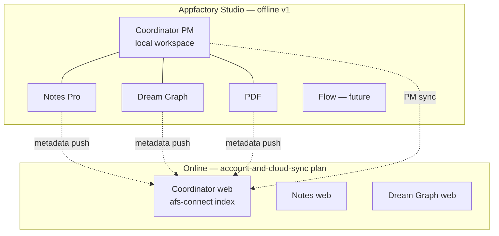

# 00 — Overview

## What Coordinator is

Coordinator is two distinct products sharing one web shell:

| Layer | Purpose | Offline desktop v1 |
|-------|---------|-------------------|
| **PM tool** | Project management — tasks, kanban, table, gantt, budget, teams | ✅ **Port fully (offline)** |
| **AFS Connect hub** | Cross-app index, search, links, insights across Notes / Dream Graph / Flow / PDF | ❌ **Defer to cloud sync plan** |

On the web, both layers share Checkpoint auth and Laravel persistence. On desktop,
Phase 0–11 delivers the PM tool with local file storage. The hub layer attaches
later when studio auth and per-app sync adapters exist.

## Why Coordinator is the hub app

Every other Appfactory Studio app is a **source**; Coordinator is the **aggregator**:

Offline: each app is independent. Online: source apps **report metadata** to
Coordinator; Coordinator PM data **syncs** to the web workspace. Full design:
[../account-and-cloud-sync/04-desktop-apps-report-to-coordinator.md](../account-and-cloud-sync/04-desktop-apps-report-to-coordinator.md).

## Goals (offline desktop port)

1. **Full PM functionality** available without network — same views as web (`dashboard`, `kanban`, `task`, `table2`, `gantt`, `budget2`, `settings`).
2. **Source-first data model** — `ProjectData.source: SourceTask[]` is canonical; derived views rebuilt by `project-sync.ts` (identical to web).
3. **Local persistence** — main-process store mirrors web `PmPersistenceService` payload shape (`projectDataToPersistPayload`).
4. **Nav integration** — Coordinator under **Apps**, **above Notes**, following the 7-file afsdesktop5 wiring pattern.
5. **No Checkpoint gate in offline v1** — local workspace with seeded demo users; auth attaches in cloud sync plan.
6. **Schema hooks** for future sync — `cloud: null`, optional `sync.json` in workspace manifest (same pattern as Dream Graph).

## Non-goals (offline v1)

- Checkpoint login / SSO redirect on app launch
- `fetch('/api/pm/*')` or Laravel backend
- AFS Connect views (`#/afs-connect`), cross-app search, item links, insights
- Brain API member resolution, Parse entitlement, Flagsmith
- Engine surface (`/api/engine/v1/connect/*`)
- Real-time collaborative editing across desktop instances
- Porting `public/core/` legacy PHP stack

## Glossary

| Term | Meaning |
|------|---------|
| **Workspace** | One member's PM data: projects list, teams, users, per-project `ProjectData` |
| **ProjectData** | In-memory shape for one project: `source[]` + derived views + budget + activity |
| **SourceTask** | Canonical flat task tree node — single write path for all PM views |
| **Derived views** | `tasks`, `tableData`, `kanbanColumns`, `ganttData`, `stats` — rebuilt, not persisted |
| **SyncOrigin** | Which view triggered a persist (for activity log attribution) |
| **AFS Connect** | Cross-app metadata hub (web only until cloud sync plan) |
| **`.coordproj`** | Desktop on-disk project payload file (see [03-data-model-and-files.md](03-data-model-and-files.md)) |

## Relationship to other desktop ports

| App | Relationship to Coordinator |
|-----|----------------------------|
| **Notes Pro** | Future: Notes metadata indexed in Coordinator; task ↔ note links |
| **Dream Graph** | Future: graph/tilemap metadata indexed; task ↔ graph links |
| **PDF** | Future: document metadata indexed; task ↔ PDF links |
| **Flow** | Future source app (not yet in afsdesktop5) |
| **Sync (P2P)** | Unrelated — local network file sync, not AFS Connect |

Dream Graph offline port is **complete** (Phases 0–6). Coordinator should reuse
its lessons (main store, IPC, scoped CSS, phase gates) but port the **vanilla TS**
SPA rather than React.

## Web internal roadmap (reference only)

The web app has an advanced-features plan at
`apps/coordinator/resources/js/_plan/overall/` (SourceTask v2, dashboard v2,
gantt v2, command palette, etc.). Desktop offline v1 ports **current shipped web
functionality** first. Advanced features from that plan are **optional stretch
phases** after Phase 11 — not blockers for offline MVP.

## Success criteria (offline MVP complete)

- Create workspace → add projects → manage tasks across kanban, list, table, gantt
- Budget2 create/edit/submit flow works locally
- Restart app → all data intact
- Export/import project JSON round-trip
- Webpack build succeeds; other afsdesktop5 views unaffected
- AFS Connect nav item **absent** or hidden until cloud sync plan Phase C
