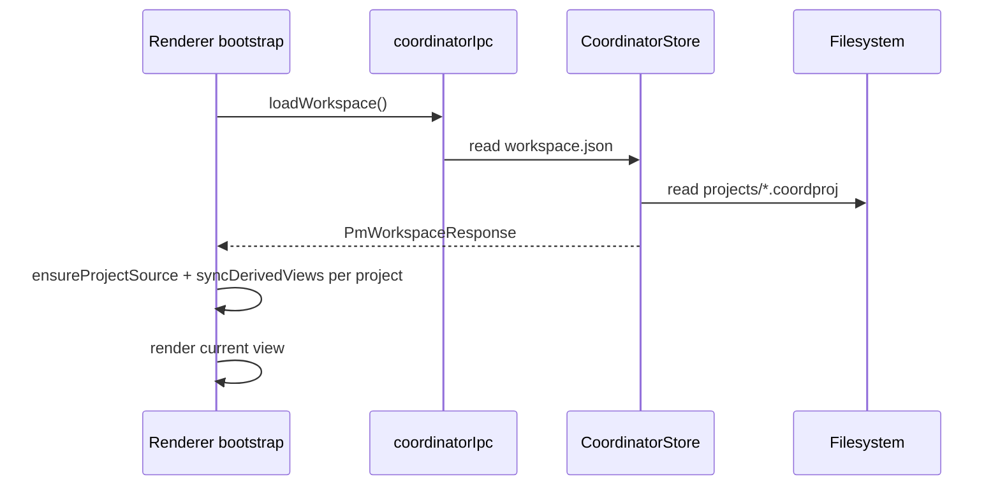

# 03 — Data Model and On-Disk Files

Local persistence contract for Coordinator desktop. Mirrors web **API payload shape**,
not normalized MySQL rows.

## Workspace envelope

Stored in `~/Documents/afsfiles/coordinator/workspace.json`:

```json
{
  "format": "coordinator-desktop/1",
  "version": 1,
  "cloud": null,
  "currentProject": 1,
  "users": [ /* User[] */ ],
  "projects": [ /* { id, name, description }[] */ ],
  "teams": [ /* Team[] */ ],
  "updatedAt": "2026-07-31T18:00:00.000Z"
}
```

| Field | Notes |
|-------|-------|
| `format` | Must be `coordinator-desktop/1` |
| `cloud` | `null` offline; future sync block (see cloud sync plan) |
| `currentProject` | Last active project id |
| `users` | Local roster — demo users in v1; Checkpoint users when online |
| `projects` | Metadata only — payload in separate files |
| `teams` | Team defs + member lists |

## Per-project payload (`.coordproj`)

Path: `projects/{id}.coordproj`

Matches `projectDataToPersistPayload()` from web `project-persist.ts`:

```json
{
  "format": "coordinator-project/1",
  "projectId": 1,
  "source": [ /* SourceTask[] — canonical */ ],
  "kanbanColumns": [ /* { id, name } only — no cards */ ],
  "budget2Data": { /* or null */ },
  "budget2Archive": { /* optional */ },
  "activity": [],
  "history": [],
  "tagRegistry": [],
  "updatedAt": "2026-07-31T18:00:00.000Z"
}
```

**Not persisted** (rebuilt on load by `project-sync.ts`):
- `tasks`, `tableData`, kanban cards, `ganttData`, `stats`

## SourceTask (canonical task node)

From web `types.ts` — port verbatim:

| Field | Type | Notes |
|-------|------|-------|
| `id` | number | Client-assigned id |
| `parent` | number \| null | Tree parent |
| `title` | string | |
| `description` | string | |
| `status` | string | Maps to kanban column |
| `priority` | string | |
| `progress` | number | 0–100 |
| `duration` | number | Hours estimate |
| `assignees` | number[] | User ids |
| `startDate` | string \| null | ISO date |
| `dueDate` | string \| null | ISO date |
| `completed` | boolean | |
| `collapsed` | boolean | Table tree UI |

Future SourceTask v2 fields (tags, dependencies, comments) from web `_plan/overall/`
are **additive** — desktop store must tolerate unknown optional fields.

## ProjectData (in-memory)

After load + sync:

```typescript
interface ProjectData {
  source: SourceTask[];
  tasks: Task[];
  tableData: TableRow[];
  kanbanColumns: KanbanColumn[];  // includes cards (derived)
  ganttData: GanttRow[];
  stats: ProjectStats;
  budget2Data: Budget2Data | null;
  budget2Archive?: Record<string, Budget2Data>;
  activity: ActivityEvent[];
  history: StatsSnapshot[];
  tagRegistry: TagDef[];
}
```

## Load pipeline



## Save pipeline

1. View mutates via `getProjectManager(id).patchTask(...)` or equivalent.
2. `persistProject(id, origin)` debounced (~1.5s, match web).
3. `projectDataToPersistPayload(data)` strips derived views.
4. IPC `save-project` → main writes `.coordproj` atomically.
5. Workspace metadata save (project list changes) → `save-workspace`.

## ID assignment

Web uses client-assigned integer ids for tasks/projects/users. Desktop continues
same scheme offline:

- New project: `max(existing ids) + 1`
- New task: per-project counter or global max in `source`

Persist id counters in `workspace.json` if needed to avoid collision after import.

## First-run behavior

If `workspace.json` missing:

1. Create `coordinatorDir` under `get-app-dirs`.
2. Seed from `load-demo-data.ts` (same demo projects as web dev mode).
3. Write initial `workspace.json` + demo `.coordproj` files.
4. Set `currentProject` to first demo project.

## Future sync hooks

Optional `~/Documents/afsfiles/coordinator/sync.json` (created only when cloud sync enabled):

```json
{
  "linkedMemberRef": "M12345",
  "lastPullAt": null,
  "lastPushAt": null,
  "conflictPolicy": "local-wins"
}
```

Per-project `cloud` block inside `.coordproj` (optional):

```json
{
  "cloud": {
    "remoteProjectId": null,
    "linkedAt": null
  }
}
```

Full sync design: [../account-and-cloud-sync/03-coordinator-pm-sync.md](../account-and-cloud-sync/03-coordinator-pm-sync.md)

## Atomic write pattern

Match Notes Pro / Dream Graph:

```typescript
const tmp = `${targetPath}.tmp`;
fs.writeFileSync(tmp, JSON.stringify(payload, null, 2));
fs.renameSync(tmp, targetPath);
```

## Schema reference (web MySQL)

For field parity when implementing cloud sync later, reference:

- `database/migrations/2026_07_13_*_pm_*.php`
- `app/Services/Pm/PmPersistenceService.php`

Desktop JSON is the **serialization of the API payload**, not a 1:1 SQL export.

## Validation / healing

On load, run `normalizeProjectDataRaw()` (from web `project-sync.ts`) to heal:
- Missing `source` → derive from legacy shapes if present
- Missing kanban columns → default columns
- Orphan parent ids → flatten or re-parent

Log warnings to console; do not crash on minor schema drift.
