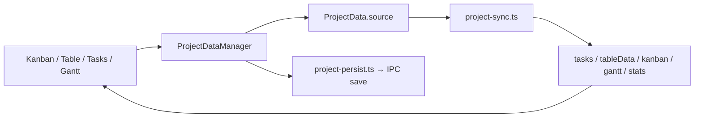

# 05 — Source-First Sync Engine

The **client-side** projection engine — not cloud sync. This is Coordinator's
architectural core and must port **verbatim** before any PM view work.

## Principle

> Every mutation goes through `source[]`. Derived views are never written to disk.



## Core modules (copy first)

| File | Responsibility |
|------|----------------|
| `project-sync.ts` | `ensureProjectSource`, `syncDerivedViews`, `projectDataFromSeed`, `normalizeProjectDataRaw` |
| `project-data-manager.ts` | `ProjectDataManager` class — `patchTask`, `addTask`, `moveTask`, column ops, `persistProject(origin)` |
| `project-persist.ts` | `projectDataToPersistPayload` — strips derived views |
| `types.ts` | `SourceTask`, `ProjectData`, `KanbanColumn`, `SyncOrigin`, etc. |

## SyncOrigin attribution

Every persist call carries origin for activity log:

```typescript
type SyncOrigin =
  | 'kanban'
  | 'table'
  | 'task-list'
  | 'gantt'
  | 'budget'
  | 'settings'
  | 'import';
```

Views pass origin when calling `persistProject(id, origin)`.

## Projection rules (summary)

| Derived | Built from |
|---------|------------|
| `tasks` | Flatten `source` tree with depth metadata |
| `tableData` | Hierarchical rows with collapse state |
| `kanbanColumns` | Column defs + cards grouped by `status` |
| `ganttData` | Tasks with date ranges on timeline |
| `stats` | Aggregates: counts by status, overdue, completion % |

Full logic stays in `project-sync.ts` — **do not reimplement** in desktop.

## Debounced persist

Web pattern (preserve in desktop):

```typescript
// state.ts
let persistTimer: ReturnType<typeof setTimeout> | null = null;

export function schedulePersist(projectId: number, origin: SyncOrigin) {
  if (persistTimer) clearTimeout(persistTimer);
  persistTimer = setTimeout(() => {
    void persistProject(projectId, origin);
  }, 1500);
}
```

On navigate away from Coordinator view: **flush** pending timer immediately.

## Load-time sync

After IPC load:

```typescript
for (const [id, raw] of Object.entries(workspace.projectData)) {
  const data = normalizeProjectDataRaw(raw);
  ensureProjectSource(data);
  syncDerivedViews(data);
  projectData[Number(id)] = data;
}
```

## Kanban column persistence nuance

Only column **definitions** persist (`{ id, name }`). Card placement is derived
from `source[].status`. On load:

1. Restore column defs from payload
2. Run `syncDerivedViews` to rebuild cards from `source`

## Budget2 isolation

Budget2 mutates `budget2Data` directly (not through `source[]`) but still calls
`persistProject(id, 'budget')` after changes. Port budget save path unchanged.

## Activity log

Mutations append to `projectData.activity[]` via helpers in `src/activity/`.
Activity entries persist in `.coordproj`. Notifications UI reads activity in
Phase 10 (can use seed + real entries).

## Testing strategy

Port web Vitest tests where they exist:

| Test location | Covers |
|---------------|--------|
| `budget2/__tests__/` | Budget calculations |
| Manual smoke | Create task in table → appears in kanban after sync |

Add desktop unit tests for `project-sync.ts` if web tests don't exist — use same
fixture seeds from `load-demo-data.ts`.

## What this doc is NOT

Cloud sync, AFS Connect indexing, and cross-app reconciliation are **not**
part of this engine. See:

- [../account-and-cloud-sync/03-coordinator-pm-sync.md](../account-and-cloud-sync/03-coordinator-pm-sync.md) — PM workspace push/pull
- [../account-and-cloud-sync/04-desktop-apps-report-to-coordinator.md](../account-and-cloud-sync/04-desktop-apps-report-to-coordinator.md) — hub indexing

The source-first engine runs **identically offline and online**; only the
persistence adapter changes (`coordinatorIpc` vs `pm-api.ts`).
