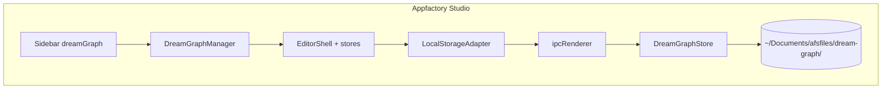

# 02 — Desktop Architecture

How Dream Graph lives inside **Appfactory Studio** (`apps/afsdesktop5`).

## Reference pattern: Notes Pro

Notes Pro already demonstrates the target architecture:

```
Renderer                          Main process
────────                          ────────────
notesPro/index.ts                 main/notesPro/index.ts  (IPC handlers)
notesPro/ipc.ts                   main/notesPro/store.ts  (filesystem)
html/notesPro.html
views.ts → 'notesPro'
renderer.ts → initUI on navigate
~/Documents/afsfiles/notes/       JSON note files + attachments
```

Dream Graph follows the same shape with a **larger** store (graphs + tilemaps +
assets).

## Proposed module layout (afsdesktop5)

```
src/
  main/
    dreamGraph/
      index.ts          # ipcMain.handle registrations
      store.ts          # DreamGraphStore — atomic read/write
      exportBundle.ts   # .dgpack + joystick-tilemap zip (Phase 6)
      paths.ts          # projectsDir under get-app-dirs
  renderer/
    html/dreamGraph.html
    components/dreamGraph/
      index.ts          # DreamGraphManager — initUI, mount React root
      ipc.ts            # typed invoke wrappers
      bootstrap.tsx     # EditorShell without web auth redirect
      adapters/
        localAdapter.ts # implements graph + tilemap API surface
    views.ts            # dreamGraph: renderTemplate(dreamGraphHtml)
    components/sidebar.ts, search.ts, locales.json
```

## View shell HTML

Minimal container — React owns the interior (like `notesPro.html`):

```html
<div id="dreamGraph-root" class="dg-shell"></div>
```

Styles: prefix `#dreamGraph-root` to avoid colliding with app shell CSS.
Import web SCSS incrementally; do **not** dump Bootstrap globally unless
scoped (Notes Pro uses dedicated token/shell CSS files).

## Webpack considerations

Dream Graph web uses Vite + many dependencies (`@xyflow/react`, zustand, …).

**Options (pick in Phase 0 spike):**

| Option | Pros | Cons |
|--------|------|------|
| **A. Add deps to afsdesktop5 webpack** | Single bundle, matches Notes Pro | Bundle size, version alignment |
| **B. Pre-build dream_graph UI as library** | Cleaner separation | Extra build step, path complexity |
| **C. Copy subset of TS into afsdesktop5** | Incremental | Duplication until unified |

**Recommendation:** Option A for parity with Notes Pro — add `@xyflow/react`,
`zustand`, and required peers to `afsdesktop5/package.json`. Port modules
from `dream_graph/resources/js` via relative copy or monorepo path alias
(`@dream-graph/*` → copied folder). Avoid second CSS framework explosion;
reuse existing glass-card / sidebar chrome from shell only.

**Critical constraint (from PDF port):** Do **not** change webpack `publicPath`
without proof. Load workers/assets like existing pdf.js setup.

## Storage adapter pattern

Replace `resources/js/graph/api/client.ts` and `tilemapClient.ts` with:

```typescript
interface GraphProjectApi {
  listProjects(): Promise<ProjectSummary[]>;
  createProject(name: string): Promise<ProjectRecord>;
  openProject(id: string): Promise<ProjectBundle>;
  saveProject(id: string, patch: Partial<ProjectRecord>): Promise<void>;
  // ... graph, node, connection methods mirroring REST shapes
}

interface TilemapApi {
  loadDocument(projectId: string, tilemapId: string): Promise<TilemapDoc>;
  saveChunks(projectId: string, tilemapId: string, payload: ChunkFlush): Promise<{ version: number }>;
  // ...
}
```

**Offline implementation:** `localAdapter.ts` → `ipcRenderer.invoke('dream-graph:...')`.

**Future online implementation:** `remoteAdapter.ts` → HTTP to Dream Graph API,
using credentials from the **studio auth plan** (out of scope here).

Store interface stays identical; `projectStore` / `tilemapStore` unchanged.

## Main process store responsibilities

`DreamGraphStore` (mirrors Eloquent semantics in filesystem):

| Operation | Notes |
|-----------|-------|
| List projects | Scan `pdfsDir`-like `dreamGraphDir` for `*.dgproj/` folders |
| Create project | Write `manifest.json` + seed root graph with Entry node |
| Load graph content | Read `graphs/{uuid}.json` |
| Save graph content | Atomic write (tmp + rename); bump `updated_at` |
| Save tilemap chunks | Write `tilemaps/{uuid}/chunks/{layer}/{cx}_{cy}.rle` or inline JSON |
| Asset write | Copy bytes to `assets/{uuid}.{ext}`; update manifest index |
| Export bundle | Sync zip in main (port PHP export logic or invoke shared Node script) |

Use **`get-app-dirs` IPC** pattern — extend with `dreamGraphDir`:
`~/Documents/afsfiles/dream-graph/projects/`.

## Renderer bootstrap (no web auth)

Web `main.tsx` redirects unauthenticated users. Desktop `bootstrap.tsx` mounts
the editor with the local adapter only — no Parse/Checkpoint init in offline v1.

## Navigation integration

| File | Change |
|------|--------|
| `index.html` | Nav item `data-view="dreamGraph"` under Apps |
| `views.ts` | Register template |
| `renderer.ts` | Import manager, `initUI` on navigate |
| `sidebar.ts` | Map view → i18n key |
| `search.ts` | Search entry |
| `locales.json` | `sidebar.dreamGraph`, `dreamGraph.*` |

## IPC channel naming

Prefix: `dream-graph:` (kebab, consistent with existing handlers).

Examples:

```
dream-graph:list-projects
dream-graph:create-project
dream-graph:open-project
dream-graph:save-graph-content
dream-graph:save-tilemap-chunks
dream-graph:write-asset
dream-graph:read-asset
dream-graph:export-bundle
dream-graph:import-bundle
dialog-open-file / dialog-save-file  (reuse existing)
```

## Threading and performance

- **Graph autosave:** debounce in renderer (5s); IPC save must be async non-blocking
- **Tilemap flush:** 1.5s debounce; chunk payloads can be large — main process
  writes sequentially per tilemap
- **TilemapSurface:** stays on renderer main thread (canvas); do not move paint
  to main process
- **Export zip:** run in main process; show progress via IPC events if >500ms

## Security (offline)

- Projects are local user files — no token storage in v1
- Future sync tokens stored per-project in `.dgproj/sync.json` (git-ignored
  equivalent: outside bundle export by default)
- Never embed service keys in renderer bundle

## Testing strategy

| Level | What |
|-------|------|
| Unit | RLE round-trip, chunk key math, graph hydrate/dehydrate |
| Integration | IPC open/save project round-trip |
| Manual | Open sample `.dgpack` import, edit graph, open tilemap, export zip |
| Parity | Compare exported `joystick-tilemap/1` with web export bytes (Phase 6) |

## Diagram



Future online path adds `RemoteStorageAdapter` when the studio auth plan
provides API credentials (see [../account-and-cloud-sync/README.md](../account-and-cloud-sync/README.md)).
