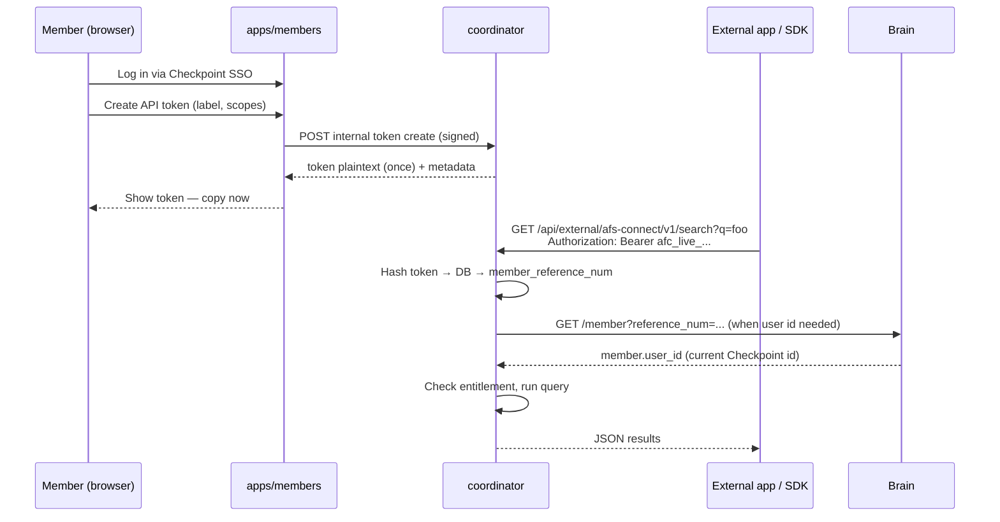

# 00 — Overview

## Problem

External applications (Unity, Unreal tooling, mobile apps, CI scripts, third-party SaaS) need to talk to coordinator afs-connect **from code**. They cannot realistically:

- Open a browser and complete Checkpoint SSO on every run
- Embed Checkpoint client credentials in a shipped binary
- Use the Joystick engine surface (`/api/engine/v1/connect/*`), which is tied to the `GAME_EDITOR` Checkpoint app and `joystick_engine` source key

The language SDKs in `apps/afsconnect` were initially documented against Checkpoint session headers and engine Bearer tokens. That works for coordinator's own web UI and Joystick, not for generic external code.

## Goal

Add a **generic external API** on coordinator with **member-issued API tokens**:

1. A logged-in member creates a token in the **members application** (browser SSO is fine here — humans log in once).
2. They copy the token into their external app / SDK config.
3. The external app calls **new dedicated routes** on coordinator with **`Authorization: Bearer {token}` only** — no member user id, no Checkpoint user id, no `user_id` query param.
4. Coordinator hashes the token, loads **`member_reference_num`** from `afsconnect_api_tokens`, and when a Checkpoint user id is needed (activity audit, live item fetches), calls **Brain** `GET /member?reference_num=...` → `member.user_id`. That id is always current — it is **not** stored on the token row.

This is a **fourth auth surface**, distinct from the three that exist today:

| Surface | Path prefix | Auth | Consumer |
|---------|-------------|------|----------|
| PM (browser) | `/api/afs-connect/*` | `X-User-Id` + `X-Checkpoint-User-Id` | Coordinator web app |
| Internal ingest | `/api/internal/afs-connect/v1/*` | HMAC service key | notes, flow, www, … |
| Engine (Joystick) | `/api/engine/v1/connect/*` | Checkpoint Bearer (`GAME_EDITOR`) | Joystick desktop |
| **External SDK (new)** | `/api/external/afs-connect/v1/*` | **Bearer token only** — identity from DB row | Unity, mobile, CLI, `apps/afsconnect` |

Existing routes stay unchanged. External SDKs migrate to the new prefix; coordinator web and internal apps are unaffected.

## Non-goals (v1)

- Replacing Checkpoint for the coordinator or members web UIs
- Replacing HMAC ingest for internal Appfactory source apps
- OAuth2 / third-party app marketplace authorization flows
- Per-token IP allowlists (consider v2)
- Token-based write access to coordinator PM tasks (tasks stay on engine/Joystick path or future phase)

## High-level flow

## Token-only identity (external API)

Unlike the coordinator web app (`/api/afs-connect/*`), which sends `X-User-Id`, `X-Checkpoint-User-Id`, and `?user_id=` on every request, **external SDK callers send a single credential: the API token.**

| Field | PM web API | External SDK API |
|-------|------------|------------------|
| `Authorization: Bearer` | No (uses session headers) | **Yes — only auth input** |
| `X-User-Id` | Required | **Not used — ignored if sent** |
| `X-Checkpoint-User-Id` | Required | **Not used — ignored if sent** |
| `?user_id=` query | Required on most routes | **Not used — ignored if sent** |
| `member_reference_num` | Resolved server-side from user id | **From token row** |
| Checkpoint `user_id` (acting user) | From request header | **From Brain `member.user_id` via `member_reference_num`** — never stored on token |

When a token is **created** in the members app (browser session), coordinator persists **only `member_reference_num`** on the token record (plus name, scopes, hash). External code never needs member ids — only the opaque secret.

**Why not store `created_by_checkpoint_user_id` on the token?** Membership primary user can change in Brain over time. Storing a checkpoint user id on the token would go stale. Resolving `user_id` from Brain on each request (with the same cache pattern as `FunctionsController::resolveMemberReferenceNum`) keeps audit and live-fetch behavior correct.

## Where token UI lives (members app)

The user suggested `MarketController.ts`. That file today only navigates between **Freelance** and **Asset Store** views — it is not a settings or credentials surface.

**Recommended placement:** extend the existing **AFS Connect settings card** in `members/resources/js/templates/views/settings.html` (already wired by `afsConnectSettings.ts` and `AfsConnectSettingsController.php`). Add an **“API access”** subsection below the source toggles:

- List tokens (name, prefix, scopes, last used, created)
- Create token (name + read / read-write scope)
- Revoke token

**Alternative (phase 2):** a dedicated **Developer** or **Integrations** settings tab if more API products appear later. Do not use MarketController unless the product decision is to group API keys with marketplace seller tools.

## Apps touched

| App | Role |
|-----|------|
| **coordinator** | Token storage, validation middleware, external route controllers, internal token CRUD for members |
| **members** | Token management UI + proxy routes (Checkpoint session required) |
| **apps/afsconnect** | SDK docs + clients switch to external routes + Bearer token (after backend ships) |
| **afsserver/plans** | This plan folder |

**Not touched in v1:** auth (Checkpoint), notes/flow/www source apps, Brain admin (except optional ops visibility later).

## Success criteria

1. Member with afs-connect enabled can create a token in members settings.
2. External script with **only** the Bearer token (no user ids) can `GET /api/external/afs-connect/v1/status` and `GET .../search?q=...`.
3. Token without entitlement returns `503` (same semantics as PM API).
4. Revoked or invalid token returns `401`.
5. Plaintext token is shown **once** at creation; database stores hash only.
6. Language SDK config is **`coordinatorUrl` + `apiToken` only** — no user ids of any kind.

## Open decisions (resolve before coding)

| # | Question | Recommendation |
|---|----------|----------------|
| 1 | Store tokens in coordinator DB or members DB? | **Coordinator** — validation happens there; members proxies CRUD via signed internal API (same pattern as settings) |
| 2 | Token prefix format? | `afc_live_` + 32 random bytes (base62 or hex) |
| 3 | Scopes in v1? | `read` and `read_write` (`read_write` adds snapshot + activity push) |
| 4 | Who can create tokens? | Any Checkpoint user on the membership with permission to open members settings; optional: primary member only |
| 5 | Max tokens per member? | Default 10 (configurable) |
| 6 | Source app for external pushes? | One registry key e.g. `external_sdk` — registered in `config/afs_connect_sources.php`, toggled like other sources |

See following documents for detail.
