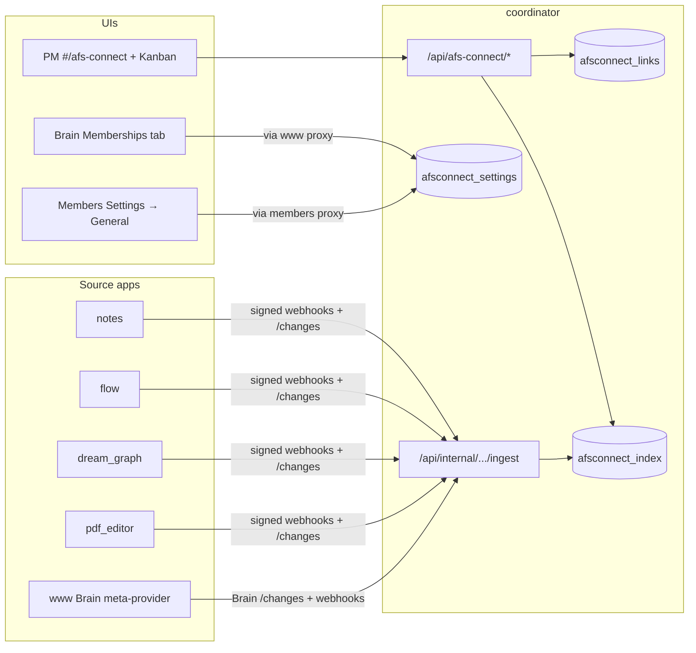

# How afs-connect works

This document is a **standalone, implementation-oriented guide** to the afs-connect feature as built in the Appfactory monorepo. It explains what the feature does, how membership and billing gates interact with it, how the **Brain** portal admin fits in, what **backfill** means, and how **notes**, **flow**, **dream_graph**, **pdf_editor**, **www**, **members**, and **coordinator** exchange data.

For the original design specs, start at [afs-connect/README.md](./afs-connect/README.md). For a step-by-step build log, see [afs-connect/complete/README.md](./afs-connect/complete/README.md).

> **Planned changes are marked ⏳ throughout.** Two planned steps change this
> document's contents materially, and both are specified in the Joystick engine
> plan repo because that is where their sequencing is tracked:
>
> | Step | File | What it changes here |
> |---|---|---|
> | **60** | `JoystickEngine_v2/plan/steps/60_afs_connect_platform.md` | Billing moves from a boolean plan flag to **alloc_v2 metered allocation** (§4, §14); the **source registry** replaces eleven registration sites (§14); settings columns become privacy/packaging JSON maps (§4); per-source staleness and link orphaning are added (§8, §10) |
> | **61** | `JoystickEngine_v2/plan/steps/61_afs_connect_engine.md` | The **Joystick game engine** joins as the first `hosted` source (§9, §14) |
>
> Contract detail for those changes lives in two new specs:
> [11-billing-and-allocation.md](./afs-connect/11-billing-and-allocation.md) and
> [12-source-registry.md](./afs-connect/12-source-registry.md).
>
> A **separate, independent** effort —
> [alloc-v2-parse-direct/](./alloc-v2-parse-direct/) — makes alloc_v2 usable
> from any client (desktop, mobile, CLI) by talking to the Parse registry
> directly instead of through a per-application PHP proxy that was never
> implemented. afs-connect consumes allocation behind a seam and is unaffected
> by which transport is in place, so the two land in either order.

---

## 1. What afs-connect is

**afs-connect** connects project management in **coordinator** with **metadata about work** spread across other apps:

- **Creative apps:** notes, flow, dream_graph, pdf_editor (shared “apps” database pattern; each app owns its tables and business logic).
- **Website / portal modules (www):** forms, direct payments, sponsorships, appointments, and related modules indexed per **website** (tenant), because each member site has its own database.
- ⏳ **The Joystick game engine** (step 61): a desktop application, not a web app — the first **`hosted`** source. It pushes; coordinator stores. Game projects, scenes, scripts, build profiles, development activity and git commits become searchable and task-linkable.

Coordinator does **not** replace those apps. It maintains a **searchable index** of titles, snippets, URLs, source types, and website dimensions, plus **links** from PM tasks to indexed items. When someone opens an item, coordinator usually **fetches live detail** from the source app rather than trusting stale index content for full payloads.

Typical PM workflows:

- Search “everything we have” for a member from `#/afs-connect`.
- Attach a note, flow project, PDF, or www form to a **PM task**.
- See **Kanban badges** for how many links a task has; open an **item drawer** for detail.
- See **insights** (tasks with no links, recent indexed items with no links).

---

## 2. Coordinator as the hub

Coordinator is the **system of record** for:

| Store | Role |
|--------|------|
| `afsconnect_settings` | Per-member master switch, per-source toggles, www module toggles, disabled website domains, backfill timestamps |
| `afsconnect_index` | Denormalized metadata rows (one row per logical item: source app + source id [+ website keys for www]) |
| `afsconnect_links` | Join rows: e.g. `linkable_type = pm_task`, `linkable_client_id`, → index item |
| `afsconnect_activity_log` | Timeline of ingest/link events for the PM dashboard |
| `afsconnect_webhook_events` | Idempotent ingest queue keyed by `event_id` |

Public PM APIs live under **`/api/afs-connect/*`** (status, summary, search, activity, links, items, insights). Internal service APIs live under **`/api/internal/afs-connect/v1/*`** (settings, ingest, token CRUD for members).

**External integrator API** (member-issued tokens, no Checkpoint in the client):

| Surface | Path | Auth |
|---------|------|------|
| External SDK | **`/api/external/afs-connect/v1/*`** | `Authorization: Bearer afc_live_...` |

Tokens are created in **Members → Settings → AFS Connect → API access**. Each token row stores only `member_reference_num` and scopes (`read`, `write`). Coordinator resolves Checkpoint `user_id` from Brain at request time when needed (e.g. activity actor). Client-supplied `X-User-Id` / `user_id` are ignored.

Write routes (`POST /snapshot`, `POST /activity`) ingest under source app **`external_sdk`**. See [afs-connect-external/README.md](./afs-connect-external/README.md) and [../../afsconnect/README.md](../../afsconnect/README.md).



**Why internal HTTP APIs instead of coordinator reading every app’s SQL tables directly**

- Schema changes in source apps do not silently break coordinator.
- Authorization and “what this user may see” stay in the app that owns the data.
- The same contracts still work if an app later moves to its own database.

---

## 3. Identity: `member_reference_num`

Almost every afs-connect call is scoped to a **member account**, identified by **`member_reference_num`** (the same reference used across Brain, members billing, and PM).

- **Coordinator PM UI** sends checkpoint user headers (`X-User-Id`, etc.); the backend resolves the active member.
- **Internal APIs** pass `member_reference_num` explicitly (query or body).
- **www** items also carry **`website_domain`** and **`website_reference_num`** so one member with many sites does not collide in the index.

---

## 4. Membership requirements and entitlement layers

Access is **not** a single boolean. Coordinator’s entitlement logic (and each source app’s guard) evaluates **layers in order**. A failure at an early layer blocks later layers from mattering for that request.

| Layer | What it is | Where it lives | Who controls it |
|-------|------------|----------------|-----------------|
| **1 — Global** | Platform kill switch / beta | Checkpoint `afs_connect` feature flag | Ops (Brain global toggle + Checkpoint) |
| **2 — Tier** ⏳ | Paid feature on subscription | **`checkpoint_registry_v3.json` → `afs_connect.tiers[tierIndex].enabled`, read through alloc_v2** (was: `ProcessorPlan.features.afs_connect`) | Billing / plan definitions |
| **3 — Member** | “I turned this on” | `afsconnect_settings.enabled` on coordinator | Member (Members dashboard) or Brain admin |
| **4 — Allowed** ⏳ | Whether the **plan** includes a given source | `sources_allowed` — derived from the registry's `min_tier_index` | Nobody: computed from tier index |
| **5 — Enabled** | Whether the **member** wants that source shared | `sources_enabled` (was: one `source_<app>` column each) | Member (creative + engine), Brain (www modules) |
| **6 — Quota** ⏳ | Whether capacity remains | alloc_v2 meters (`afs_connect_index_rows`, …) | Consumption |
| **7 — Website** (www only) | Exclude specific domains | `disabled_website_domains` | Brain admin |

⏳ **Why layers 4 and 5 split.** A single `sources.*` map conflated two different
questions — *may afs-connect touch this app's data* (a member privacy choice)
and *does your plan include this app* (packaging). With one flag, a downgrade
destroys the member's preferences and the UI cannot distinguish "you turned this
off" from "your plan doesn't include it". Split, a downgrade flips only
`sources_allowed`, re-upgrading restores the member's exact prior configuration,
and the settings screen can say *"Included from Professional"* instead of
showing an innocent-looking unchecked box.

⏳ **Why the plan layer became a registry lookup.** afs-connect's cost is index
rows, ingest events and live fetches — not a boolean. The registry entry that
says *whether* a tier may use the feature (`enabled`) is the same entry that
says *how much* (`value`), so entitlement and quota can never disagree. See
[11-billing-and-allocation.md](./afs-connect/11-billing-and-allocation.md).

**Fail-closed behavior (important)**

- If **global** is off → PM sees “temporarily unavailable”; internal writes that require entitlement may be rejected.
- If **plan** does not include afs-connect → enable attempts return payment/upgrade semantics; UI shows upsell.
- If **member** has not enabled → status returns `enabled: false` with a reason; PM nav may hide afs-connect.
- If a **source** is off → that app’s data is omitted from fetch, ingest, and reconcile for that member; the source app’s **`AfsConnectEntitlementGuard`** also refuses to answer provider APIs.
- ⏳ If **quota is exhausted** → new index rows are refused with `quota_exceeded` and an activity-log entry the PM UI explains, but ingest still returns `202` so the sender stops rather than retrying a condition retrying cannot fix. Monthly counters use `overage: notify` and only warn.

### ⏳ Billing in one paragraph (step 60)

**afs-connect is not available on the free tier — tier index 1 and above.** That
is expressed as `enabled: false` on the index-0 entry of the **`afs_connect`**
resource in `checkpoint_registry_v3.json`, read through **alloc_v2** (Parse-backed;
alloc v1 is deprecated). The same mechanism gates **secondary users** via the
**`secondary_users`** resource (index 0 = `0, disabled`; then 3 / 10 / 50 /
unlimited) — so free accounts cannot create team-member identities. That is new
enforcement: `secondary/register` has no quota check today. Optional capacity
meters (indexed items, monthly ingest events, live fetches, activity retention)
are proposed on top and land behind the same seam once pricing signs off.

**Tiers are identified by index, never by name.** `brain_memberships.membership`
*is* the alloc_v2 tier index — the same 0–4 ladder (0 = free, 4 = top) that keys
every resource's `tiers[]` array. The two label sets read differently
(`Free/Pro/Business/…` vs `free/starter/professional/…`) and that difference is
cosmetic; a name-based lookup would break silently the first time either set is
edited for marketing reasons. See
[11-billing-and-allocation.md](./afs-connect/11-billing-and-allocation.md) §11.3.

**Two admin paths to Layer 3 / 4**

1. **Members self-service** — Settings → General → **AFS Connect** (`apps/members` proxies to coordinator with **`members`** service auth). Plan + global must pass for a member to enable themselves.
2. **Brain admin** — Memberships → member detail → **afs-connect** tab (`apps/www` proxies with **`www`** service auth and `brain_admin=1`). Brain can enable a member and configure **www** module toggles even when plan/global would block the members UI path; diagnostics on GET explain global/plan/member state.

**Checkpoint global flag in Brain**

Brain can read/update the Checkpoint **`afs_connect`** global feature via portal routes (see [afs-connect/complete/10-checkpoint-global-flag-brain.md](./afs-connect/complete/10-checkpoint-global-flag-brain.md)). That is Layer 1 ops control without SQL.

---

## 5. Brain portal section (Memberships → afs-connect)

Brain is the **operator control plane** for member accounts and websites. The afs-connect tab is the supported way for staff to:

- Turn afs-connect **on/off** for a member.
- Toggle **creative** sources: notes, dream_graph, flow, pdf_editor.
- Toggle **www** sources: forms, direct payments, sponsorships, appointments, subscribers, analytics, e-commerce, events (per rollout maturity).
- Maintain **disabled website domains** (one per line) so specific sites are excluded from www indexing.

**Request path**

```
Brain UI (brain_membership.ts)
  → GET/PUT /portal/api/v1/memberships/{ref}/afs-connect   (www)
  → CoordinatorSettingsClient (HMAC-signed as app "www")
  → GET/POST coordinator /api/internal/afs-connect/v1/settings
      ?member_reference_num=…  [& brain_admin=1 on admin writes/reads]
```

On **first enable** (disabled → enabled), coordinator persists settings and dispatches **`AfsConnectBackfillMemberJob`** so the index is populated without waiting for the next scheduled reconcile.

The tab shows **status badges** (global, plan, member, effective PM access) using entitlement diagnostics returned when `brain_admin=1`.

**www as meta–source app**

Brain (www central deployment) does not store all tenant form rows in one DB. It uses **`brain_http_server_tenants`** / tenant resolution to read each site’s database and expose a signed internal API:

- `/api/internal/afs-connect/v1/summary`
- `/api/internal/afs-connect/v1/changes` (paginated cursor for large tenants)
- `/api/internal/afs-connect/v1/items/{id}`

Module-specific logic lives in providers (e.g. `WwwFormsProvider`). See [afs-connect-www/README.md](./afs-connect-www/README.md).

---

## 6. Members dashboard (self-service)

Members who are **entitled by plan** and not blocked globally use:

- **GET/PUT** `/api/v1/afs-connect/settings` on the members app (primary user id in query).

That API **does not** store settings in the members database; it forwards to coordinator internal settings with **`members`** service authentication. The UI exposes:

- Master enable (with confirm on first enable).
- Toggles for the four **creative** apps only (www module toggles remain Brain-admin scope in the current product split).

Coordinator **`GET /api/afs-connect/status`** drives PM messaging (`reason`, `backfill_status`, optional `members_settings_url` from env).

---

## 7. What backfill is

**Backfill** means: *for a member who just turned afs-connect on, coordinator pulls historical items from all entitled sources and writes them into `afsconnect_index`.*

Without backfill, only **new** changes (webhooks or incremental reconcile) would appear; years of existing notes/forms would be invisible in search until touched.

### When backfill runs

1. **Automatic on enable** — `AfsConnectSettingsController` detects `enabled` going from false → true and dispatches **`AfsConnectBackfillMemberJob`**.
2. **Manual / ops** — `php artisan afs-connect:reconcile --member=… --backfill` (or `--queue` to dispatch the same job).
3. **Scheduled reconcile** — every ~15 minutes for enabled members; incremental `since` cursor, not full history unless backfill mode.

### What the job does (conceptually)

- For **www / Brain**: aggregator calls Brain **`/changes`** with a sentinel “since beginning of time” (e.g. `1970-01-01…`) and paginates until exhausted.
- For **notes, flow, dream_graph, pdf_editor**: coordinator **`SourceAppAfsConnectClient`** calls each app’s **`/changes`** with the same member scope and applies upserts through the same index service as webhooks.
- Respects **source toggles** — disabled sources are skipped.

### Backfill status in the PM UI

`afsconnect_settings` stores **`backfill_started_at`** and **`backfill_completed_at`**.  
`GET /api/afs-connect/status` exposes:

| `backfill_status` | Meaning |
|-------------------|---------|
| `pending` | Enabled but job not started or not recorded yet |
| `in_progress` | Job running; index may be incomplete |
| `complete` | Job finished; search/summary should reflect full entitled history |

The `#/afs-connect` view shows a banner during import so PMs know empty search may be temporary.

Backfill is **metadata indexing**, not a full export of every blob/file into coordinator.

---

## 8. Three ways data stays in sync

| Mechanism | Direction | Latency | Use |
|-----------|-----------|---------|-----|
| **Webhooks (push)** | Source → coordinator ingest | Seconds | Primary path after CRUD in source apps |
| **Reconcile (pull)** | Coordinator → source `/changes` | ≤ ~15 min + job runtime | Safety net; backfill; recovery from failed webhooks |
| **Live fetch** | Coordinator → source `/items/{id}` | On demand | Task drawer, authoritative detail when user opens an item |
| ⏳ **Snapshot (hosted push)** | Hosted client → coordinator | Seconds | The only mechanism for `hosted` sources (§9, step 61): a **full item list plus a content hash**, diffed by coordinator into upserts and deletes. Self-healing the way reconcile is, without needing a pull. Hosted sources are **skipped** by reconcile and backfill entirely — pulling from a source with no HTTP surface is meaningless. |

⏳ **Knowing when a source went quiet (step 60).** The activity log is evidence
of arrival and there was no evidence of *absence*: a source that stops answering
produces no rows anywhere, so the index silently ages with nothing to alert on.
`afsconnect_source_status` (one row per member × source) records
`last_attempt_at`, `last_success_at`, `consecutive_failures` and `last_error` on
every reconcile attempt — driving a per-source "last synced" line in PM, an ops
endpoint listing stale sources, and the circuit breaker the design always
mentioned but never persisted.

### Webhook push (creative apps + partial www)

On create/update/delete (and note trash/restore/favorite where applicable):

1. Source app checks **`AfsConnectEntitlementGuard`** (cached GET of coordinator settings for that member + source key).
2. If allowed, queue **`SendAfsConnectIngestJob`** (never block the user request on coordinator HTTP).
3. Job POSTs signed payload to coordinator **`/api/internal/afs-connect/v1/ingest`** with `event_id`, `items[]` (`op`: `upsert` | `delete`).
4. Coordinator enqueues **`ProcessAfsConnectWebhookJob`** → upsert/delete index + activity log.

**www forms:** portal admin create/update can dispatch ingest when tenant context is known (request body or managed-domain fallback). Other www modules may still rely primarily on Brain `/changes` until wired similarly.

### Reconcile command

`php artisan afs-connect:reconcile`:

- All enabled members, or `--member=…`
- Optional `--since=…` for incremental cursor
- `--backfill` for historical pull
- `--queue` to run backfill job asynchronously

Uses the **same upsert logic** as webhook processing to avoid drift.

### Live item detail

`GET /api/afs-connect/items/{sourceApp}/{sourceId}` returns indexed metadata plus, when possible, a **live** payload from:

- **www** — Brain internal item API (tenant-aware).
- **notes / flow / dream_graph / pdf_editor** — each app’s **`GET /api/internal/afs-connect/v1/items/{sourceId}?member_reference_num=…`**.

The index powers **search and links**; live fetch powers **trustworthy detail**.

---

## 9. How each app works with coordinator

### coordinator

- Owns index, settings, links, activity, entitlement checks for PM APIs.
- **`AfsConnectAggregatorService`** — pull `/changes`, backfill, reconcile.
- **`SourceAppAfsConnectClient`** — HTTP to creative apps + Brain.
- **`AfsConnectEntitlementService`** — layers 1–4 for PM and internal reads.
- PM frontend: `#/afs-connect`, task link UI, Kanban badges, insights.

### notes

| Integration | Detail |
|-------------|--------|
| Internal API | `/api/internal/afs-connect/v1/summary`, `/changes`, `/search`, `/items/{id}`, `/health` |
| Indexed type | `source_app=notes`, `source_type=note`, `source_id` = note id |
| Webhooks | Note CRUD/trash/restore/favorite → ingest job |
| Guard | `AfsConnectEntitlementGuard` + `config('afs_connect.app_name')` = `notes` |

### flow

| Integration | Detail |
|-------------|--------|
| Internal API | Same pattern as notes |
| Indexed type | `flow_project`, id = flow project id |
| Webhooks | Project create/update/delete |

### dream_graph

| Integration | Detail |
|-------------|--------|
| Internal API | Same pattern |
| Indexed type | `graph_project`, id = project **uuid** |
| Webhooks | Graph project create/update/delete |

### pdf_editor

| Integration | Detail |
|-------------|--------|
| Internal API | Same pattern |
| Indexed type | `pdf_document`, id = document id |
| Webhooks | Document create/update/delete |

### www (Brain)

| Integration | Detail |
|-------------|--------|
| Role | Meta-provider over many tenant DBs |
| Internal API | Central Brain routes under `/api/internal/afs-connect/v1/*` |
| `source_app` values | `www_forms`, `www_direct_payments`, … (see www plan) |
| Index keys | Includes `website_domain`, `website_reference_num` |
| Admin | Brain tab for module + domain toggles; forms ingest webhooks when tenant context resolves |
| Pull | Coordinator paginates Brain `/changes` (`has_more`, `next_cursor`) |

### ⏳ joystick engine (step 61)

| Integration | Detail |
|-------------|--------|
| Kind | **`hosted`** — a desktop application. It pushes; coordinator stores. No `/changes`, no reconcile, no service key, no relay |
| Auth | **Per-user Checkpoint access token** on coordinator's `/api/engine/v1/*` surface — a third auth mode alongside the public session APIs and HMAC-signed internal APIs. `member_reference_num` is derived from the validated identity, never accepted from the client |
| Identity | Real Checkpoint SSO via a standalone C++ client, launcher-owned, with **secondary-user** support (app name `GAME_EDITOR`) |
| Indexed types | `game_project`, `scene`, `script`, `tilemap`, `build_profile`, `commit` |
| Activity | Builds/exports, script compile failures, play sessions, scene saves — coalesced server-side |
| Links | Commit messages naming a task (`#123`, `TASK-123`) auto-create `afsconnect_links` rows — no schema change; the links table already keys that way |
| Two-way | The editor reads its project's PM tasks and can change status, comment, and link — the **only** source that writes back |

### members

| Integration | Detail |
|-------------|--------|
| Role | Billing/plan features; self-service settings proxy |
| Does not | Store afs-connect index or settings locally |
| Calls | Coordinator internal settings with **`members`** service key |

### auth (Checkpoint)

| Integration | Detail |
|-------------|--------|
| Role | Global feature flag `afs_connect` |
| Read by | Coordinator entitlement service (cached) |

---

## 10. Linking coordinator PM work to indexed items

**Links** are separate from the index:

- A row in `afsconnect_links` connects e.g. **`pm_task`** + `linkable_client_id` to `(source_app, source_id, website_* )`.
- Task edit UI: search index → POST link.
- Kanban: **`GET /api/afs-connect/links/counts`** for badges; modal lists links; **View** opens item drawer.

⏳ **When an indexed item disappears (step 60).** Links are **orphaned, not
deleted**: `afsconnect_links` gains `orphaned_at`, the row survives, badge counts
exclude it, and the task drawer shows it greyed as "no longer available" with the
option to remove. Cascading would lose information about the *task*, not just the
artifact — and a trash/restore cycle in a source app must not permanently sever a
PM link, so re-appearance simply clears `orphaned_at`.

**Insights** (`GET /api/afs-connect/insights`):

- **Undocumented tasks** — active PM tasks with no links.
- **Orphaned items** — recently updated index rows with no links.

This nudges teams to connect delivery work (tasks) with artifacts (notes, flows, forms, PDFs).

---

## 11. Service-to-service authentication

Cross-app calls use **HMAC-signed requests** (shared pattern with Checkpoint `system_key` style):

- Each app has `AFS_CONNECT_SERVICE_KEY` and **`peer_keys`** for coordinator, notes, www, members, etc.
- Signatures cover method, path, body, timestamp skew window.
- TLS verification is configurable (`AFS_CONNECT_COORDINATOR_VERIFY_SSL`) for dev hosts.

Source apps **re-fetch entitlement** from coordinator settings rather than trusting ingest alone for outbound pushes. Coordinator **re-checks entitlement** on every PM API call.

Details: [afs-connect/06-security-and-service-auth.md](./afs-connect/06-security-and-service-auth.md).

---

## 12. End-to-end lifecycle (example)

1. **Ops** ensures Checkpoint global `afs_connect` is on and the member’s **plan** includes the feature.
2. **Brain admin** opens Memberships → member → **afs-connect**, enables feature and toggles notes + www forms; save triggers **backfill job**.
3. PM opens coordinator; **`/api/afs-connect/status`** shows enabled, `backfill_status` moves to `complete`.
4. Member creates a **note** in notes app → webhook → index row within seconds.
5. PM searches `#/afs-connect`, links note to a **task** → `afsconnect_links` row.
6. Kanban shows link count; **View** loads live note detail via coordinator items API.
7. If webhooks were down for an hour, **reconcile** still catches up from `/changes`.

---

## 13. Environment and operations (pointers)

| App | Config doc |
|-----|------------|
| coordinator | [_env/10-coordinator-env-variables.md](./_env/10-coordinator-env-variables.md) |
| www | [07-www-env-variables.md](./07-www-env-variables.md) |

**Queues:** Run workers on coordinator (`ProcessAfsConnectWebhookJob`, `AfsConnectBackfillMemberJob`) and on each source app that dispatches `SendAfsConnectIngestJob` (notes, flow, dream_graph, pdf_editor, www).

**Useful commands (coordinator)**

```bash
php artisan migrate                    # afsconnect_* tables + backfill columns
php artisan afs-connect:reconcile      # incremental sweep
php artisan afs-connect:reconcile --member=w1x… --backfill
php artisan optimize:clear
```

---

## 14. Related documentation map

| Topic | Document |
|-------|----------|
| Design index | [afs-connect/README.md](./afs-connect/README.md) |
| ⏳ **Billing & allocation (alloc_v2)** | [afs-connect/11-billing-and-allocation.md](./afs-connect/11-billing-and-allocation.md) |
| ⏳ **Source registry & `hosted` sources** | [afs-connect/12-source-registry.md](./afs-connect/12-source-registry.md) |
| ⏳ Platform fixes build order | `JoystickEngine_v2/plan/steps/60_afs_connect_platform.md` |
| ⏳ Game engine integration build order | `JoystickEngine_v2/plan/steps/61_afs_connect_engine.md` |
| Architecture diagrams | [afs-connect/02-architecture.md](./afs-connect/02-architecture.md) |
| API contracts | [afs-connect/04-api-contracts.md](./afs-connect/04-api-contracts.md) |
| Billing layers | [afs-connect/05-feature-toggle-and-billing.md](./afs-connect/05-feature-toggle-and-billing.md) |
| Sync / webhooks / reconcile | [afs-connect/07-sync-and-indexing-strategy.md](./afs-connect/07-sync-and-indexing-strategy.md) |
| www extension | [afs-connect-www/README.md](./afs-connect-www/README.md) |
| Implemented steps | [afs-connect/complete/README.md](./afs-connect/complete/README.md) |
| Brain admin tab | [afs-connect/complete/07-brain-admin-afs-connect.md](./afs-connect/complete/07-brain-admin-afs-connect.md) |
| Backfill / reconcile | [afs-connect/complete/05-backfill-and-reconcile.md](./afs-connect/complete/05-backfill-and-reconcile.md) |
| Webhooks | [afs-connect/complete/13-webhooks-ingest.md](./afs-connect/complete/13-webhooks-ingest.md) |
| External client SDKs | [../../afsconnect/README.md](../../afsconnect/README.md) |
| External token API plan | [afs-connect-external/README.md](./afs-connect-external/README.md) |

---

## 15. Glossary

| Term | Definition |
|------|------------|
| **Index** | Coordinator table of metadata used for search, summary, and linking — not full document bodies. |
| **Backfill** | One-time (per enable) historical pull into the index for all entitled sources. |
| **Reconcile** | Scheduled or manual incremental pull via `/changes` to fix drift or catch missed webhooks. |
| **Ingest** | Coordinator internal endpoint that accepts webhook payloads and updates the index. |
| **Source app** | Identifier such as `notes`, `flow`, `www_forms` — keys settings and index rows. |
| **Brain admin bypass** | www-signed settings calls with `brain_admin=1` for operator enable/diagnostics. |
| **Tenant context (www)** | `member_reference_num`, `website_reference_num`, `website_domain`, `subdomain` for scoping www items. |
| ⏳ **Source kind** | `provider` (serves `/changes`, coordinator pulls), `meta` (one app fronting many tenant DBs), `hosted` (cannot serve HTTP; pushes, coordinator stores). |
| ⏳ **Snapshot** | A hosted source's full item list plus a content hash, diffed by coordinator into upserts and deletes. |
| ⏳ **Meter** | An alloc_v2 resource id metered for a source, defined in `checkpoint_registry_v3.json`. Distinct from an **access flag** like `afs_connect`, which is read for entitlement and never consumed. |
| ⏳ **Tier index** | 0–4 rank (0 = free) shared by `brain_memberships.membership` and every registry `tiers[]` array. The only tier identifier with contractual meaning; names are labels. |
| ⏳ **Allowed vs enabled** | `sources_allowed` = the plan includes this source; `sources_enabled` = the member wants it shared. A source is live only when both are true. |
| ⏳ **Orphaned link** | A link whose indexed item was deleted. Retained with `orphaned_at` set, excluded from badge counts, restored if the item reappears. |

---

*Last aligned with implemented steps through [afs-connect/complete/14-insights-ui.md](./afs-connect/complete/14-insights-ui.md) and partial www webhook rollout per [afs-connect/complete/README.md](./afs-connect/complete/README.md).*

*⏳-marked content describes planned steps 60 (platform fixes + alloc_v2 billing) and 61 (Joystick game engine as the first `hosted` source), specified in the `JoystickEngine_v2/plan/steps/` repo. Everything unmarked is implemented today.*
