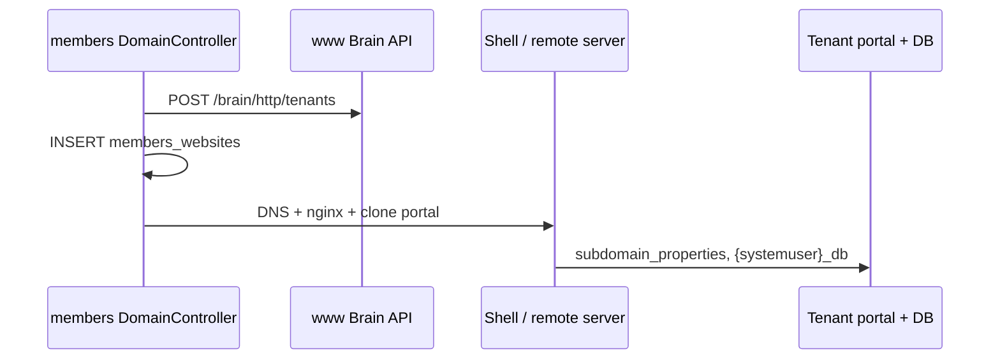

# 01 — Current State Audit

Ground truth from the repo as of the plan date. Read alongside [afs-connect/01-current-state-audit.md](../afs-connect/01-current-state-audit.md).

## 1. Website lifecycle (members → Brain → tenant)

Documented in `members/WEBSITE_DEPLOYMENT_PROCESS.md`.



**Key registry tables**

| Table | DB | Scoping columns |
|-------|-----|-----------------|
| `members_websites` | members | `member_reference_num`, `domain_name`, `reference_num`, `webbuilder_reference_num`, `tenant_reference_num`, `tenant_username` |
| `brain_http_server_tenants` | Brain (central) | `member_reference_num`, `domain_name`, `reference_num`, `systemuser` |
| `brain_dns_zones` | Brain (central) | `member_reference_num`, `domain_name` |
| `subdomain_properties` | Per-tenant copy | `SubDomain`, `PropertyName`, `PropertyValue` — includes `member_reference_num`, `db_name`, `Domain` |

**Model:** `members/app/Models/Brain/Website.php` → `members_websites`.

**Gap:** No automated link from tenant `laravel_forms` / `laravel_direct_payments` rows back to `website_reference_num` — isolation is implicit via DB boundary.

## 2. Forms module (tenant DB)

| Item | Detail |
|------|--------|
| Migration | `www/database/migrations/2026_04_11_000001_create_laravel_forms_tables.php` |
| Tables | `laravel_forms`, `laravel_form_submissions` |
| Scoping | **None at row level** — entire tenant DB = one website |
| Controller | `www/app/Http/Controllers/Externals/Forms/FormsController.php` |
| Routes | `www/routes/portal.php` — `/portal/api/v1/forms/*` |
| Publish | Registers in `laravel_builder_output` (`typename='forms'`) |
| Public submit | `POST /forms/submit` — no Checkpoint auth |

**Indexable metadata (v1):** form `reference_num`, `name`, submission count, `created_at`/`updated_at`, publish status (via builder_output join).

**Not indexed (v1):** full `json_data` field definitions, individual submission bodies (PII).

## 3. Direct payments module (tenant DB)

| Item | Detail |
|------|--------|
| Migration | `www/database/migrations/2026_04_03_160000_create_laravel_direct_payments_table.php` |
| Tables | `laravel_direct_payments`, `laravel_direct_payment_items`, `laravel_direct_payment_tiers`, `laravel_direct_payment_invoices` |
| Scoping | **None at row level** — tenant DB |
| Controller | `www/app/Http/Controllers/Externals/DirectPayments/DirectPaymentsController.php` |
| Routes | `/portal/api/v1/directpayments/*` |
| Brain cross-tenant | `GET /portal/api/v1/brain/directpayments/invoices?user_id=` (invoice lookup only) |

**Indexable metadata (v1):** DP `reference_num`, `name`, `pay_type`, item/tier counts, invoice count + recent totals (aggregated), `updated_at`.

**Not indexed (v1):** processor tokens, full `items_data` on invoices, customer PII beyond counts.

## 4. Database topology vs afs-connect assumptions

```
┌─────────────────────────────────────────────────────────────┐
│  Shared apps DB (coordinator, notes, graph, flow, pdf)      │
│  afsconnect_* lives HERE                                    │
└─────────────────────────────────────────────────────────────┘

┌──────────────────────┐    ┌──────────────────────────────┐
│  members DB          │    │  www Brain DB (central)      │
│  members_websites    │    │  brain_http_server_tenants   │
│  checkpoint_*        │    │  brain_dns_zones             │
│  laravel_processor_* │    │  brain_memberships           │
└──────────────────────┘    └──────────────────────────────┘

┌─────────────────────────────────────────────────────────────┐
│  Tenant DB per website ({systemuser}_db)                    │
│  laravel_forms, laravel_direct_payments, laravel_sponsorships,            │
│  laravel_appointments, laravel_ecommerce_*, laravel_subscriber_*,           │
│  laravel_analytics_events, events (legacy) / laravel_events (stub),         │
│  subdomain_properties                                                       │
└─────────────────────────────────────────────────────────────┘
         ▲                           ▲
         │                           │
    website A                   website B
   (example.com)              (shop.io)
```

**Implication:** Coordinator **cannot** `DB::table('laravel_forms')` like it could theoretically do for `notes_notes`. Brain must fan out to tenant DBs.

## 5. Existing cross-app patterns (reuse vs replace)

| Pattern | Today | afs-connect-www should |
|---------|-------|------------------------|
| Member identity | `GET {BRAIN_API_URL}/member?user_id=` | Reuse unchanged — every app reads `BRAIN_API_URL` from its own `.env` |
| Website list | `members_websites` + Brain DNS API via `BRAIN_API_URL` | Brain meta-provider reads both |
| Progress tracking | `ProgressService` + Redis | Unrelated — keep separate |
| Brain HTTP calls | `BRAIN_API_URL` in each app's `.env` (unsigned today for provisioning) | **Signed** afs-connect HMAC for aggregation paths; same base URL |
| Portal auth | `PermissionService` + portal users | Tenant webhook auth via service key, not portal session |

## 6. Gaps that block integration today

| # | Gap | Severity | Fix |
|---|-----|----------|-----|
| 1 | Tenant form/DP tables lack `domain_name` / `website_reference_num` | Medium | Edit create migrations + log SQL in [db_table_alter.md](db_table_alter.md); populate at write time |
| 2 | No Brain service to query all tenant DBs for one member | **High** | Build `WwwAfsConnectMetaProvider` |
| 3 | No webhooks on form/DP mutations | **High** | Event listeners in tenant portal |
| 4 | Coordinator index has no website dimension | **High** | Migration: `website_domain`, `website_reference_num` |
| 5 | `afsconnect_settings` has no www module / per-site toggles | Medium | Extend settings schema |
| 6 | Brain API unsigned | **High** (security) | Apply `AfsConnectServiceAuthMiddleware` on Brain internal routes |
| 7 | Base afs-connect Phase 0 incomplete | **High** | Finish creative-apps Phase 0 before or in parallel |

## 7. Tenant DB connection resolution (Brain-side)

Brain already stores enough to open a tenant DB:

1. `brain_http_server_tenants` row for `member_reference_num` + `domain_name`
2. `systemuser` / tenant username
3. `subdomain_properties` on tenant: `db_name`, `db_host` (verify exact property names in `FunctionsController::get_subdomain_managed_domain_new_way()` during implementation)

**Action item for implementation:** Extract existing tenant DB connection logic into `App\Services\TenantDatabaseResolver` on Brain — do not duplicate connection string assembly.

## 8. Prerequisites inherited from base afs-connect

These still apply before coordinator shows **any** cross-app data reliably:

- Header-trust → server-side auth migration ([09-rollout Phase 0 #7](../afs-connect/09-rollout-plan.md))
- Service keys in `.env` for all peers including new `www`
- **`BRAIN_API_URL` in every app's `.env`** — see [06-environment-config.md](06-environment-config.md)
- `afs_connect` feature flag + plan entitlement

www-specific work is **additive** on top.

## 9. Additional portal modules (afs-connect-www expanded scope)

Full per-module detail: **[05-modules-reference.md](05-modules-reference.md)**.

| Module | Tables (tenant DB) | Maturity | afs-connect tier |
|--------|-------------------|----------|------------------|
| Sponsorships | `laravel_sponsorships`, `_levels`, `_applications`, `laravel_sponsor_users` | Full Laravel | **A** |
| Appointments | `laravel_appointments`, `_slots`, `_bookings` | Full Laravel | **A** |
| Subscribers | `laravel_subscriber_*` (5 tables) | Partial (email stub, localStorage admin) | **B** aggregate |
| Analytics | `laravel_analytics_events` | Infra working | **B** rollups only |
| E-commerce | `laravel_ecommerce_stores`, `_products`, `_categories` | Checkout **missing** | **C** stub |
| Events | Legacy `events` (no migration) | Legacy PHP CRUD | **C** stub |

### Sponsorships (Tier A)

- Migration: `2026_05_02_000001_create_laravel_sponsorships_tables.php`
- Links to direct payments via `direct_payment_reference_num`; links to events via `meta.event_references[]`
- Routes: `/portal/api/v1/sponsorships/*`, `/sponsor-applications/*`, sponsor portal `/portal/api/sponsors/*`
- Index parent programmes only — not applications or sponsor user PII

### Appointments (Tier A)

- Migration: `2026_04_13_000001_create_laravel_appointments_table.php`
- Routes: `/portal/api/v1/appointments/*`
- Index `laravel_appointments` rows; bookings contribute **counts only** (PII in booking rows)

### Subscribers (Tier B)

- Migrations: `2026_04_05_133000_*`, `2026_04_05_133500_*`
- `SendSubscriberEmails` job is a **stub** (no real mail transport)
- Index one **summary row per website**, not individual subscriber emails

### Analytics (Tier B)

- Migration: `2026_04_26_000001_create_laravel_analytics_tables.php`
- Client SDK POSTs events; admin dashboard reads `AnalyticsApiController`
- Never index raw `laravel_analytics_events` — aggregate into daily rollups (new stub table in [db_table_alter.md](db_table_alter.md))

### E-commerce (Tier C stub)

- Migration: `2026_04_03_133338_create_ecommerce_tables.php`
- Admin CRUD complete; `external/commerce/api.ts` checkout calls **non-existent** `POST /portal/api/v1/processors/checkout`
- Stub: index stores + product counts; new `laravel_ecommerce_orders` placeholder table

### Events (Tier C stub)

- Legacy unprefixed `events` table — created outside Laravel migrations
- CRUD via `functions.php` / legacy `request.php`; only `GET /portal/api/v1/events/{ref}` in Laravel
- Stub: new `laravel_events` create migration; provider reads legacy table until CRUD migrates

## 10. Updated gaps (expanded scope)

| # | Gap | Severity | Fix |
|---|-----|----------|-----|
| 8 | Six new modules lack `website_domain` / `website_reference_num` on index-parent tables | Medium | [db_table_alter.md](db_table_alter.md) |
| 9 | Events has no Laravel migration | **High** for Tier A | New create migration stub + legacy read adapter |
| 10 | E-commerce checkout route missing | **High** for Tier A | Stub provider until `processors/checkout` exists |
| 11 | Analytics events contain PII in metadata | Medium | Rollups only; never index raw events |
| 12 | Subscribers admin partially localStorage | Low | Aggregate index unaffected; fix admin separately |
