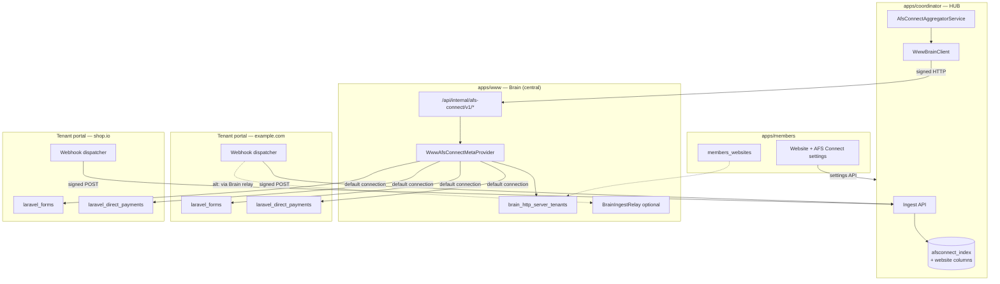

# 02 — Architecture

## Component overview



## Why Brain is the meta-provider (not coordinator → N tenants)

Coordinator knows `member_reference_num` but not:

- How many websites the member has
- Which HTTP server hosts which domain
- ~~Each tenant's DB host/name/credentials~~ — **no component stores these.**
  See the implementation note below

Brain + `members_websites` **already maintain this registry**. A single signed call:

```
GET /api/internal/afs-connect/v1/changes?member_reference_num=MR-8841&since=...
```

…should return form and DP deltas **across all enabled websites**, with each item carrying `website_domain` and `website_reference_num`.

**Rejected alternative:** Coordinator calls each tenant portal URL directly.

- Requires N endpoint URLs + N keys per member
- Tenant URLs are custom domains with varying SSL/DNS state
- Provisioning churn breaks coordinator config

**Rejected alternative:** Raw cross-DB reads from coordinator into tenant DBs.

- Coordinator lacks tenant DB credentials by design
- Violates isolation boundary

(As implemented, *no* component performs cross-DB reads — Brain included.)

## Data flows

### 1. Index read (coordinator dashboard)

Same as base afs-connect — read `afsconnect_index` locally. New filters:

- `?website_domain=example.com`
- `?source_app=www_forms|www_direct_payments|www_sponsorships|…` (full list in [05-modules-reference.md](05-modules-reference.md))

### 2. Webhook push (tenant → coordinator)

On tenant portal, Laravel events (Tier A modules get full webhooks; Tier B/C as noted):

| Event | Module | Index effect |
|-------|--------|--------------|
| Form created/updated/deleted | Forms | Upsert/delete `www_form` |
| Form submission created | Forms | Bump submission count + activity log |
| Direct payment created/updated/deleted | DP | Upsert/delete `www_direct_payment` |
| Invoice created/status changed | DP | Activity + invoice stats on parent |
| Sponsorship saved/deleted | Sponsorships | Upsert/delete `www_sponsorship` |
| Application approved/denied | Sponsorships | Activity log; update pending count metadata |
| Appointment saved/deleted | Appointments | Upsert/delete `www_appointment` |
| Booking created | Appointments | Update parent booking counts only |
| Subscriber/article changed | Subscribers | Refresh single `www_subscriber_summary` row |
| — | Analytics | **No per-event webhook** — nightly rollup job |
| Store saved | E-commerce (stub) | Upsert store row; `metadata.checkout_status: stub` |
| — | Events (stub) | **None** until Laravel CRUD exists |

**Webhook payload must include:**

```json
{
  "event_id": "www-forms-{ulid}",
  "source_app": "www_forms",
  "member_reference_num": "MR-8841",
  "website_domain": "example.com",
  "website_reference_num": "WS-abc123",
  "items": [ { "source_type": "www_form", "source_id": "vxxxxxxxxxxx", "op": "upsert", ... } ]
}
```

**Signing options (pick one in implementation — recommend A):**

| Option | Flow | Pros | Cons |
|--------|------|------|------|
| **A. Tenant → Coordinator direct** | Tenant holds coordinator ingest URL + signs with tenant-scoped key | Lowest latency | N keys or one shared tenant key (weaker) |
| **B. Tenant → Brain relay → Coordinator** | Brain validates tenant, re-signs as `www` | Single outbound key from Brain | Extra hop |
| **C. Brain poll only** | No tenant webhooks; reconcile every 15m | Simplest | Stale index, load on Brain |

**Recommendation:** **A for v1** with a **single `AFS_CONNECT_SERVICE_KEY_WWW_TENANT`** shared by all tenant deployments (same codebase/env template), plus `website_domain` in payload validated by Brain during reconcile. **B** as hardening in Phase 2 if key compromise is a concern.

Tenant resolves `member_reference_num` + `website_domain` from `subdomain_properties` at boot (already available via `FunctionsController`).

### 3. Reconciliation (Brain meta-provider pull)

Coordinator scheduler calls `WwwBrainClient::changes()` — Brain:

1. Loads all `brain_http_server_tenants` for member where afs-connect enabled for that website
   (`TenantDatabaseResolver::websitesForMember()`; `members_websites` is **not** joined)
2. Queries **enabled module providers** (forms, DP, sponsorships, appointments, +
   aggregate/stub providers) changed since `since` — **on the running deployment's
   default connection**, not per tenant DB
3. Merges, paginates, returns unified cursor

Same idempotent upsert into `afsconnect_index` as other source apps.

> **As implemented (2026-08-23) — read this before trusting step 2.**
>
> `TenantDatabaseResolver::withTenantConnection()` ignores the `TenantContext` it is
> given and returns `config('database.default')`. Providers are already
> connection-aware (`Form::on($connection)`, and `TenantContext` carries an unused
> `connection` property plus a `withConnection()` helper), so the seam for real
> per-tenant connections exists — but nothing populates it. The credentials are
> available: `brain_http_server_tenants.json` carries `db_host`, `db_name`,
> `db_username`, and `db_password` (see `FunctionsController` ≈L735–760, which
> mirrors them into `subdomain_properties` and then strips them from its response),
> exactly as [01-current-state-audit.md §7](01-current-state-audit.md) said. What is
> missing is the plumbing: no tenant connection template in
> `www/config/database.php`, no runtime connection registration, and no caller for
> `TenantContext::withConnection()`. Per-deployment `DB_*` is the shipped model per
> [07-www-env-variables.md](../07-www-env-variables.md) ("No `AFS_CONNECT_TENANT_DB_*`
> variables") — a choice, not a constraint.
>
> **Consequence for this flow.** `apps/www` is a single codebase, so its migrations
> create the module tables (`laravel_forms`, `laravel_direct_payments`, …) on *every*
> deployment. On Brain those tables exist but hold no member-site data, so provider
> queries there return empty and reconcile contributes no www module rows. Tenant
> module data therefore reaches the index via **tenant-side webhooks**, which are
> currently wired for **forms only** (`Portal/Admin/FormsController`). This is the
> most likely explanation for `WwwBrainClient::websites()` having no caller and
> `AfsConnectWebsiteSyncStatus` being written but never read. Confirm against a live
> Brain database before relying on it — this was determined by code inspection, not
> by querying a running system.
>
> Decision of 2026-08-23: keep the deployment-scoped model and correct these docs to
> match, rather than build cross-tenant fan-out.

### 4. Live fetch (on-demand)

```
GET /api/afs-connect/items/www_forms/{source_id}?website_domain=example.com
  → coordinator → Brain → tenant DB → form detail + submission list (capped)
```

Brain re-runs portal-equivalent authorization (admin user context passed as `requested_by_checkpoint_user_id`).

## Normalized item shapes

### Form (`source_type: www_form`)

| Field | Source |
|-------|--------|
| `source_id` | `laravel_forms.reference_num` |
| `title` | `name` |
| `snippet` | `"N submissions"` or last submission date |
| `url` | `{contact_base_url}/portal/admin#forms/{ref}` — see [06-environment-config.md](06-environment-config.md) § Tenant contact URLs |
| `metadata` | `{ "submission_count": 47, "published": true, "website_domain": "example.com" }` |

Unique key in index: `(source_app, source_id, website_reference_num)` — **website dimension required** because `reference_num` is only unique within a tenant DB, not globally.

### Direct payment (`source_type: www_direct_payment`)

| Field | Source |
|-------|--------|
| `source_id` | `laravel_direct_payments.reference_num` |
| `title` | `name` |
| `snippet` | pay type + item count, e.g. `"SINGLE_PAY · 3 items"` |
| `url` | `{contact_base_url}/portal/admin#directpayments/{ref}` |
| `metadata` | `{ "pay_type": "SUBSCRIPTION", "invoice_count_30d": 12, "total_invoiced_30d_cents": 124000 }` |

### Sponsorship (`source_type: www_sponsorship`) — Tier A

| Field | Source |
|-------|--------|
| `source_id` | `laravel_sponsorships.reference_num` |
| `title` | `name` |
| `snippet` | level count + pending applications, e.g. `"3 tiers · 2 pending"` |
| `metadata` | `{ "active": true, "direct_payment_reference_num": "...", "level_count": 3, "pending_application_count": 2 }` |

### Appointment (`source_type: www_appointment`) — Tier A

| Field | Source |
|-------|--------|
| `source_id` | `laravel_appointments.reference_num` |
| `title` | `name` or `title` |
| `snippet` | `"4 slots · 12 bookings"` |
| `metadata` | `{ "slot_count": 4, "booking_count": 12, "upcoming_booking_count_7d": 3 }` |

### Subscriber summary (`source_type: www_subscriber_summary`) — Tier B

One row per website (fixed `source_id`: `{website_reference_num}:summary`):

| Field | Source |
|-------|--------|
| `title` | `"Subscribers — {domain}"` |
| `snippet` | `"842 subscribers · 12 published articles"` |
| `metadata` | `{ "category_count", "active_subscriber_count", "published_article_count" }` |

### Analytics summary (`source_type: www_analytics_summary`) — Tier B

One row per website; refreshed by rollup job or reconcile aggregate query:

| Field | Source |
|-------|--------|
| `title` | `"Analytics — {domain}"` |
| `snippet` | `"1,240 page loads (30d)"` |
| `metadata` | `{ "page_loads_30d", "events_by_module": {...} }` |

### E-commerce store (`source_type: www_ecommerce_store`) — Tier C stub

| Field | Source |
|-------|--------|
| `source_id` | `laravel_ecommerce_stores.reference_num` |
| `title` | store `name` |
| `snippet` | product count |
| `metadata` | `{ "product_count", "direct_payment", "checkout_status": "stub" }` |

### Event (`source_type: www_event`) — Tier C stub

Provider reads legacy `events` when present; index may be empty until `laravel_events` migration lands:

| Field | Source |
|-------|--------|
| `source_id` | `events.reference_num` or `laravel_events.reference_num` |
| `title` | event name/title |
| `metadata` | `{ "stub": true, "has_direct_payment": bool, "tickets_sold": N }` |

## Entitlement guard (Brain)

Before any meta-provider response, Brain checks (independently of coordinator):

1. Global `afs_connect` flag
2. Member plan includes feature (HTTP to members entitlements API)
3. `afsconnect_settings.enabled`
4. Module toggles: `source_www_forms`, `source_www_direct_payments`, `source_www_sponsorships`, `source_www_appointments`, `source_www_subscribers`, `source_www_analytics`, `source_www_ecommerce`, `source_www_events`
5. Per-website: domain not in member's `disabled_website_domains` list
6. Tier C modules: if toggle on but provider `isStub()`, coordinator shows preview badge — no error

## Linking to coordinator entities

`afsconnect_links` gains website context in metadata (or new columns):

```json
{
  "linkable_type": "pm_task",
  "linkable_client_id": 42,
  "source_app": "www_forms",
  "source_type": "www_form",
  "source_id": "vabc123",
  "website_reference_num": "WS-xyz",
  "website_domain": "example.com"
}
```

Unique constraint must include `website_reference_num` — same form ref can exist on different sites (unlikely but ID namespace is per-tenant).

## Failure modes

| Failure | Behavior |
|---------|----------|
| One tenant DB unreachable | Skip that website in reconcile; others proceed; mark website sync status degraded |
| Website deleted / tenant removed | Reconciliation emits deletes for all indexed items for that `website_reference_num` |
| Domain DNS down | Index metadata still valid; live fetch returns 503 with clear message |
| Member disables one website in settings | Purge index rows for that `website_reference_num`; stop webhooks |

## Stub provider behavior (Tier C)

`WwwEcommerceProvider` and `WwwEventsProvider` implement `ProvidesWwwModuleData::isStub(): true`.

- **`summary` / `changes`:** return whatever safe metadata exists (store list, legacy event count); never throw if checkout or Laravel CRUD missing.
- **Coordinator UI:** render module tile with *"Preview"* badge and `metadata.stub = true`.
- **Promotion:** when module reaches Tier A, flip `isStub()` to false — no coordinator schema change required.

Provider map and file layout: [05-modules-reference.md](05-modules-reference.md) § Brain meta-provider adapter map.
