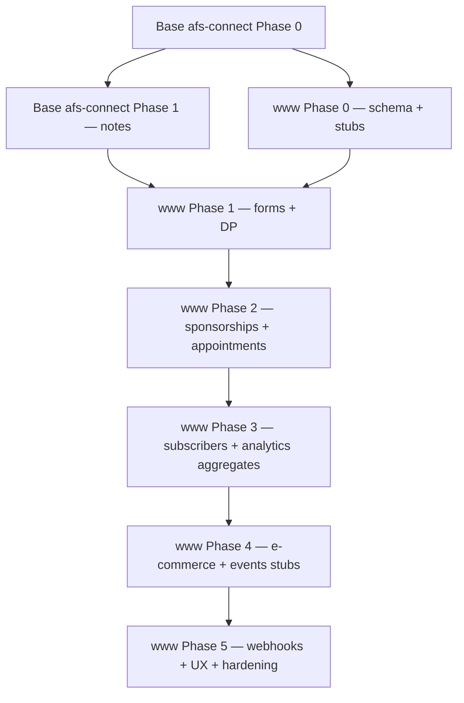

# 04 — Rollout Plan

Phased delivery **after** base afs-connect Phase 1 (notes beta) is stable — www adds complexity and should not block the first creative-app integration.

Module tiers: [05-modules-reference.md](05-modules-reference.md).

Dependency graph:

---

## Phase 0 — Prerequisites (no user-visible www data)

1. **Tenant DB resolver** — extract Brain logic into `App\Services\TenantDatabaseResolver`; unit test with fixture tenant.

2. **Coordinator schema extensions** — §3.1 (`website_*` columns, all eight `source_www_*` toggles, sync status table).

3. **Service keys** — `AFS_CONNECT_SERVICE_KEY_WWW`, `AFS_CONNECT_SERVICE_KEY_WWW_TENANT`.

4. **Brain `config/afs_connect.php`** — peer keys; derive www afs-connect internal API base from `BRAIN_API_URL` ([06-environment-config.md](06-environment-config.md)).

5. **Verify `BRAIN_API_URL`** in `.env` / `.env.example` for coordinator, notes, dream_graph, flow, pdf_editor, members, and www.

6. **www schema (edit create migrations + new stub tables)** — full list in **[db_table_alter.md](db_table_alter.md)**:
   - Website scoping on Tier A parent tables (forms, DP, sponsorships, appointments, ecommerce stores)
   - **New create migrations:** `laravel_events`, `laravel_ecommerce_orders`, `laravel_analytics_daily_rollups`
   - Log all raw SQL in `db_table_alter.md`

7. **Stub code scaffold** on Brain (empty providers with `isStub()` where needed):
   - `www/app/AfsConnect/Providers/WwwEcommerceProvider.php`
   - `www/app/AfsConnect/Providers/WwwEventsProvider.php`
   - `ProvidesWwwModuleData` interface

8. **Website registry join** — verify `members_websites` ↔ `brain_http_server_tenants` ↔ `subdomain_properties`.

**Exit criteria:** Migrations + stub files in place; Brain opens test tenant DB; global flag off.

---

## Phase 1 — Tier A core: Forms + Direct payments (pull-only beta)

1. Implement full providers: `WwwFormsProvider`, `WwwDirectPaymentsProvider`.
2. `WwwAfsConnectMetaProvider` + internal API + `WwwBrainClient` in coordinator.
3. Reconcile-only (no webhooks yet).
4. Coordinator UI tiles: websites, forms, direct payments per domain.

**Exit criteria:** Two websites show form/DP counts after reconcile; module toggles work.

---

## Phase 2 — Tier A extended: Sponsorships + Appointments

1. Providers: `WwwSponsorshipsProvider`, `WwwAppointmentsProvider`.
2. Extend reconcile fan-out; index programmes and appointment objects (not booking PII).
3. Coordinator UI: sponsorship + appointment tiles per website.

**Exit criteria:** Sponsorship pending-application counts visible; appointment booking counts on parent rows only.

---

## Phase 3 — Tier B: Subscribers + Analytics aggregates

1. `WwwSubscribersProvider` — one summary index row per website.
2. `WwwAnalyticsProvider` — reads `laravel_analytics_events` aggregates or `laravel_analytics_daily_rollups` when populated.
3. Optional: `analytics:rollup-daily` scheduled command on tenant (writes rollups table).
4. **No** raw analytics events in index.

**Exit criteria:** Coordinator shows subscriber totals and 30-day page-load summary per domain.

---

## Phase 4 — Tier C stubs: E-commerce + Events

1. **`WwwEcommerceProvider` (stub):** index stores + product counts; `metadata.checkout_status: stub`.
2. **`WwwEventsProvider` (stub):** read legacy `events` table when present; else zero; `metadata.stub: true`.
3. **`laravel_events` migration** — Laravel-native schema ready for future CRUD migration (no legacy removal yet).
4. **`laravel_ecommerce_orders` migration** — empty placeholder for checkout.
5. Settings defaults: `source_www_ecommerce` and `source_www_events` **false**; UI shows opt-in preview.

**Exit criteria:** Enabling stub toggles shows preview tiles without errors; legacy events count appears when table exists.

---

## Phase 5 — Webhooks, linking, insights, hardening

1. **Webhooks** for Tier A modules (+ subscriber summary refresh).
2. Members settings: per-website checkboxes + all module toggles.
3. Linking/search/insights across all indexed modules.
4. Alerting, load test (10+ websites), key rotation runbook.

**Exit criteria:** Form create on tenant appears in coordinator within seconds; link task → sponsorship on specific domain works.

---

## Promotion path (post-v1)

| Module | Trigger to leave stub/partial tier |
|--------|-----------------------------------|
| E-commerce | `POST /processors/checkout` implemented + orders written to `laravel_ecommerce_orders` |
| Events | Laravel `EventsController` replaces legacy PHP; data in `laravel_events` |
| Subscribers | Admin UI fully API-backed; email job sends real mail — optional per-email index (unlikely) |
| Analytics | Rollups table always populated; optional richer dashboards |

---

## Rollback

1. Flip global `afs_connect` flag off.
2. Disable individual `source_www_*` toggles per member.
3. Stub modules: set `source_www_ecommerce` / `source_www_events` off — no data loss.

---

## Open decisions

| # | Question | Decision |
|---|----------|----------|
| 1 | Index submissions/bookings/analytics events individually? | **No** — counts/aggregates only |
| 2 | Split `source_app` per module? | **Yes** — eight values (see §3.7) |
| 3 | Stub modules default on or off? | **Off** — member opt-in to preview |
| 4 | Events: migrate legacy data before indexing? | **Stub reads legacy**; migrate later for Tier A |
| 5 | E-commerce: index products or stores only? | **Stores only** in stub; products in metadata count |

---

## Estimated effort

| Phase | Scope |
|-------|--------|
| Phase 0 | ~70% of original Phase 0 (more schema + stubs) |
| Phase 1 | Forms + DP (baseline) |
| Phase 2 | +40% (two Tier A modules) |
| Phase 3 | +30% (aggregate logic) |
| Phase 4 | +20% (stubs — low risk) |
| Phase 5 | +50% (webhooks × modules + UX) |

Total www extension ≈ **2.5–3×** a single creative source app, due to eight modules + multi-tenant fan-out + stub layer.
