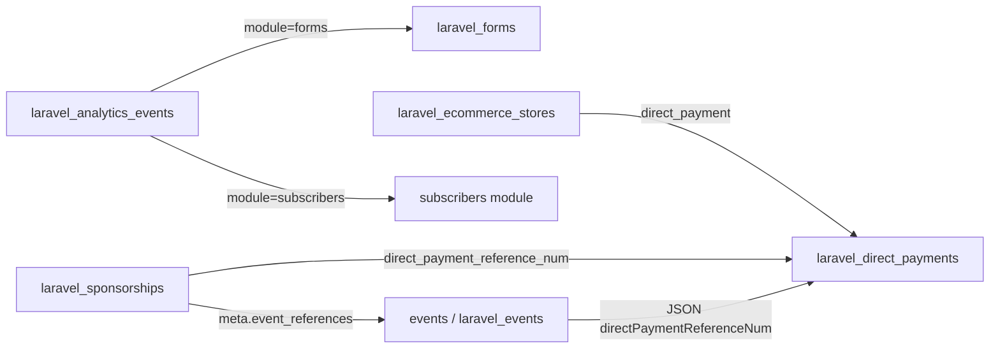

# 05 — Portal Modules Reference

Detailed audit of every www portal module in scope for afs-connect-www. Use this when implementing Brain meta-provider adapters, tenant webhooks, and [db_table_alter.md](db_table_alter.md) edits.

## Maturity tiers (implementation strategy)

| Tier | Meaning | afs-connect approach |
|------|---------|---------------------|
| **A — Full index** | Laravel-complete; stable schema; index entity metadata + webhooks | Ship in Phases 1–2 |
| **B — Aggregate index** | Working backend but index **counts/summaries** per website, not every row | Ship aggregates; optional entity index later |
| **C — Stub** | Incomplete or legacy; schema/code stub only until module matures | DB stub + no-op/stub provider; reconcile returns placeholder summary |

| Module | Tier | Rationale |
|--------|------|-----------|
| Forms | **A** | Laravel CRUD complete |
| Direct payments | **A** | Laravel CRUD + invoices |
| Sponsorships | **A** | Full Laravel stack + sponsor portal |
| Appointments | **A** | Laravel CRUD; index **objects** not bookings (PII) |
| Subscribers | **B** | Backend solid; admin UI partially localStorage; email job stub |
| Analytics | **B** | Ingest works; index **daily rollups** only, never raw events |
| E-commerce | **C** | Admin CRUD works; **checkout route missing** (`POST /processors/checkout`) |
| Events | **C** | Legacy PHP CRUD; **no Laravel migration**; dual code paths |

---

## 1. Forms (Tier A)

| Item | Detail |
|------|--------|
| Migration | `www/database/migrations/2026_04_11_000001_create_laravel_forms_tables.php` |
| Tables | `laravel_forms`, `laravel_form_submissions` |
| Models | `App\Models\Externals\Form`, `App\Models\Externals\FormSubmission` |
| Controller | `App\Http\Controllers\Externals\Forms\FormsController` |
| Routes | `/portal/api/v1/forms/*` in `routes/portal.php` |
| Frontend | `resources/js/portal/admin/views/` + `controllers/` (forms) |
| Builder | `laravel_builder_output` where `typename='forms'` |
| `source_app` | `www_forms` |
| `source_type` | `www_form` |
| Index `source_id` | `laravel_forms.reference_num` (prefix `v` + 11 chars) |
| DP link | None |
| Index metadata | `submission_count`, `published` (via builder_output), `updated_at` |
| Webhooks | `FormSaved`, `FormDeleted`, `FormSubmissionCreated` |
| PII boundary | Do not index submission bodies or emails |

---

## 2. Direct payments (Tier A)

| Item | Detail |
|------|--------|
| Migration | `www/database/migrations/2026_04_03_160000_create_laravel_direct_payments_table.php` |
| Tables | `laravel_direct_payments`, `_items`, `_tiers`, `_invoices` |
| Models | `App\Models\Externals\DirectPayment`, `DirectPaymentItem`, `DirectPaymentTier`, `DirectPaymentInvoice` |
| Controller | `App\Http\Controllers\Externals\DirectPayments\DirectPaymentsController` |
| Routes | `/portal/api/v1/directpayments/*` |
| Brain cross-read | `GET /portal/api/v1/brain/directpayments/invoices?user_id=` |
| `source_app` | `www_direct_payments` |
| `source_type` | `www_direct_payment` |
| Index `source_id` | `laravel_direct_payments.reference_num` (9-char) |
| Index metadata | `pay_type`, item/tier counts, `invoice_count_30d`, `total_invoiced_30d_cents` |
| Webhooks | `DirectPaymentSaved`, `DirectPaymentDeleted`, `DirectPaymentInvoiceUpdated` |
| PII boundary | No customer emails, charge IDs, or `items_data` in index |

---

## 3. Sponsorships (Tier A)

| Item | Detail |
|------|--------|
| Migration | `www/database/migrations/2026_05_02_000001_create_laravel_sponsorships_tables.php` |
| Tables | `laravel_sponsorships`, `laravel_sponsorship_levels`, `laravel_sponsorship_applications`, `laravel_sponsor_users` |
| Models | `App\Models\Externals\Sponsorship`, `SponsorshipLevel`, `SponsorshipApplication`, `SponsorUser` |
| Controllers | `App\Http\Controllers\Externals\Sponsorships\SponsorshipController`, `SponsorshipApplicationController`, `SponsorPortalController` |
| Routes | `/portal/api/v1/sponsorships/*`, `/sponsor-applications/*`, `/portal/api/sponsors/*` |
| Frontend | `sponsorshipsView.ts`, `resources/js/portal/sponsors/*` |
| `source_app` | `www_sponsorships` |
| `source_type` | `www_sponsorship` |
| Index `source_id` | `laravel_sponsorships.reference_num` (20-char max) |
| DP link | `direct_payment_reference_num` on sponsorship row |
| Events link | `meta.event_references[]` JSON (soft ref to legacy events) |
| Index metadata | `active`, `level_count`, `pending_application_count`, `direct_payment_reference_num` |
| Webhooks | `SponsorshipSaved`, `SponsorshipDeleted`, `SponsorshipApplicationStatusChanged` |
| PII boundary | No applicant contact fields, `brand_data`, or sponsor credentials |

Index **programmes** only — not individual applications or sponsor portal users.

---

## 4. Appointments (Tier A)

| Item | Detail |
|------|--------|
| Migration | `www/database/migrations/2026_04_13_000001_create_laravel_appointments_table.php` |
| Tables | `laravel_appointments`, `laravel_appointment_slots`, `laravel_appointment_bookings` |
| Models | `App\Models\Externals\Appointment`, `AppointmentSlot`, `AppointmentBooking` |
| Controller | `App\Http\Controllers\Externals\Appointments\AppointmentsController` |
| Routes | `/portal/api/v1/appointments/*` |
| Frontend | `appointmentsView.ts`, `external/appointments/api.ts` |
| `source_app` | `www_appointments` |
| `source_type` | `www_appointment` |
| Index `source_id` | `laravel_appointments.reference_num` (`a` + 6 chars) |
| DP link | None |
| Index metadata | `slot_count`, `booking_count`, `upcoming_booking_count_7d` |
| Webhooks | `AppointmentSaved`, `AppointmentDeleted`, `AppointmentBookingCreated` (updates parent metadata only) |
| PII boundary | **Never** index booking rows (`user_name`, `user_email`, `user_phone`) |

---

## 5. Subscribers (Tier B)

| Item | Detail |
|------|--------|
| Migrations | `2026_04_05_133000_create_laravel_subscribers_module_tables.php`, `2026_04_05_133500_create_laravel_subscriber_email_progress_table.php` |
| Tables | `laravel_subscriber_categories`, `laravel_subscribers`, `laravel_subscriber_category_subscriber`, `laravel_subscriber_articles`, `laravel_subscriber_email_progress` |
| Models | `App\Models\Externals\Subscriber\*` |
| Controller | `App\Http\Controllers\Externals\Subscribers\SubscribersController` |
| Job | `App\Jobs\SendSubscriberEmails` — **mail transport TODO** (logs only) |
| Routes | `/portal/api/v1/subscribers/*` |
| Builder | `laravel_builder_output` where `typename='subscribers'` |
| `source_app` | `www_subscribers` |
| Index strategy | **One index row per website** (`source_type: www_subscriber_summary`), not per subscriber email |
| Index metadata | `category_count`, `active_subscriber_count`, `published_article_count`, `last_article_published_at` |
| Webhooks | `SubscriberCreated`, `SubscriberArticlePublished` → refresh summary row only |
| Known gaps | Categories/articles partially stored in admin **localStorage**; not all admin paths hit API |

**Coordinator display:** *"example.com — 842 subscribers, 12 articles"* not a searchable list of emails.

---

## 6. Analytics (Tier B)

| Item | Detail |
|------|--------|
| Migration | `www/database/migrations/2026_04_26_000001_create_laravel_analytics_tables.php` |
| Table | `laravel_analytics_events` — `module`, `event`, `resource_name`, `resource_reference`, `route`, `metadata` JSON |
| Model | `App\Models\AnalyticsEvent` |
| Controller | `App\Http\Controllers\Externals\Analytics\AnalyticsApiController` |
| Routes | `POST/GET /portal/api/v1/analytics/events`, `GET .../summary` |
| Frontend | `analytics.ts`, `AnalyticsController.ts`, `external/analytics/api.ts` |
| `source_app` | `www_analytics` |
| Index strategy | **Rollups only** — no raw event rows in `afsconnect_index` |
| Stub table | `laravel_analytics_daily_rollups` (new create migration — see [db_table_alter.md](db_table_alter.md)) |
| Index metadata | `page_loads_30d`, `unique_resources_30d`, top modules breakdown JSON |
| Webhooks | Optional nightly job writes rollups; no per-event webhook to coordinator |
| PII boundary | `metadata` may contain `visitor_id` — never copy to coordinator index |

Brain meta-provider runs aggregate SQL on `laravel_analytics_events` at reconcile time until rollups table is populated.

---

## 7. E-commerce (Tier C — stub)

| Item | Detail |
|------|--------|
| Migration | `www/database/migrations/2026_04_03_133338_create_ecommerce_tables.php` |
| Tables | `laravel_ecommerce_stores`, `laravel_ecommerce_products`, `laravel_ecommerce_categories` |
| Models | `App\Models\Externals\EcommerceStore`, `EcommerceProduct`, `EcommerceCategory` |
| Controller | `App\Http\Controllers\Externals\Ecommerce\EcommerceController` |
| Routes | `/portal/api/ecommerce/*`, builder `GET /store-products/{ref}` |
| Frontend | `ecommerceView.ts`, `external/commerce/api.ts` |
| **Blocker** | `commerce.checkout()` calls `POST /portal/api/v1/processors/checkout` — **route does not exist** |
| `source_app` | `www_ecommerce` |
| `source_type` | `www_ecommerce_store` (index stores, not every product in v1 stub) |
| Index `source_id` | `laravel_ecommerce_stores.reference_num` (`s` + 6 chars) |
| DP link | Store → `direct_payment`; product → `direct_payment_item_reference_num` |
| Stub table | `laravel_ecommerce_orders` — placeholder for future checkout (see db_table_alter) |
| Stub code | `WwwEcommerceAfsConnectProvider` returns stores + product counts; `checkout_status: 'stub'` in metadata |
| Webhooks | `EcommerceStoreSaved` only in stub phase; order webhooks deferred |

**When checkout ships:** promote to Tier A; index orders as activity on parent store metadata.

---

## 8. Events (Tier C — stub)

| Item | Detail |
|------|--------|
| **Legacy table** | `events` (unprefixed) — **not in Laravel migrations** |
| Legacy CRUD | `public/_portal_/admin/core/php/includes/functions.php` — `admin_events_*` |
| Duplicate | `App\Http\Controllers\FunctionsController.php` (same logic) |
| Laravel read | `SponsorPortalController::getEvent` — `DB::table('events')` |
| Route | `GET /portal/api/v1/events/{ref}` only; CRUD via legacy `request.php` |
| Frontend | `eventsView.ts` → `external/events/api.ts` (legacy PHP) |
| No Eloquent model | — |
| DP link | `directPaymentReferenceNum` inside event JSON blob |
| Sponsorship link | `Sponsorship.meta.event_references[]` |
| `source_app` | `www_events` |
| `source_type` | `www_event` |
| Stub migration | **New** `create_laravel_events_tables.php` — Laravel-native schema (see db_table_alter) |
| Stub code | `WwwEventsAfsConnectProvider` reads legacy `events` if present, else empty; returns `{ events_count, stub: true }` in summary |
| Webhooks | **None** until Laravel CRUD replaces legacy PHP |

**Promotion path (post-stub):** migrate CRUD to `EventsController`, backfill `laravel_events` from legacy `events`, switch provider to Tier A.

---

## Brain meta-provider adapter map

Each module gets a class under `App\AfsConnect\Providers\` on Brain (tenant portal dispatches webhooks):

| Provider class | Tier | Methods |
|----------------|------|---------|
| `WwwFormsProvider` | A | `summary`, `changes`, `item` |
| `WwwDirectPaymentsProvider` | A | same |
| `WwwSponsorshipsProvider` | A | same |
| `WwwAppointmentsProvider` | A | same |
| `WwwSubscribersProvider` | B | `summary` + summary row in `changes` |
| `WwwAnalyticsProvider` | B | `summary` only (aggregates) |
| `WwwEcommerceProvider` | C | `summary` stub; `changes` returns stores only |
| `WwwEventsProvider` | C | `summary` stub; `changes` empty until migration |

`WwwAfsConnectMetaProvider` fans out to enabled providers per member website.

---

## Stub code layout (www — planned, not yet implemented)

```
www/app/AfsConnect/
  Providers/
    WwwFormsProvider.php
    WwwDirectPaymentsProvider.php
    WwwSponsorshipsProvider.php
    WwwAppointmentsProvider.php
    WwwSubscribersProvider.php          # summary aggregates
    WwwAnalyticsProvider.php            # rollup reads only
    WwwEcommerceProvider.php              # @stub until checkout exists
    WwwEventsProvider.php                 # @stub until laravel_events migration
  WwwAfsConnectMetaProvider.php
  Listeners/
    DispatchAfsConnectWebhook.php       # per-module events
  Http/
    Controllers/InternalAfsConnectController.php
  AfsConnectEntitlementGuard.php
```

Tenant portal reuses the same `Listeners/` pattern; each listener checks module toggle before dispatch.

**Stub provider contract:** must implement interface `ProvidesWwwModuleData` with `isStub(): bool` — coordinator UI shows *"Events (preview — coming soon)"* when true.

---

## Cross-module relationships (indexing implications)



Coordinator insights can join across `source_app` values via shared `direct_payment_reference_num` in metadata when both sides indexed.
