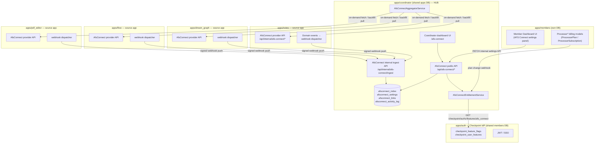
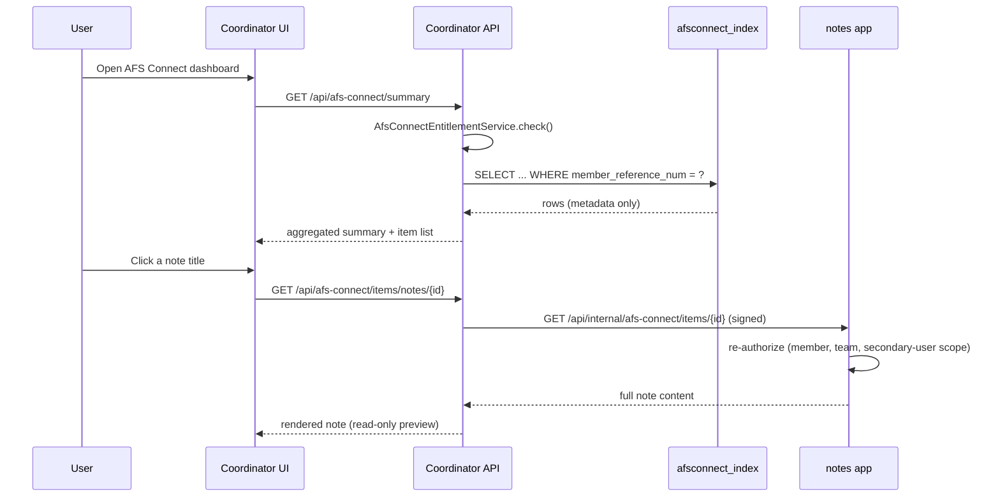
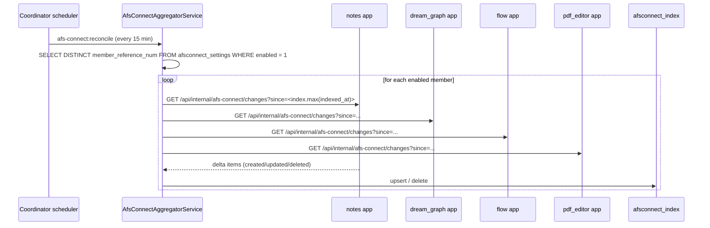

# 02 — Architecture

## Component overview

## Why an internal API, not raw cross-DB reads

The shared physical database means coordinator *could* `DB::table('notes_notes')->...`
directly, the same way `TeamSettingsService` reads `pm_teams` today (see
[01-current-state-audit.md](01-current-state-audit.md) §2). Every domain
table across all five apps is now correctly, consistently prefixed (per the
audit's §1 correction), so table-name collisions are no longer the risk
they briefly looked like — but a direct-read approach was still considered
and rejected as the **primary** mechanism, for three reasons:

1. **Schema churn isolation.** dream_graph alone has 25+ tables and is
   actively evolving (see its migration list). If coordinator queries those
   tables directly, every schema change in dream_graph is a silent breaking
   change for coordinator. An API contract is a place to put a version
   number and a deprecation policy.
2. **Per-request authorization.** A raw `DB::table()` read from coordinator
   has no way to ask "is this specific note visible to this specific
   secondary user, in this specific team, right now?" — that logic lives in
   each app's own policies/controllers. Going through the app's own API
   means its own authorization runs every time.
3. **Future portability.** If any of these apps is ever split onto its own
   database (a real possibility — `apps/members` already proves the
   monorepo doesn't assume one DB forever), an API-based integration keeps
   working unchanged; a raw cross-DB read would not.

The shared-DB fact is still useful operationally — see
[07-sync-and-indexing-strategy.md](07-sync-and-indexing-strategy.md) §"Future
optimization" for a documented, opt-in fast path that a source app can
expose later if API round-trips become the bottleneck for heavy analytics.

## Data flow: three read paths

afs-connect uses three distinct paths depending on freshness/cost tradeoffs,
not one:

1. **Index read (fast, default).** Coordinator's dashboard/search reads
   `afsconnect_index` — its own local table — with no cross-app network
   call. This is what powers the summary dashboard, activity timeline, and
   search-across-apps UI.
2. **Webhook ingest (near-real-time write path).** A source app fires a
   signed HTTP POST to coordinator's `/api/internal/afs-connect/ingest`
   whenever a relevant entity is created/updated/deleted/renamed. Coordinator
   upserts/deletes the matching `afsconnect_index` row. Typical latency:
   seconds.
3. **Live fetch (on-demand, authoritative).** When a user actually opens a
   linked item (e.g. clicks through from coordinator to view a note's
   content), coordinator calls the source app's `/api/internal/afs-connect/items/{id}`
   endpoint live, and the source app re-runs its own normal authorization
   for that item before returning content. The index is never used to serve
   full content, only metadata used to decide what to show as a link.

## Backfill / reconciliation path

Webhooks can be missed (deploys, retries exhausted, an app enabling
afs-connect for the first time with years of existing data). A scheduled
pull closes the gap:

## Component responsibilities (coordinator side)

| Component | Responsibility |
|---|---|
| `App\Services\AfsConnect\AfsConnectEntitlementService` | Answers "is afs-connect on for member X, and which source apps are enabled?" by checking, in order: global flag → plan entitlement → member toggle → per-source-app toggle. See [05-feature-toggle-and-billing.md](05-feature-toggle-and-billing.md). |
| `App\Services\AfsConnect\Clients\{Notes,Graph,Flow,PdfEditor}Client` | One HTTP client per source app, implementing a shared `SourceAppClient` interface (`summary()`, `changes()`, `item()`, `search()`). Handles signing, retries, timeouts, circuit-breaking. |
| `App\Services\AfsConnect\AfsConnectAggregatorService` | Fans out to the four clients (via `Http::pool()`), normalizes responses into a `CrossAppItem` DTO, and reconciles into `afsconnect_index`. |
| `App\Services\AfsConnect\AfsConnectLinkService` | CRUD for `afsconnect_links` — attaching a `pm_tasks`/`pm_projects` row to an item in another app. |
| `App\Http\Controllers\Api\AfsConnect\*Controller` | Public API surface under `/api/afs-connect/*`, consumed by coordinator's own frontend. |
| `App\Http\Controllers\Api\Internal\AfsConnectIngestController` | Internal API surface under `/api/internal/afs-connect/*`, consumed by the four source apps' webhook dispatchers and the members app's settings panel. |

## Component responsibilities (each source app: notes / dream_graph / flow / pdf_editor)

| Component | Responsibility |
|---|---|
| `App\AfsConnect\AfsConnectProvider` (interface `Provides SourceAppData`) | Implements `summary()`, `changes(since)`, `item(id)`, `search(query)` against that app's own models, scoped to `member_reference_num`. |
| `App\AfsConnect\Http\Controllers\*` | Exposes the provider over `/api/internal/afs-connect/*`, guarded by the shared service-auth middleware (see [06](06-security-and-service-auth.md)). |
| `App\AfsConnect\Listeners\DispatchAfsConnectWebhook` | Laravel event listener on the app's own domain events (`NoteSaved`, `GraphProjectUpdated`, `FlowProjectSaved`, `DocumentUploaded`, etc.) that POSTs a signed webhook to coordinator. |
| `App\AfsConnect\AfsConnectEntitlementGuard` | Middleware re-checking the same four-layer entitlement independently before returning any data — a source app never trusts "coordinator asked for it" alone. |

## Identity & scoping reused, not reinvented

- `member_reference_num` remains the scoping key everywhere, resolved the
  existing way (`ResolvesMember` trait → `FunctionsController::resolveMemberReferenceNum`
  → brain API), per [01-current-state-audit.md](01-current-state-audit.md) §3.
- Team-level visibility (which coordinator team a cross-app item should be
  associated with, for permission purposes) is derived from `pm_teams` /
  `pm_team_members` / `pm_users.checkpoint_user_id`, the tables the other
  apps already read for their own team-settings screens. afs-connect adds
  no new team model.
- Secondary users (sub-accounts under a member, per Checkpoint's multi-tenant
  system) inherit visibility the same way a primary user does — scoped by
  `member_reference_num`, filtered further by whatever team/project
  membership already restricts them inside coordinator today.
