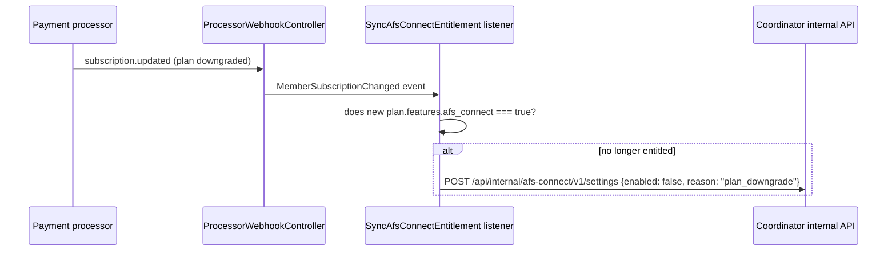

# 05 — Feature Toggle & Billing

> ⏳ **Layer 2 of this document is superseded by
> [11-billing-and-allocation.md](11-billing-and-allocation.md)** (planned step
> 60). The boolean `ProcessorPlan.features.afs_connect` becomes a
> registry-driven, metered entitlement read through **alloc_v2**: afs-connect is
> available from the **starter** tier upward, expressed as `enabled: false` on
> the free entry of `afs_connect_index_rows` in `checkpoint_registry_v3.json`.
> Layer 4 also splits into *allowed* (packaging) and *enabled* (privacy) — see
> [12-source-registry.md](12-source-registry.md) §12.4. Layers 1 and 3 below are
> unchanged. The rest of this document remains accurate for the **currently
> implemented** system.

afs-connect must be a **paid, controllable** feature. This is enforced by
four independent layers, checked in order, by
`App\Services\AfsConnect\AfsConnectEntitlementService::check(memberReferenceNum, ?sourceApp)`
on **every** coordinator-side afs-connect request, and independently
re-derived (not just trusted) by each source app's
`AfsConnectEntitlementGuard` middleware.

```mermaid
flowchart TD
    A[Request for member X] --> B{Global flag<br/>checkpoint_feature_flags.afs_connect enabled?}
    B -- no --> Z1[503 feature disabled]
    B -- yes --> C{Plan entitlement<br/>ProcessorPlan.features.afs_connect?}
    C -- no --> Z2[402/403 upgrade required]
    C -- yes --> D{Member toggle<br/>afsconnect_settings.enabled?}
    D -- no --> Z3[200 with enabled:false — feature off, not an error]
    D -- yes --> E{Source-app toggle<br/>afsconnect_settings.source_&#123;app&#125;?}
    E -- no --> Z4[that source app's data omitted]
    E -- yes --> F[Proceed]
```



## Layer 1 — Global kill switch

**Where:** `checkpoint_feature_flags` table (already exists — see
[01-current-state-audit.md](01-current-state-audit.md) §5), row
`feature_key = 'afs_connect'`.

**Who controls it:** platform ops, via the existing Checkpoint admin panel
(`apps/auth`). No afs-connect-specific admin UI is needed for this layer —
it's a row in a table the admin panel already manages.

**Purpose:** incident response ("afs-connect is causing load problems,
kill it everywhere in one toggle") and staged rollout ("off for everyone
except the accounts in `checkpoint_user_features` during beta").

**How it's read:** coordinator calls
`GET /checkpoint/authz/features/afs_connect` (existing Checkpoint endpoint)
with a short cache (60s, local `Cache::remember`) so this doesn't add a
network hop to every request.

**Per-user beta override:** `checkpoint_user_features` (`user_id`,
`feature_key`, `enabled`) already supports exactly "enable this for these
specific users even if the global flag is off" / "disable for this user
even if globally on" — used during the beta phase (see
[09-rollout-plan.md](09-rollout-plan.md) Phase 1) without any new table.

## Layer 2 — Plan entitlement (billing) — ⏳ SUPERSEDED, see [11-billing-and-allocation.md](11-billing-and-allocation.md)

**Where:** `apps/members` `ProcessorPlan.features` JSON column (added if
absent, per [03-database-schema.md](03-database-schema.md) §3.7), e.g.:

```json
{ "afs_connect": true, "afs_connect_source_limit": null }
```

**Who controls it:** whoever manages plan definitions today, via
`ProcessorPlanAdminController` (existing) — afs-connect just adds a field
to an existing admin form, not a new admin surface.

**How it's read:** coordinator does not query `members`' database directly
(separate DB, by design). Instead:

- `apps/members` exposes `GET /api/v1/member/{reference_num}/entitlements`
  (new, small endpoint, same shape as the existing brain `/member` call)
  returning the active `ProcessorSubscription`'s plan `features` blob.
- Coordinator's `AfsConnectEntitlementService` calls this, caches the result
  for 15 minutes per member (entitlement changes are not latency-sensitive),
  and treats a failed/unreachable call as **deny** (fail closed) rather than
  fail open, since this gates a paid feature.

**Downgrade/cancellation enforcement:** `ProcessorWebhookController`
(existing, handles the payment processor's webhooks) gets one new listener:



This is a **hard disable**, not a soft grace period, in v1 — matches the
existing pattern of Layer 3 below acting as the single source of truth for
"is this currently on." A grace-period/dunning flow can be added later by
having the listener set a `disabled_at` + `grace_until` instead of
disabling immediately; the schema in
[03-database-schema.md](03-database-schema.md) already has `disabled_at`
to support this without a migration when it's built.

## Layer 3 — Member on/off toggle

**Where:** `afsconnect_settings.enabled`, owned by coordinator.

**Who controls it:** the member themself (or a sub-user with account-admin
permission), from the **Members dashboard** — this is the literal "turned
on and off" control the member sees, and it is the layer the UX in
[08-frontend-ux.md](08-frontend-ux.md) is built around.

**Flow:** Members dashboard → `apps/members` backend → signed
`POST /api/internal/afs-connect/v1/settings` on coordinator (§4.2). Members
does not persist this itself (its DB is intentionally separate); coordinator
is system-of-record, matching how coordinator already owns `pm_teams` as
canonical across apps (see audit §2).

**Why gated behind Layer 1 and 2 still:** a member could technically call
this endpoint (via the Members UI) even on a plan that doesn't include
afs-connect; coordinator's settings endpoint re-checks Layer 2 before
persisting `enabled: true` and returns `402 Payment Required` with an
upsell payload if not entitled, so the UI can show "upgrade to enable this."

## Layer 4 — Per-source-app data-sharing toggle

**Where:** `afsconnect_settings.source_notes` / `source_dream_graph` /
`source_flow` / `source_pdf_editor`.

**Purpose:** privacy/consent granularity distinct from billing — a member
might be entitled to and have enabled afs-connect overall, but not want,
say, personal journal-style notes surfaced into a project-management
analytics dashboard. This is a pure data-sharing preference, not a
billing gate, and defaults to `true` (opt-out) once the member has turned
the master switch on, rather than opt-in-per-app, to keep the common case
("just turn it on") a single click — but every toggle is visible and
independently switchable in the same settings panel.

**Enforcement:** both coordinator's aggregation (it simply won't fetch/
ingest from a disabled source) and each source app's own
`AfsConnectEntitlementGuard` (it independently checks this before
answering `changes`/`items`/`search`, so a stale or bypassed coordinator
check can't leak data — see [06-security-and-service-auth.md](06-security-and-service-auth.md)).

## Test matrix (for QA / acceptance criteria)

| Global flag | Plan entitled | Member enabled | Source enabled | Expected |
|---|---|---|---|---|
| off | — | — | — | 503 everywhere, dashboard shows "temporarily unavailable" |
| on | no | — | — | Dashboard shows upsell; settings toggle disabled with "upgrade" CTA |
| on | yes | no | — | Dashboard shows "enable afs-connect" onboarding screen |
| on | yes | yes | notes=off | Notes data absent from summary/search/index; other 3 apps present |
| on | yes | yes (all sources) | all on | Full feature |
| on | yes→no (mid-cycle downgrade) | was yes | — | Auto-disabled via webhook listener; member sees "disabled due to plan change" |
