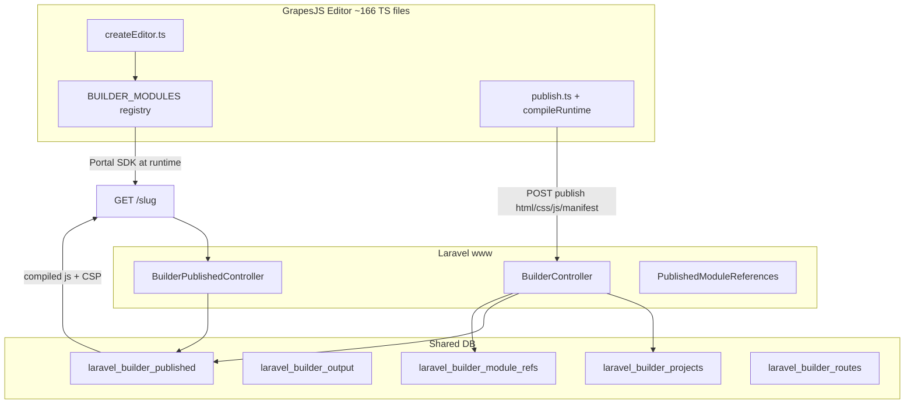

# Builder plan & codebase audit

Audit of `packages/afsserver/plans/www/builder` against `www/resources/js/portal/builder/` and related PHP/routes. Local codebase read; no live publish/auth probes beyond what completion docs record.

---

## Executive summary

The builder plan is **substantially implemented** for its core loop (editor refactor, module registry, publish compile, admin instance wiring). **Four of ten modules** work end-to-end in the builder (forms, ecommerce, events, site_users). **Six remain inert or absent**, including appointments despite that module shipping separately.

The plan README still says **"STUB, FOR AUDIT"** — that is **stale**. Docs **02–05** have completion records; **06** (UX/styling) and **08** (rollout/testing) were never written. **07** (module handoffs) is written but not marked complete.

**Critical open issue:** **B20** — the builder API group (`/portal/api/v1/builder/*`) still has **no `ApiAuthMiddleware`**, including publish/delete and an unscoped `/stores` closure.

---

## Plan document status

| Doc | Topic | Plan | Complete doc | Code landed? |
|-----|-------|------|--------------|--------------|
| 00 | Overview | Written | — | N/A |
| 01 | Current-state audit (B1–B24) | Written | — | Evidence doc |
| 02 | Module registry | Written | ✅ | **Yes** — P0–P8 (P8 closed via 05) |
| 03 | Editor architecture | Written | ✅ | **Yes** — `initEditor()` 2,242 → 19 lines |
| 04 | Publish & serve | Written | ✅ | **Yes** — `compileRuntime`, js column, CSP |
| 05 | Admin module config | Written | ✅ | **Yes** — instance providers, delete guards |
| 06 | Editor UX & styling | **Not written** | — | **No** |
| 07 | Module handoffs | Written | — | **Partial** — matrix still accurate |
| 08 | Rollout & testing | **Not written** | — | Tests exist ad hoc |

**229 builder JS tests pass** (`npm run test:builder`). PHP: `PublishedModuleReferencesTest`, `BuilderModuleRefsBackfillTest`, plus site-users route guard tests.

---

## Architecture (as built today)



**What changed since the original audit (B1–B3):**

- Publish now runs `compileRuntime()` and writes the **`js` column**; component scripts are stripped from `html` (`core/editor/publish/publish.ts`).
- **B8a fixed:** published pages 500'd on missing Blade props — layout now declares `afssdk`, `title`, etc.
- **B8 withdrawn:** nested slugs work with the existing `where()` pattern.
- **B10 mitigated:** transactional publish + generated-column uniqueness for active slugs.

---

## Goals vs reality

| Goal | Status | Notes |
|------|--------|-------|
| **G1** Required runtime on every module | **Partial** | Registry enforces for **4 declared modules**; 6 legacy types still register outside registry |
| **G2** One file + one line per module | **Partial** | True for ecommerce/events/site_users/forms; legacy types still in `components.ts` |
| **G3** Publish compiles to `js` | **Done** | Plan 04 complete |
| **G4** Palette gating | **Partial** | Tier gates exist; **B23** — no installed/enabled store |
| **G5** Version stability | **Partial** | `migrations.ts` + version attrs; **version stamping not on all blocks yet** (05 backfill note) |
| **G6** Testable editor phases | **Done** | Plan 03 complete |
| **G7** Trusted script output | **Mostly done** | Sanitize + CSP hash; raw CSS still injected |
| **G8–G9** UX / tenant errors | **Not started** | Doc 06 missing; **B13** open |
| **G10** Nested paths | **Done** | B8 withdrawn |

---

## Module integration matrix (plan 07 §7.2, updated)

| Module | Palette block | Runtime on publish | Instance picker | Page-type | Status |
|--------|---------------|-------------------|-----------------|-----------|--------|
| **Forms** | ✅ `module-form` | ✅ compiled | ✅ instance-select (05) | — | **Works** |
| **Ecommerce** | ✅ 7 blocks | ✅ | ✅ | ✅ `e-commerce` | **Works**; **B18** inert `module-commerce` still in palette |
| **Events** | ✅ 3 blocks | ✅ | ✅ | ✅ `events` | **Works** |
| **Site Users** | ✅ 3 blocks | ✅ | ✅ | auth section | **Works**; admin panel added (**B19** addressed) |
| **Direct Payments** | ⚠️ `module-payment` | ❌ no script | text trait | — | **Inert** |
| **Subscribers** | ⚠️ `module-subscriber` | ❌ | — | — | **Inert** |
| **Appointments** | ❌ **no block** | ❌ | — | ✅ page-type only | **B17 still open** despite full appointments module |
| **Listings / Discussions / Feedback** | ⚠️ dynamic | ❌ | — | — | **Inert** |

**Registry (`core/modules/index.ts`)** declares only: ecommerce, events, site_users, forms. The other six are explicitly deferred with a comment pointing at 07 §7.2.

**Three mechanisms (B15)** — blocks, per-module component files, page-type binding — still coexist; **§7.4 block↔page-type inheritance is not implemented** in code (plan only).

---

## Findings ledger

### Fixed or substantially addressed

| Finding | Was | Now |
|---------|-----|-----|
| **B2** | `js` always `''` | `compileRuntime` writes `js` |
| **B3** | Scripts only in HTML blob | Stripped on publish; compiled to `js` |
| **B4** | 2,242-line `initEditor` | 19-line composition root |
| **B5** | No tests | 229 JS + PHP tests |
| **B6/B16** | Three hand-edited files × 3 copies | Registry + `check:modules` build gate |
| **B8a** | All published pages 500 | Blade props fixed |
| **B10** | Race on `is_active` | Transaction + DB constraint |
| **B11** | 3.1 MB vendored GrapesJS dupes | Removed per 03 complete |
| **B19** | No Site Users admin UI | Modules index + site users panel (05) |
| **B21** | Forms block used demo forms only | instance-select wired to real forms |

### Still open (ordered by severity)

| Finding | Severity | Current state |
|---------|----------|---------------|
| **B20** | **Critical** | `routes/portal.php:455` — builder API **outside** auth middleware; includes publish/delete and unscoped `GET /stores` |
| **B1** | Critical (legacy) | `module-payment`, `module-subscriber`, `module-commerce`, dynamic types — **no runtime** in `components.ts` |
| **B17** | High | Appointments: page-type only, **no booking widget block** |
| **B18** | High | Inert `module-commerce` beside 7 working Commerce blocks |
| **B15** | High | Block vs page-type conflict rules **not coded** |
| **B24** | High | Live `/form` references missing form `vuls3jcsaya8` — delete-refusal/backfill found it; content may still be broken |
| **B13** | Medium | No tenant-facing error surface in editor |
| **B14** | Medium | Version on instances partial; stamping not universal |
| **B23** | Medium | `availability.requires` has no backing data |
| **B9** | Medium→High | CSP added for compiled JS; CSS still raw injection |
| **B12** | Low | Large template strings in TS |

---

## Security note (B20)

The authenticated admin group ends at `portal.php:251`. Builder routes at **455+** inherit only CORS / site-users guard:

```455:497:C:\projects\afs-eco\w\www\routes\portal.php
    Route::prefix('api/v1/builder')->group(function () {
        Route::get('/projects', [BuilderController::class, 'listProjects']);
        // ...
        Route::post('/publish', [BuilderController::class, 'publishRelease']);
        Route::delete('/publish/delete', [BuilderController::class, 'deleteRelease']);
        Route::get('/stores', function () {
            $stores = \Illuminate\Support\Facades\DB::table('laravel_ecommerce_stores')
                ->select('reference_num', 'name')
                ->get();
            return response()->json($stores);
        });
```

Plan 05 explicitly avoided adding new routes here for that reason. **Fix belongs in 04 or a security pass** — move builder write paths behind `ApiAuthMiddleware` and scope reads by tenant.

---

## Code inventory (high level)

| Area | Location | ~Scale |
|------|----------|--------|
| Editor | `www/resources/js/portal/builder/` | ~166 files |
| Module registry | `core/modules/` | 4 modules declared |
| Publish pipeline | `core/publish/` + `core/editor/publish/` | compile, sanitize, strip |
| Block runtimes | `core/component_scripts/` + `*_components.ts` | 4 working SDK adapters |
| PHP API | `BuilderController.php` | projects, publish, history |
| Public serve | `BuilderPublishedController.php` + `routes/web.php` | slug → active published row |
| Delete protection | `PublishedModuleReferences.php` | forms, ecommerce, events, DP |
| Migrations | 3 builder migrations (2026_04_19 + 2026_09_01 ×2) | projects, published manifest, module_refs |
| External SDK | `resources/js/external/` | `window.Portal.*` consumed at runtime |

**Cross-module dependency:** Builder does not import externals TS (correct per AGENTS.md). Published pages load `sdk.js` + compiled runtime that calls `Portal.forms`, `Portal.commerce`, `Portal.events`, `Portal.siteUsers`.

---

## Plan vs codebase gaps

1. **README / 00-overview headers say "STUB" and "nothing built"** — contradicts 02–05 completion docs and working publish compile.
2. **07-module-handoffs not executed** for 6 modules — especially **appointments** (recently shipped module, zero builder blocks).
3. **06 UX and 08 rollout** never written — G8/G9 and formal rollout checklist missing.
4. **B20 unfixed** — highest-risk drift from plan intent.
5. **Legacy `components.ts` types** bypass registry — `check:modules` cannot catch B18 until `module-commerce` is declared or removed.
6. **Page-type ↔ block inheritance (07 §7.4.2–7.4.3)** — design only; UNRESOLVED instances can still publish silently for unregistered types.

---

## Recommended priority order

1. **B20** — Authenticate builder API; remove or scope `/builder/stores`; treat as P0 security.
2. **07 handoffs** — Appointments builder blocks (widget block using storefront SDK); retire **B18** `module-commerce`.
3. **Register or remove inert types** — DP, subscribers, listings, discussions, feedback: either `noRuntime('…')` + honest palette, or real runtimes.
4. **07 §7.4** — Implement instance resolution + publish-time refusal for UNRESOLVED refs.
5. **Write 06 + 08** — UX tokens, tenant error surface, formal rollout/concurrency tests.
6. **Refresh plan index** — Update README status table; add completion stubs for 07 when done.

---

## Verification commands

```bash
cd C:\projects\afs-eco\w\www
npm run check:modules    # registry consistency (runs before build)
npm run test:builder     # 229 tests
php artisan test --filter=Builder
```

For B20, plan 01 §1.11.1 documents the contrast: `/portal/api/ecommerce/stores` → 401, `/portal/api/v1/builder/stores` → 200 unauthenticated.

---

**Bottom line:** The builder plan correctly diagnosed a broken publish loop and missing contracts; **02–05 delivered the foundation**. What remains is mostly **module completion (6/10)**, **security hardening (B20)**, **UX (06)**, and **honest plan doc housekeeping**. Appointments is the largest functional gap relative to other recently finished modules.